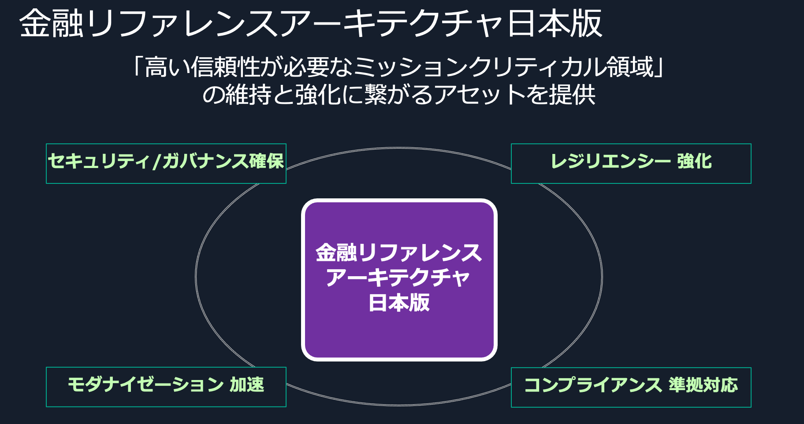
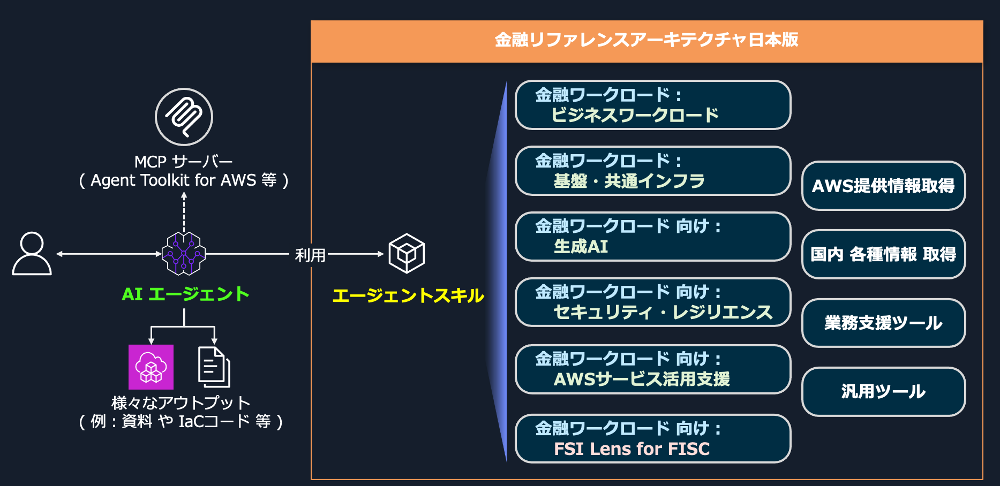

# 金融リファレンスアーキテクチャ 日本版 (FSI Reference Architecture JP)

> \[[English (EN)](README_en.md)\]

金融システムで求められる **セキュリティ・可用性・コンプライアンス** に関するベストプラクティスやナレッジ、ツールを、**エージェントスキル**を中心としたアセットとして提供します。銀行、保険、キャッシュレス決済などの金融ワークロードを、AWS クラウド上で設計・構築・運用するための具体的な指針を示します。

## 金融リファレンスアーキテクチャ日本版 とは / 概要

金融リファレンスアーキテクチャ日本版は、金融システムの「高い信頼性が必要なミッションクリティカル領域」の維持と強化に繋がるアセットです。セキュリティ／ガバナンスの確保、レジリエンシーの強化、モダナイゼーションの加速、コンプライアンス準拠対応といった、日本の金融機関におけるエンジニアの作業を支援するコンテンツから構成されています。

  

### 想定する利用者

- 金融領域でのビジネスやITシステムに関わる **エンジニア** や **アーキテクト**、**開発者**
- それらによって利用される **AIエージェント** や **生成AIツール**

### 想定する利用場面

- AWSサービスを利用したシステムのアーキテクチャ検討や設計 および 実装や運用
- AWSクラウドに関する日常的な情報収集活動

## 提供するコンテンツ

### エージェントスキル

このアセットが提供するコンテンツやナレッジの多くは、**エージェントスキル**（Agent Skills、以下「スキル」）として作成されています。
AIエージェントがスキルを利用することで、金融ワークロードのアーキテクティングや情報収集などの業務遂行を支援します。スキルはカテゴリ別に整理しており、金融ワークロード（ビジネスワークロード／基盤・共通インフラ／生成AI／セキュリティ・レジリエンス）を中心に、AWSサービス活用支援、AWS Well-Architected フレームワーク FSI Lens for FISC、各種情報取得、業務支援、汎用ツールを提供します。

  

各スキルの一覧・概要は、**[スキルカタログ（skills/README.md）](skills/README.md)** を参照してください。

### AWS Well-Architected フレームワーク FSI Lens for FISC

AWS Well-Architected(W-A) フレームワークレビューの拡張として、[FISC (金融情報システムセンター)](https://www.fisc.or.jp/) が公開する「金融機関等コンピュータシステムの安全対策基準・解説書」の実務基準を中心に、AWS上でワークロードを設計・デプロイする場合の検討ポイントを示したナレッジ("**レンズ(Lens)**")です。
この **レンズ** もエージェントスキルとして作成され、AIエージェントが利用できるナレッジとして提供されています。

詳細は [FSI Lens for FISC](skills/fsi-lens-for-fisc/SKILL_ja.md) を参照してください。

### GameDay Plan Generator

AWSクラウド環境の構成情報（CloudFormationテンプレート or 構成図）から、GameDay（障害対応訓練）実施計画を自動生成するツールです。

詳細は 別リポジトリ [GameDay Plan Generator](https://github.com/aws-samples/sample-fsi-reference-architecture-jp-gameday-plan-generator) を参照して下さい。

## 補足： コンテンツの種類 と 内容物について

それぞれのコンテンツは、大別して 以下の 1つ または 複数 の種類の内容を提供します。

- **エージェントスキル**（Agent Skills または 単に「スキル」と表記）
  - ベストプラクティスなどのナレッジ や 作業ステップを、エージェントスキルとして提供します。これにより、利用者およびその 生成AI・AIエージェント の**知識や能力を拡張**し、その業務やタスクの実行を支援します。
    - エージェントスキル は、エージェントに特定の能力や専門知識を提供するためのフォーマットであり、オープンな標準です。
    - [Kiro](https://kiro.dev/) を含む、多くの AIエージェントツール が サポートしています。
    - エージェントスキルについての 概要 や 仕様 は、 [https://agentskills.io/](https://agentskills.io/home) を参照してください。
- **ドキュメント**
  - 一部のナレッジは、「エージェントスキル」ではなく、ドキュメントとして提供される場合があります。
  - 例：ホワイトペーパー、顧客事例集
- **Webアプリケーション**
  - 金融リファレンスアーキテクチャ日本版 のコンテンツとして、エージェントスキルやドキュメント以外で、Webアプリケーションを提供します。
  - これらのWebアプリケーションは、本 GitHub リポジトリとは 別のリポジトリで提供されます。

## License

This library is licensed under the MIT-0 (MIT No Attribution) License. See the LICENSE file.
