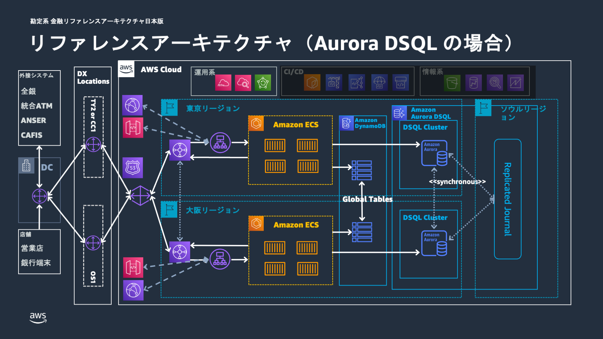
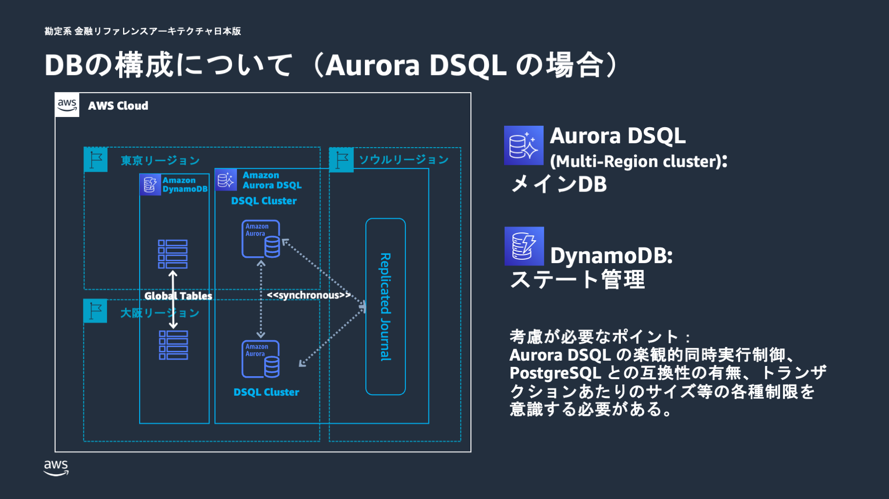

# 勘定系ワークロードへの Aurora DSQL 適用について

## 概要

本ドキュメントでは、勘定系ワークロードにおける Amazon Aurora DSQL の適用の可能性について解説する。Aurora DSQL は、特定の要求事項に対して従来の Aurora PostgreSQL とは異なるアプローチを提供する新しいデータベースサービスである。

Aurora PostgreSQL は長年にわたる実績と高い PostgreSQL 互換性により、多くのエンタープライズ環境で信頼性を実証してきた。一方、Aurora DSQL は分散アーキテクチャと同期レプリケーションにより、特にマルチリージョンの高可用性と強整合性が重要視される環境において新たな選択肢を提供する。要件に応じた最適な選択を行うための情報を提供する。

## Aurora DSQL とは

Amazon Aurora DSQL は、**トランザクションワークロードに最適化されたサーバーレス分散リレーショナルデータベースサービス**である。従来の Aurora PostgreSQL は読み書き可能な単一のプライマリインスタンスを中心とした構成であるのに対し、Aurora DSQL は分散アーキテクチャを採用することで、異なる特性を持つデータベースサービスとして設計されている。

Aurora DSQL の最も特徴的な点は、その分散設計にある。従来のリレーショナルデータベースが単一のプライマリインスタンスと 1 台以上のスタンバイノード（レプリカ）から構成されるのに対し、Aurora DSQL はマルチテナント分散アーキテクチャを採用している。この設計により、単一障害点を排除し、高い可用性を実現している。

### 主要な特徴

| 特徴 | 内容 |
| --- | --- |
| 分散アーキテクチャ | マルチテナントコンポーネントから構成され、高い冗長性と自動回復機能を実現。各コンポーネントが 3 つのアベイラビリティーゾーンで冗長化され、自動クラスタースケーリングと障害時の自動回復を実現する |
| マルチリージョンクラスター | 同期レプリケーション、強整合性、Active-Active 構成により、99.99%（単一リージョン）、99.999%（マルチリージョン）の可用性を実現。両リージョンのエンドポイントで同時読み書き操作が可能で、強いデータ整合性を保持する |
| サーバーレス特性 | インフラ管理が不要で、ワークロードに応じた自動スケーリングを提供。サーバーのプロビジョニング、パッチ適用、インフラアップグレードに関連するメンテナンスダウンタイムを心配する必要がない |
| PostgreSQL 互換性 | PostgreSQL 16 ベースの互換性により、既存の PostgreSQL ドライバー、ORM、フレームワーク、SQL 機能を使用できる。ただし Aurora PostgreSQL と比較するとサポートされる機能は限定的 |

## 勘定系ワークロードに Aurora DSQL を取り込む背景

金融システム、特に勘定系システムは、その業務特性から極めて厳格な要求事項を持つ。これらの要求事項は、単に技術的な性能だけでなく、規制対応、リスク管理、業務継続性など多岐にわたる。

### 金融システムの要求事項

- **高い可用性**: システム停止は直接的に業務停止を意味するため、可能な限り高い可用性が求められる。計画停止も含めて年間のダウンタイムを最小化する必要がある。
- **強いデータ整合性**: 金融取引においてデータの不整合は許容されない。災害復旧時やシステム障害時においても、データの整合性を保持する必要がある。
- **災害対策**: 地理的に分散した冗長構成により、大規模災害時でも業務継続を可能にする必要がある。

### 新たな選択肢としての Aurora DSQL

金融システムの要求がより高度化し、グローバル展開や 24 時間 365 日の無停止運用が求められるシステムも珍しくない。従来のアーキテクチャでは対応が困難な課題も浮上している。

- **レプリケーション遅延の課題**: Aurora PostgreSQL Global Database は非同期レプリケーションを採用しているため、セカンダリリージョンでのデータ遅延が少なからず発生する。リアルタイム性が求められる取引において制約となる場合がある。
- **フェイルオーバー時間の課題**: Aurora PostgreSQL Global Database は、リージョンの機能低下や停止が発生した場合、セカンダリリージョンへの切り替え処理が発生する。データベースのフェイルオーバーにかかる時間は RTO における制約となる場合がある。
- **Active-Standby 構成の制約**: Aurora PostgreSQL Global Database の場合、セカンダリリージョンでは読み取り専用のアクセスのみ可能で、書き込み操作はプライマリリージョンに限定される。書き込みワークロードの地理的分散における制約となる。

Aurora DSQL は、これらの課題に対して分散アーキテクチャと同期レプリケーションという新しいアプローチを提供する。

## 勘定系ワークロードにおける Aurora DSQL の特徴と価値

### データ整合性における特徴

Aurora DSQL の最も特徴的な点は、その同期レプリケーション機能である。従来の Aurora PostgreSQL がリージョン間のデータ同期において非同期レプリケーションを採用していたのに対し、Aurora DSQL は**同期データレプリケーション**を実現している。

この同期レプリケーションにより、全てのリージョンで同一のデータ状態が保証され、ACID 特性（原子性、一貫性、分離性、永続性）を完全に保持する。特に重要なのは、マルチリージョン構成においても強いデータ整合性が維持され、どのリージョンからアクセスしても常に同じデータが参照できることである。

金融取引において、この特性は重要な意味を持つ。例えば、東京リージョンで実行された取引が、大阪リージョンで即座に一貫した状態で参照できることは、リアルタイム性が求められる勘定処理において大きな価値となる。ただし、同期レプリケーションの特性上、コミット処理時にはリージョン間の同期ネットワーク通信が必要となる。地理的距離に応じたレイテンシーの影響を受けるため、性能への影響も考慮する必要がある。

### 可用性における特徴

Aurora DSQL は Active-Active 構成を採用しており、両リージョンで同時に読み書き操作が可能である。これは従来の Aurora PostgreSQL の Primary-Secondary 構成と大きく異なる点である。また、Active-Active 構成の場合、リージョン障害時におけるクラスターの明示的なフェイルオーバーが不要となる点もメリットである。RTO の短縮や運用負荷の軽減に繋がる。

しかし、Active-Active 構成は、同時更新による競合の可能性を高めるという側面もある。Aurora DSQL は楽観的同時実行制御を採用しているため、アプリケーション側で適切に競合時のハンドリングを行う必要がある。

### 運用面における特徴

Aurora DSQL のサーバーレス特性は、運用面で大きな変化をもたらす。インフラのプロビジョニング、パッチ適用、アップグレードが不要となり、ワークロードに応じた自動スケーリングが提供される。データベース管理者の負荷軽減が期待できる。

一方で、使用量ベースの課金体系への変更により、コスト予測の難しさが増す可能性がある。Aurora PostgreSQL（Provisioned の場合）の時間ベース課金と比較して、ワークロードパターンによってはコストが予想以上に変動する場合がある。

## 留意点・制限事項

### PostgreSQL 互換性

Aurora DSQL は PostgreSQL 16 のコア機能をサポートしているが、Aurora PostgreSQL と比較するとサポートされる機能はサブセットとなっている。ACID トランザクション、セカンダリインデックス、結合、挿入、更新といった基本的な機能は完全にサポートされているが、一部の PostgreSQL 拡張機能や高度な機能については未サポートである。

既存の PostgreSQL アプリケーションを Aurora DSQL に移行する場合は、事前に使用している機能の互換性確認が必要である。特に、カスタム拡張機能や特殊なデータ型を使用している場合は、代替実装の検討が必要となる場合がある。なお、互換性に関する制約は随時改善される。常に最新のドキュメントを確認すること。

### 楽観的同時実行制御の影響

Aurora DSQL は、分散アーキテクチャの特性上、楽観的同時実行制御を採用している。これは従来の Aurora PostgreSQL の悲観的ロック機構とは異なるアプローチである。

楽観的同時実行制御では、同じデータに対する同時更新が発生した場合、シリアライゼーションエラーが発生する。このため、アプリケーション側で適切なエラーハンドリングとリトライロジックの実装が必要となる。高い競合が予想される環境では、リトライによる性能影響も考慮する必要がある。ただし、適切なトランザクション設計とリトライ戦略により、この影響を最小化することは可能である。

### トランザクション制限とバッチ処理への影響

分散アーキテクチャの特性上、従来の Aurora PostgreSQL とは異なるトランザクション制限がある。特に大量データを扱うバッチ処理において重要な考慮事項となる。

| 制限項目 | 制限値 | バッチ処理への影響 |
| --- | --- | --- |
| トランザクションサイズ制限 | 最大 10MiB | 大量データを一括で更新・挿入する処理を複数のトランザクションに分割する必要がある |
| 行数制限 | 最大 3,000 行 | 従来数万行を一度に処理できたバッチ処理も設計変更が必要となる場合がある |
| トランザクション実行時間制限 | 最大 5 分 | 長時間実行されるバッチ処理はこの制限内で完了するよう処理を分割する必要がある |
| 接続時間制限 | 最大 60 分 | 長時間実行されるバッチジョブでは定期的な接続の再確立が必要 |

なお、上記の制限は 2025 年 10 月時点のものである。今後サービスの改善により制限が緩和される可能性もあるため、常に最新のドキュメントを確認すること。

## まとめ

Aurora DSQL と Aurora PostgreSQL は、それぞれ異なる設計思想に基づく特徴を持つデータベースサービスである。要求事項に応じて最適なサービスを選択することが重要である。

- **Aurora PostgreSQL** は、長年にわたる実績と高い PostgreSQL 互換性により、多くのエンタープライズ環境で信頼性を実証してきた。予測可能な運用特性と豊富なエコシステムは、安定性を重視する環境において大きな価値を提供する。
- **Aurora DSQL** は、分散アーキテクチャと同期レプリケーションにより、特に分散環境での強整合性が重要視される環境において新たな選択肢を提供する。サーバーレス特性による運用負荷軽減も魅力的な特徴である。

金融システムにおける技術選択は、単純な性能比較だけでなく、長期的な運用性、リスク管理、規制対応など多面的な検討が必要である。Aurora DSQL は、特定の要求事項において価値を発揮する一方で、全ての環境で最適解となるわけではない。採用にあたっては、十分な検証と段階的なアプローチにより、リスクを最小化しながら価値を最大化することが重要である。

## アーキテクチャ図

### Aurora DSQL 版 全体アーキテクチャ

### Aurora DSQL 版 データベースアーキテクチャ

## 関連ドキュメント

### AWS 公式情報

- [Amazon Aurora DSQL](https://aws.amazon.com/rds/aurora/dsql/) - Aurora DSQL サービスページ
- [Amazon Aurora Global Database](https://aws.amazon.com/jp/rds/aurora/global-database/) - Aurora Global Database サービスページ
- [What is Amazon Aurora DSQL?](https://docs.aws.amazon.com/aurora-dsql/latest/userguide/what-is-aurora-dsql.html) - Aurora DSQL の概要と主要特徴
- [Resilience in Amazon Aurora DSQL](https://docs.aws.amazon.com/aurora-dsql/latest/userguide/disaster-recovery-resiliency.html) - Aurora DSQL の高可用性とレジリエンス機能
- [Unsupported PostgreSQL features in Aurora DSQL](https://docs.aws.amazon.com/aurora-dsql/latest/userguide/working-with-postgresql-compatibility-unsupported-features.html) - Aurora DSQL でサポートされていない PostgreSQL の機能
- [Cluster quotas and database limits in Amazon Aurora DSQL](https://docs.aws.amazon.com/aurora-dsql/latest/userguide/CHAP_quotas.html) - Aurora DSQL のクォータと制限

### 本プロジェクト関連ドキュメント

- [リファレンスアーキテクチャ詳細 [勘定系]](./architecture.md) - Aurora PostgreSQL 版の基本アーキテクチャ
- [FISC 実務基準対策一覧 [勘定系]](./fisc-mapping.md) - FISC 準拠に関する詳細
- [デプロイ手順 [勘定系]](./deployment.md) - 実装手順とサンプルコード
