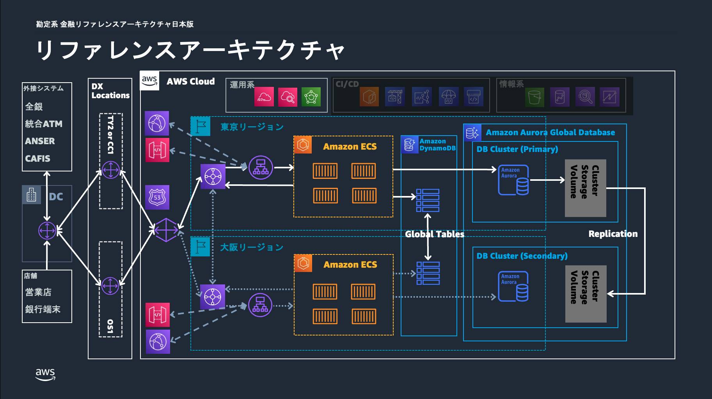
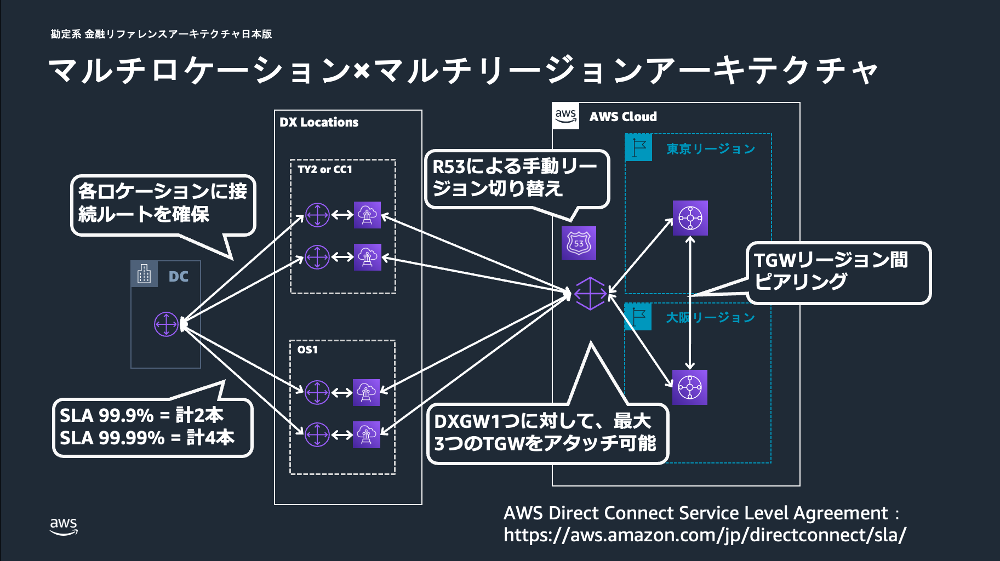
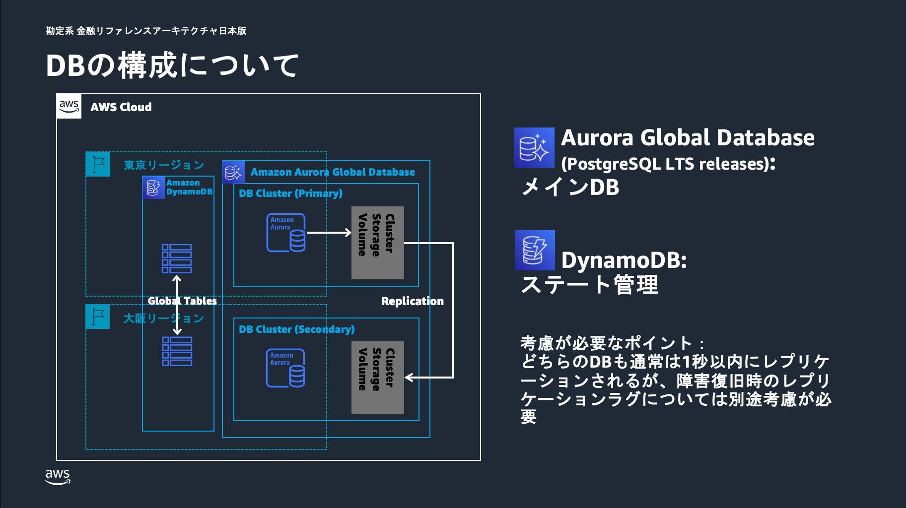
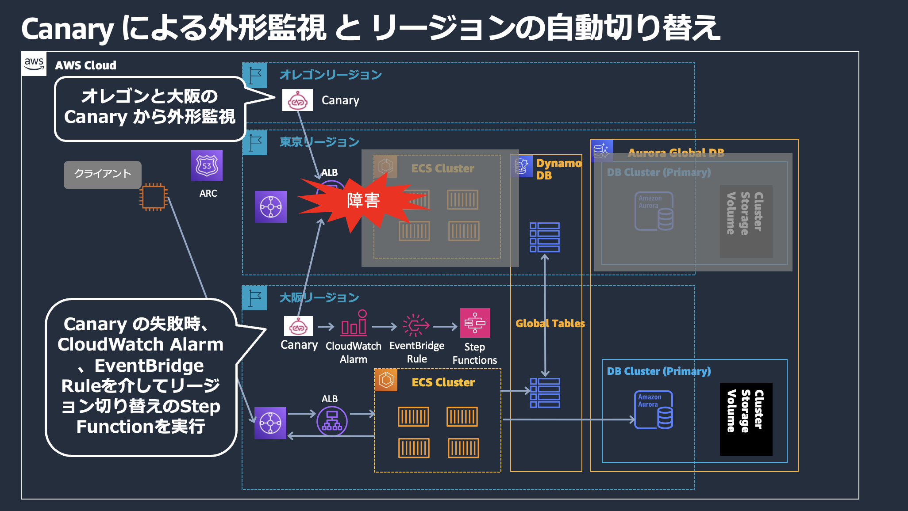

# リファレンスアーキテクチャ詳細 [勘定系 / Core Banking]

金融ワークロード「勘定系」のリファレンスアーキテクチャの技術詳細をまとめる。銀行の各種業務（預金・為替・融資など）を取り扱うミッションクリティカルな勘定系システムを対象とし、高い可用性・データ整合性・災害対策を実現する汎用的な構成である。

## 前提条件・スコープ

- 本リファレンスアーキテクチャは銀行の各種業務を取り扱う勘定系を対象とする。チャネル系や情報系などは範囲外とする。
- 勘定系に限らず、高い可用性が求められるミッションクリティカルなシステムに応用できる汎用的な構成である。
- CDK サンプルテンプレートで実装している範囲と実装していない範囲は以下のとおり。

| 区分 | 対象サービス |
| --- | --- |
| CDK で実装済み | Amazon Route 53、AWS Transit Gateway、Elastic Load Balancing (ELB)、Amazon ECS、Amazon DynamoDB、Amazon Aurora Global Database、AWS Backup |
| CDK で実装済み（フェイルオーバー機構） | Amazon Application Recovery Controller (ARC)、AWS Step Functions、AWS Lambda |
| CDK で実装済み（外形監視） | Amazon CloudWatch Synthetics Canary |
| CDK では未実装 | Amazon CloudFront、Amazon API Gateway、AWS Direct Connect の Direct Connect ゲートウェイ (DXGW)、DX Locations、DC |

## ユースケース

- 銀行システムのうち、預金や為替、融資などの各種業務を取り扱う勘定系システムを想定する。
- 高可用性が求められるミッションクリティカルシステム全般に応用できる。

## アーキテクチャの特徴

### マルチリージョン構成

- 勘定システムにおけるレイテンシ、データの整合性を考慮した**ウォーム・スタンバイ構成**を採用する。
- プライマリリージョン（東京）とセカンダリリージョン（大阪）、および監視リージョン（オレゴン）の 3 リージョンで構成する。

### アプリケーションの外形監視

- アプリケーションの正常性を監視するため、大阪リージョンと監視リージョンであるオレゴンリージョンの CloudWatch Synthetics Canary から東京リージョンに対して疑似トランザクションを発生させ、その応答を確認することで外形監視を行う。

### マイクロサービスのオブザーバビリティ

- Amazon CloudWatch Application Signals を使用して、ECS 上で動作するマイクロサービスの包括的な監視を実現する。
- Application Signals により、サービス間の依存関係、レイテンシ、エラー率、可用性などの重要なメトリクスを自動的に収集・可視化する。
- CloudWatch Agent をサイドカーコンテナとして各 ECS タスクに配置し、アプリケーションコードの変更なしに OpenTelemetry ベースの分散トレーシングを実現する。
- サービスマップにより、勘定系システム内の各マイクロサービス（残高照会、取引処理、件数管理など）の相互関係と健全性を一目で把握できる。

### リージョンの切り替え

- プライマリリージョンからセカンダリリージョンへの切り替えは、Amazon Application Recovery Controller (ARC) による信頼性の高い切り替えを行う。
- リージョン切り替えが DNS に依存するため、オンプレミス側からの通信は Route 53 の名前解決を利用した実装となっている。
- データの整合性を考慮したアプリケーション閉塞、Aurora Global Database の切り替えなど一連の切り替え手順を Step Functions で自動化することにより、**約 5 分もしくはそれ以下の RTO** を実現する。
- 東京リージョンから大阪リージョンへの切り替えに用いる Step Functions のステートマシンは、切り替えを確実に実行できるよう、障害による影響を受けていない大阪リージョンで実行する。
- デプロイ時は無効化された EventBridge Rule を有効化することで、大阪リージョンとオレゴンリージョンの外形監視 Canary のステータスがともに失敗となった場合に、自動的にリージョン切り替えを行うことも可能である。

### アプリケーションのコンピューティング環境

- フルマネージドコンテナオーケストレーションサービスである Amazon ECS を採用する。
- 要件に合わせて、Amazon ECS の代わりに Amazon Elastic Kubernetes Service (Amazon EKS) や Amazon Elastic Compute Cloud (Amazon EC2) を選択することも可能である。

### DB の構成

- メイン DB として **Aurora Global Database**、アプリケーションのステート管理用 DB として **DynamoDB** を採用する。
- リージョンを切り替える際、DynamoDB についてはグローバルテーブルを用いる場合、切り替え作業は不要である。Aurora Global Database については Step Functions により切り替えをトリガーする。
- どちらの DB も通常は 1 秒以内にレプリケーションされるが、障害復旧時のレプリケーションラグについては業務要件やアプリケーションの特性などを踏まえて別途考慮が必要である。
- メイン DB として **Aurora DSQL** の利用を採用する実験的アプローチも考えられる。詳細は「[勘定系ワークロードへの Aurora DSQL 適用について](./architecture-dsql.md)」を参照。

### データバックアップ

- ランサムウェアにデータを暗号化もしくは使用不可能とされた場合の復旧手段として、AWS Backup によるバックアップを取得する。
- **コンプライアンスモード**でボールトロックを作成することで、一度ロックされるとイミュータブルとなり、データ保持期間が終了するまでデータを削除または変更できなくなる。
- 本サンプルでは便宜上、十分な IAM アクセス許可を持つユーザーであればデータ削除が可能である**ガバナンスモード**での実装としている。

## アーキテクチャ図

### 全体アーキテクチャ図（Overview）

### マルチロケーション x マルチリージョンアーキテクチャ

### DB の構成について

### 外形監視と自動フェイルオーバー

## リージョン割り当て（サンプル既定値）

| ロール | リージョン | 役割 |
| --- | --- | --- |
| プライマリ | 東京 (ap-northeast-1) | 主リージョン。読み書きの中心。ワーカーもここで稼働 |
| セカンダリ | 大阪 (ap-northeast-3) | 副リージョン。ウォーム・スタンバイ。切り替え用 Step Functions を実行 |
| 監視 | オレゴン (us-west-2) | 監視リージョン。外形監視 Canary を配置 |
