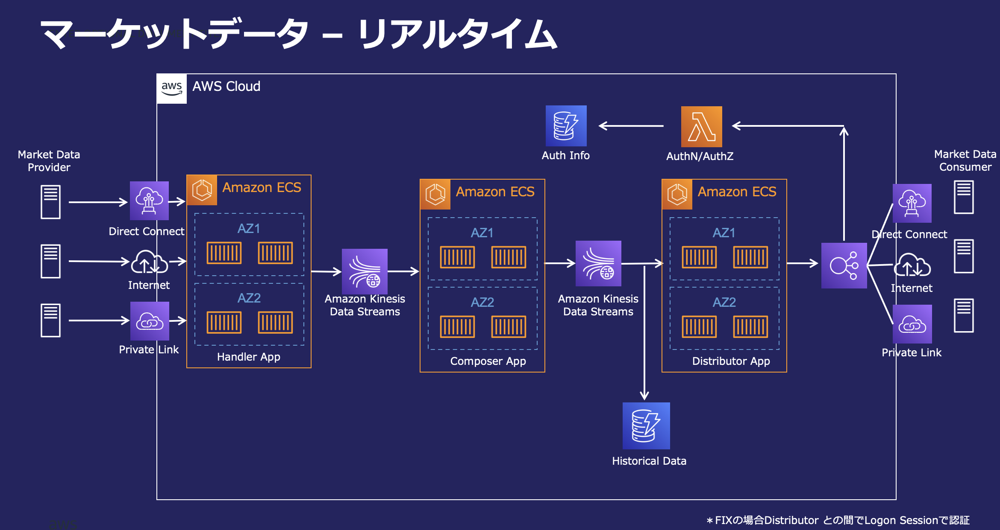

# マーケットデータ リファレンスアーキテクチャ 技術詳細

本ドキュメントは、金融ワークロード「マーケットデータ」のリファレンスアーキテクチャの技術的詳細を記述する。出典は BLEA for FSI（金融リファレンスアーキテクチャ日本版）のアーキテクチャ解説である。

## ユースケース

- 金融機関のマーケットデータ配信システムは、市場に関わる様々なデータを生成し、社内外のクライアントへ配信する。
- 通常、配信データは社内外のデータプロバイダから収集したデータを元に計算される。
- クライアント、プロバイダとの通信には FIX, REST, WebSocket などのプロトコルが用いられる。
- データの発生頻度、発生からクライアントへの配信までに求められる鮮度によって、リアルタイム、ニアリアルタイム、バッチの大きく 3 パターンに分類される。これらのうち、本リファレンスアーキテクチャではリアルタイムなユースケースを対象とする。
  - リアルタイム
    - 株価、為替レートなど
    - 1 分あたり数千〜を超える更新
    - レイテンシセンシティブである場合も多い
  - ニアリアルタイム
    - 市況ニュース、非リアルタイムなプライス配信など
    - 数分に 1 度の更新
  - バッチ
    - 金利指標、企業格付け、外為公示相場など
    - 数時間〜に 1 度の更新

## アーキテクチャの特徴

本アーキテクチャは Handler App, Composer App, Distributor App の 3 層で構成される。

### Handler App

- 配信データの元となる Input を受信する。プロトコルや認証方式は Provider が定めるインターフェースに依る。
- Handler は受信データを Kinesis Data Streams にプロデューサとして書き込む。

### Composer App

- 配信データの計算を行う。
- 多くの場合、配信データは上流の Market Data Provider や、社内のリファレンスデータをインプットとして計算される。
  - Input データは Handler App が提供する Stream をコンシューマとして利用する。
  - 他の Composer の計算結果が Input となる場合もある。この時も他の Composer が提供する Stream をコンシューマとして利用する。
    - ex. 為替レート計算のユースケースで、Composer C（GBPJPY を計算）の Input として、Composer A（GBPUSD を計算）、Composer B（USDJPY を計算）の Stream を利用する場合など

### Distributor App

- クライアントに向けたデータの配信を行う。
- 配信データは Composer App が提供する Stream をコンシューマとして利用する。
- Distributor App はクライアントの要求に応じてフォーマットの変換や配信頻度、粒度の調整などを行う。
  - 上流の Composer App、及びその Stream が何らかの障害で利用不能になった場合に、直近正常時の値を固定値として提供することなども Distributor の責務である。
- クライアントの種類や要件に応じて様々なプロトコルがあるが、主に FIX, REST, WebSocket を想定する。
  - FIX
    - Consumer は NLB を経由して Distributor App と通信する。
    - 認証は FIX 通信時の Logon プロセスで実施する。
  - REST, WebSocket
    - Consumer は ALB を経由して Distributor App と通信する。
    - ALB は HTTP の Authorization ヘッダを検証して、認証用の Lambda と Distributor App をルーティングする。
- Provider, Client とのネットワークは要件に応じて Direct Connect, Internet, Private Link 等を利用する。

### その他ポイント

- 各コンテナアプリケーションは同一構成を Multi AZ で配置し、Active - Active で稼働する。クライアントに対しては両現用な 2 つのエンドポイントを示し、障害時の切り替えをガイドする。
- コンポーネント間の連携に Stream を採用することで、コンポーネント間の結合を疎にしている。プロデューサとなる Handler や Composer は後続コンポーネントの存在や場所を意識することなくデータを提供することができ、コンシューマの数を変動させることも容易である。
  - また、本構成を拡張して、例えば分析用途に新たな DB などを追加したい場合も、コンシューマの一員として追加することで容易に拡張できる。

## アーキテクチャ図

