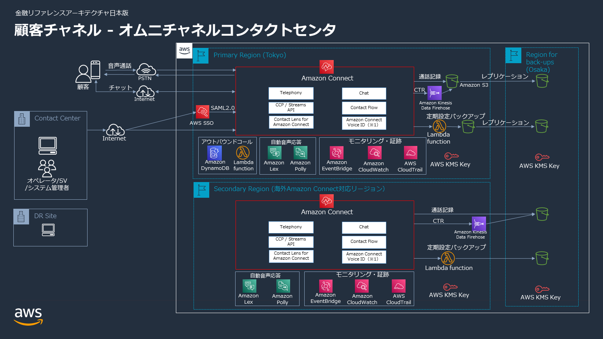
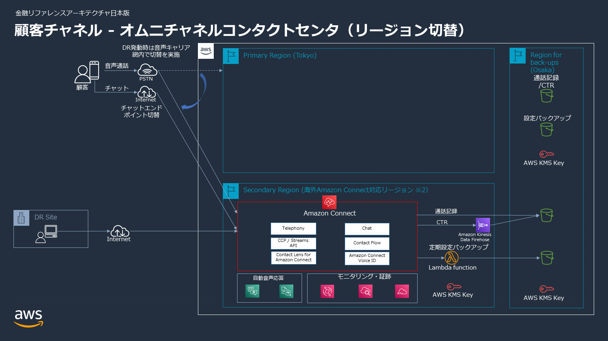

# 金融ワークロードアーキテクチャ解説 [顧客チャネル]

本ドキュメントは、BLEA for FSI（金融リファレンスアーキテクチャ日本版）における「顧客チャネル」ワークロードのリファレンスアーキテクチャを構造化して解説するものである。

## ユースケース

金融機関は、ウェブポータルでのテキストチャット、コールセンタオペレータとの音声通話、チャットボットなど複数のチャネルを通して顧客体験と従業員体験を向上する、オムニチャネルなコンタクトセンターの構築にますます投資している。これらのユースケースにおいて、Amazon Connect をはじめとする様々な AWS のサービスと機械学習のテクノロジーを活用することができる。ここでは、金融機関に求められるセキュリティとコンプライアンス、信頼性を備えるコンタクトセンターを構築する際に参考となるリファレンスアーキテクチャを提示する。

### 想定する業務

コンタクトセンターにおける業務としては以下を想定する。

- **顧客チャネル**: 公衆回線を用いた音声、もしくはウェブポータルからのチャットを想定する。
- **インバウンドのコンタクト**: お客様窓口、代理店窓口、自動受付（テレホンバンキング、カードローン仮審査など）、受電集中といった用途を想定する。
- **アウトバウンド**: 折り返し電話、テレマーケティング、督促業務といった業務を想定する。
- **コンプライアンスチェック**: 音声チャネルの会話の文字起こし結果から、社内のコンプライアンス規定に反する単語を検出することを想定する。

### 提供するサンプルコンタクトフロー

- **インバウンド業務**: エージェントに直接接続されるコンタクトフローを提供する。
- **アウトバウンド業務**: API による発信自動化と、Amazon DynamoDB による発信記録の管理を行うフローを提供する。

## アーキテクチャの特徴

### Amazon Connect へのログインと認証について

- ユーザー管理は AWS IAM Identity Center（旧 AWS SSO）との SAML 連携によって行い、パスワードポリシーの強制、MFA の利用ができるようにしている。

### 広域災害への対策

- セカンダリリージョンの利用はリファレンスアーキテクチャにおいて**必須ではない**。複数アベイラビリティゾーンによる冗長構成で要件を満たしているお客様や、データレジデンシーの問題を懸念されるお客様においては、この部分を省いて利用することも可能である。
- 関東広域被災発生時には、プライマリリージョン（例: 東京リージョン）に替えて、セカンダリリージョンにあらかじめ用意した Amazon Connect インスタンスと電話番号を使用する。2022 年 9 月末時点で大阪リージョンで Amazon Connect が提供されていないが、切り替え先として海外リージョンが利用可能である。通話録音 / CTR データの保管先としては、その他のリージョン（例: 大阪リージョン）の S3 バケットを指定する。
- プライマリリージョンにおけるユーザー管理は AWS IAM Identity Center（旧 AWS SSO）との SAML 連携によって行い、セカンダリリージョンでは Amazon Connect のユーザー管理機能によって行う。こちらはお客様の要件によっては外部 IdP を選択することも可能である。
- 通話録音やコンタクトトレースレコード（CTR）などのデータは、プライマリリージョンの S3 から別のリージョンへレプリケーションすることで遠隔バックアップとする。
- コンタクトフローなど重要な設定情報についても、別のリージョンへ定期的にバックアップを行う。

### サンプルテンプレートについて

- 本リファレンスアーキテクチャのサンプルテンプレートにおいて、Amazon Connect の Preview API を使用する。Preview API は今後仕様変更される可能性がある点に注意が必要である。
- 本リファレンスアーキテクチャの**サンプルテンプレートの実装範囲は、後述のアーキテクチャ図の全てではなく一部**となっている。基本機能はおおよそ実装しているが、例えば設定の定期バックアップなどは未実装である。今後拡充の予定である。

## アーキテクチャ図

> **注記**: アーキテクチャ図は以前のバージョンのものであり、新規に追加されたリソースが含まれていない。今後更新予定である。

### マルチリージョン構成のリファレンスアーキテクチャ

### 広域災害発生時のリージョン切り替えイメージ

## リージョン構成（CDK サンプル実装より）

サンプルアプリケーションは、最大 3 つのリージョンにスタックをデプロイする構成となっている。

| リージョン区分 | 既定リージョン | 役割 |
| --- | --- | --- |
| プライマリ (primary) | ap-northeast-1（東京） | Amazon Connect インスタンス本体、各種サンプル機能、通話録音バケットを配置する主系リージョン |
| セカンダリ (secondary) | ap-southeast-1（シンガポール）※例 | DR 用の Amazon Connect インスタンスを配置する。既定では無効（コメントアウト）で、Staging/Production では有効化する想定 |
| ターシャリ (tertiary) | ap-northeast-3（大阪） | 通話録音・CTR データのバックアップ（レプリケーション先）バケットを配置する |
| WAF 用 | us-east-1 | CloudFront に関連付ける WAF Web ACL を配置する（CloudFront 用 WAF は us-east-1 必須） |

- セカンダリリージョンのスタックはターシャリリージョンのスタックの存在に依存する（バックアップバケットをレプリケーション先として共有するため）。
- リージョン間参照のため、CDK スタックでは `crossRegionReferences: true` を設定している。

## リファレンスアーキテクチャの主要コンポーネント

### コンタクトセンター基盤 (Amazon Connect)

- Amazon Connect インスタンスを中核とし、インバウンド・アウトバウンドの音声通話、Web チャット、Web 通話を提供する。
- インスタンス属性として、インバウンド通話・アウトバウンド通話・Contact Lens・コンタクトフローログなどを既定で有効化する。
- Amazon Connect は複数 AZ で動作しており、サービスとして高い可用性を有する。

### 認証・ID 管理

- プライマリリージョンでは AWS IAM Identity Center との SAML 連携により、パスワードポリシーの強制と MFA を実現する。
- ID 管理方式は `CONNECT_MANAGED`（Connect 管理）、`SAML`（IAM Identity Center 連携等）、`EXISTING_DIRECTORY`（既存ディレクトリ）から選択できる。
- SAML 連携時には、SAML プロバイダー、フェデレーション用 IAM ロール（`connect:GetFederationToken` を許可）、リレーステート URL を CDK が自動生成・出力する。

### インバウンド

- **通常インバウンド (inbound-sample)**: Amazon Lex ボット（本人確認用 `IdentificationBot`、日本語ロケール `ja_JP`）と連携し、エージェントに接続するコンタクトフローとエージェントウィスパーフローを提供する。
- **即時インバウンド (immediate-inbound-sample)**: コンタクトを即座に受け付けるフロー。顧客キュー再生プロンプト、エージェントウィスパー（ビープ音）、Amazon Q in Connect アシスタント連携を含む。コミュニケーションウィジェット（チャット / Web 通話）のコンタクトフローとして使用する。

### アウトバウンド

- API（Amazon API Gateway、IAM 認証）経由で発信を自動化する。
- AWS Step Functions ステートマシン（EXPRESS 型）が Amazon Connect の `StartOutboundVoiceContact` を呼び出し、発信記録を Amazon DynamoDB の `ContactTable` に保存する。
- 通話終了（`DISCONNECTED` イベント）を Amazon EventBridge で検知し、別の Step Functions ステートマシンが `GetContactAttributes` を呼び出して DynamoDB のレコードを更新する。

### AI / 生成 AI 機能

- **Amazon Q in Connect (qconnect-sample)**: アシスタント、ナレッジベース（外部データ連携、Amazon AppIntegrations 経由）、AI プロンプト、AI エージェント（回答レコメンド / マニュアル検索 / セルフサービス）を構成する。プロンプトは日本語向けに用意され、Amazon Bedrock のモデル（Amazon Nova Lite/Pro、Anthropic Claude 3 Haiku / Claude 3.5 Sonnet 等）を利用する。CloudWatch Logs への配信も設定する。
- **通話モニタリング (call-monitoring-sample)**: リアルタイムの通話文字起こしを Amazon Kinesis Data Streams で受け取り、AWS Lambda（Node.js 22.x）が処理する。Amazon Bedrock（Anthropic Claude 3 Sonnet を既定）を使用して、文字起こしデータのコンプライアンスチェックと会話要約を実施する。結果は AWS AppSync（GraphQL）経由でフロントエンドに配信する。エージェントワークスペースに「Call monitoring」アプリケーションとして統合する。
- **Amazon Connect Customer Profiles (customer-profiles-sample)**: 顧客プロファイルドメイン（`amazon-connect-` プレフィックス、既定有効期限 366 日、KMS 暗号化、名寄せ / ルールベースマッチング有効）を作成し、CTR オブジェクトタイプで Amazon Connect と統合する。
- **Amazon Connect Cases (cases-sample)**: ケース管理ドメインを作成し、Amazon Connect と統合する。

### フロントエンド（デモ用）

- **Web 通話サンプル (web-call-sample)**: 架空の銀行「AnyBank」の Web サイト（React）を Amazon S3 + Amazon CloudFront で配信する。コミュニケーションウィジェット（チャット・通話ボタン）を埋め込む。
- **通話モニタリングフロントエンド**: React 製の管理画面。Amazon Cognito で認証し、CloudFront + WAF で配信する。

### データ保護・バックアップ

- 通話録音・チャットトランスクリプト・スケジュールレポートは Amazon S3 に KMS 暗号化して保存する。
- CTR は Amazon Data Firehose（旧 Kinesis Data Firehose）経由で S3 に保存する。
- 録音バケットはバージョニングとクロスリージョンレプリケーション（ターシャリリージョンのバックアップバケットへ）を適用する。
- すべての S3 バケットはプライベート（`PrivateBucket` コンストラクト）で、アクセスログバケットを別途持つ。

### エッジ保護

- CloudFront ディストリビューションには AWS WAF Web ACL を関連付ける。既定アクションは block とし、許可 IP アドレス（IPv4 / IPv6）のリストに基づいてフィルタリングする。既定では全 IP を許可する設定になっており、利用時に絞り込む想定である。

## 参考情報

- Amazon Connect のセキュリティ: <https://docs.aws.amazon.com/ja_jp/connect/latest/adminguide/security.html>
