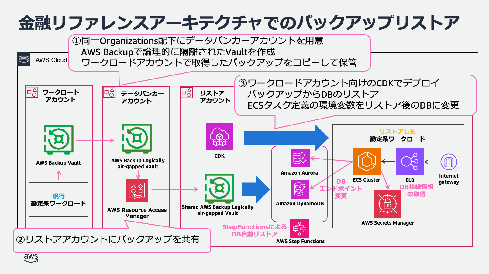
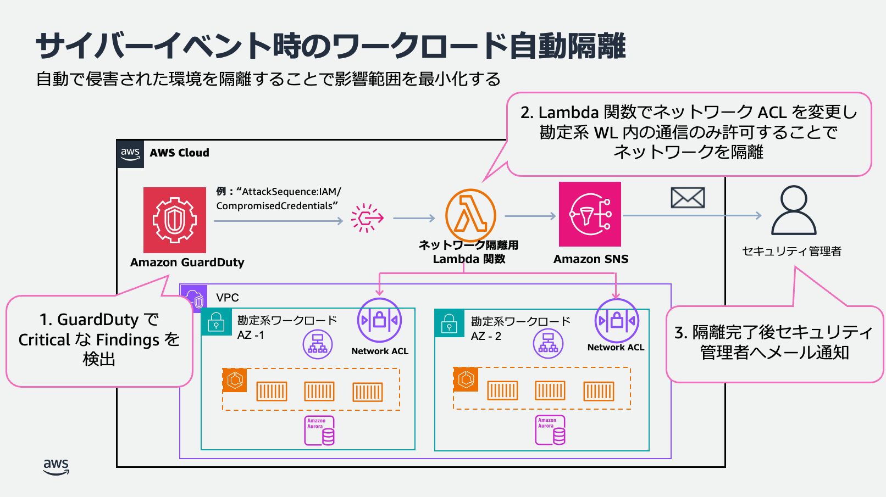

# サイバーレジリエンス リファレンスアーキテクチャ

本書は BLEA for FSI（金融リファレンスアーキテクチャ日本版）の「サイバーレジリエンス」アセットの
アーキテクチャ解説である。出典は同アセットの README である。

## ユースケース

- サイバーレジリエンスとは、サイバー攻撃を受けることを前提として、攻撃を予防し、検知し、対応し、
  復旧する能力を総合的に高めることである。従来の「攻撃を防ぐことに主眼を置く」という考え方から、
  「攻撃を受けても事業を継続し、迅速に復旧する」という考え方への転換が求められている。特に可用性に
  影響を与える DDoS 攻撃やランサムウェア攻撃といったサイバーイベントに対する防御は実装が急務と
  されている。本リファレンスアーキテクチャは、金融機関におけるサイバーイベントからの迅速な復旧を
  具体的なアーキテクチャとともに実装サンプルとして提示する。
- ランサムウェアに感染したデータがバックアップにコピーされるリスクを考慮し、バックアップデータを
  論理的に隔離した上で、メインデータセンターが依然として感染している可能性があるため、本番とは完全に
  別の環境での復旧を想定する。
  - 参考：金融庁「金融分野におけるサイバーセキュリティに関するガイドライン」の [2.3.3. データ保護] 参照

## アーキテクチャの特徴

- 本リファレンスアーキテクチャは、金融リファレンスアーキテクチャの勘定系ワークロードをベースに、
  バックアップを論理的に隔離し、本番環境とは別環境にリストアする構成を CDK として提供する。
- また、サイバー攻撃により侵害されたシステムをネットワーク隔離し、影響範囲を最小限に留めることが
  できる。

### アカウント設計

- **ワークロードアカウント**: 本番環境の勘定系システム等稼働アカウント
- **データバンカーアカウント**: 論理的に隔離されたバックアップ保管用アカウント
- **リストアアカウント**: 本番環境が侵害されている想定で、復旧先となる新規アカウント
- **フォレンジックアカウント**: 侵害されたシステムの改ざん検出やマルウェアスキャン、データの完全性と
  アプリケーション依存関係の確認用アカウント（本ワークロードでは対象外）

### バックアップ・リストアについて

- ① ワークロードアカウントでは AWS Backup を利用してバックアップを取得している。本リファレンス
  アーキテクチャでは、別途用意したデータバンカーアカウントに **AWS Backup Logically Air-gapped
  Vault** を作成し、ワークロードアカウントで取得したバックアップデータをこの Vault に複製している。

- ② サイバーイベント発生時において、バックアップデータのリストアが必要な場合は、データバンカー
  アカウントに直接アクセスするのではなく、**AWS Resource Access Manager** を使用してリストア
  アカウントとバックアップを共有する方式を採用している。これにより、データバンカーアカウントへの
  直接アクセスを制限し、バックアップデータの不正アクセスや改ざんを防止する、より安全な運用を実現
  している。

- ③ リストアアカウントでは、アプリケーションやインフラストラクチャの構成は、CDK を用いて環境を
  自動的に再構築する。データベースについては、バックアップからのリストアを StepFunctions で自動
  実行する仕組みを実装している。ただし、復旧したデータベース環境への接続については、業務影響度の
  評価やリスク判断が必要となるため、自動化の対象外としている。実際の切り替え時には、手動で ECS
  タスク定義の環境変数をリストア後のデータベースに更新し、ECS タスクを再起動することで新環境への
  移行を完了する運用手順を提供している。

- 具体的なバックアップ取得手順および復旧手順は、`backup-procedures.md`（バックアップ手順書）
  および `restore-procedures.md`（復旧手順書）を参照のこと。

### 隔離とフォレンジックについて

- サイバーイベント発生時には、影響を受けたシステムの速やかな隔離とインシデント調査のための証拠保全を
  実施することが重要である。また、バックアップデータを用いた復旧作業に着手する前には、バックアップの
  完全性を評価する必要がある。
- 本リファレンスアーキテクチャでは、勘定系ワークロードを対象として、Amazon GuardDuty で不審な
  アクセスがあったことをトリガーに、Lambda 関数でネットワーク ACL を変更し、侵害されたシステムを
  隔離する処理を実行する。隔離が完了すると、Amazon SNS にて管理者へ通知を行う。詳細は
  `isolation-procedures.md`（自動ネットワーク隔離手順書）を参照のこと。
- なお、勘定系ワークロードは Amazon ECS Fargate を用いており、コンテナホストが AWS の管理責任下に
  あるため調査箇所が限られていることから、フォレンジックアカウントのデプロイおよび実施手順は省略して
  いる。フォレンジックの実装ガイドおよびソリューションは以下 AWS ドキュメントを参照のこと。
  - https://docs.aws.amazon.com/ja_jp/security-ir/latest/userguide/appendix-b-incident-response-resources.html#forensic-resources

## 参考情報

### 規制・ガイドライン

- 金融庁は「金融分野におけるサイバーセキュリティに関するガイドライン」を策定し、バックアップに
  関する規程整備やランサムウェア攻撃への対応事項を定義している。
  - https://www.fsa.go.jp/news/r6/sonota/20241004/18.pdf
- 上記を受けて、FISC 安全対策基準でもサイバーレジリエンス強化に関する基準項目が新設され、本リファ
  レンスアーキテクチャを活用した対策内容を更新している。実務基準の対策については、勘定系アセットの
  FISC マッピングファイル（`fisc-mapping-core-banking.md`）を参照のこと。本アセット専用の FISC
  マッピングファイルは存在しない。

### ベストプラクティス・ホワイトペーパー

- AWS クラウドセキュリティ ランサムウェアからの保護
  - https://aws.amazon.com/jp/security/protecting-against-ransomware/
- オンプレミスのインフラから AWS へのバックアップとリカバリ
  - https://docs.aws.amazon.com/ja_jp/prescriptive-guidance/latest/backup-recovery/on-premises-to-aws.html
- AWS Backup の Logically air-gapped vault によるサイバーレジリエンスの構築
  - https://aws.amazon.com/jp/blogs/news/building-cyber-resiliency-with-aws-backup-logically-air-gapped-vault/
- オンプレミス環境のバックアップ隔離の実装
  - https://aws.amazon.com/jp/blogs/industries/banking-trends-2022-cyber-vault-and-ransomware/
- インシデント対応の例
  - https://docs.aws.amazon.com/ja_jp/whitepapers/latest/aws-security-incident-response-guide/incident-response-examples.html
- AWS re:Invent 2024 - What's new with AWS Backup (STG203)
  - https://youtu.be/YFcoAZQvcHM?si=A1rBTUs8ppJMCl9P
