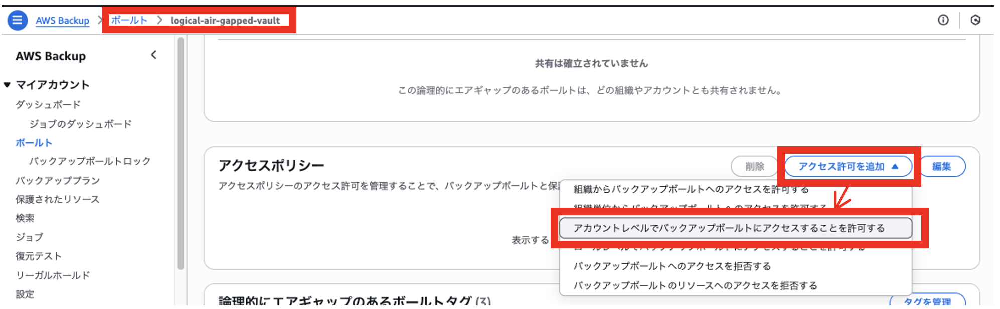
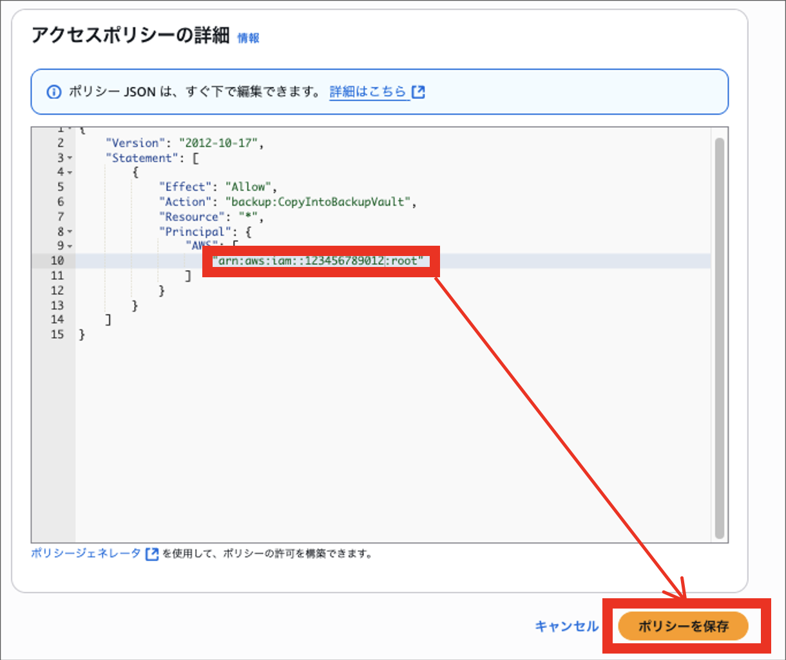
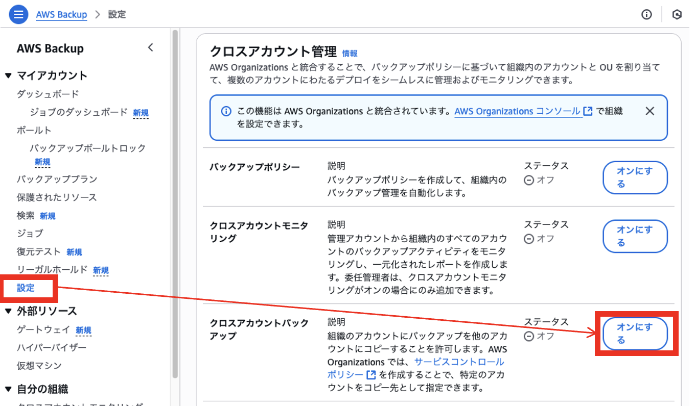
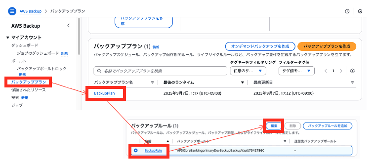
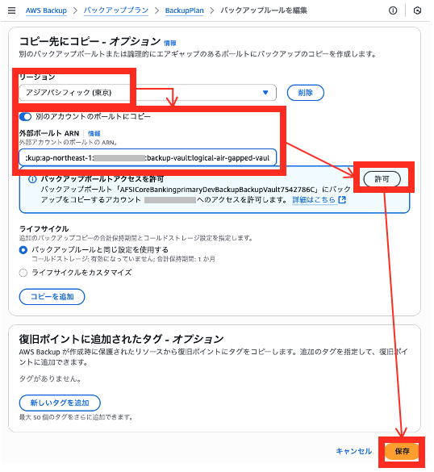

# サイバーレジリエンス バックアップ手順書

本書は BLEA for FSI「サイバーレジリエンス」アセットのバックアップ手順書である。

## 概要

本ドキュメントは、サイバーインシデントに備えるための、論理的に隔離された別 AWS アカウントに
バックアップを取得するための手順を説明する。論理的な隔離とは、厳格なアクセス制御と不変性の仕組みに
よって、バックアップデータに対する操作（読み取り、変更、削除）を不可能にし、管理者権限を持つユーザーや
攻撃者でさえも、指定した保持期間中は変更・削除できないよう制御することを意味する。

## 前提条件

### 必要なソフトウェア

- AWS CLI v2
- Node.js 18.0.0 以上
- AWS CDK v2.95.1 以上

### アカウント構成

- **ワークロードアカウント**: 勘定系ワークロードが稼働
- **データバンカーアカウント**: 論理的に隔離されたバックアップデータを保管
  - 両アカウントは同一の AWS Organizations に属している必要がある。

## 導入手順

データバンカーアカウントに SSO で認証している状態からのデプロイメントの手順を示す。

### 1. データバンカーアカウントデプロイ用の AWS CLI プロファイルを設定する

データバンカーアカウントにデプロイするための AWS CLI プロファイルを設定する。ここではデータバンカー
アカウントの ID を 123456789012 としている。

`~/.aws/config`

```sh
# for Data Bunker Account Login
[profile ct-databunker-sso]
sso_start_url = https://d-90xxxxxxxx.awsapps.com/start/
sso_region = ap-northeast-1
sso_account_id = 123456789012
sso_role_name = AWSAdministratorAccess
region = ap-northeast-1
```

### 2. 環境別の設定を指定する

デプロイ前にデータバンカーアカウントの情報を指定する必要がある。下記の typescript ファイルを編集する。

`<fsi-banking-core>/assets/sample-cdk/bin/parameter.ts`

このサンプルはアカウント ID 123456789012 のデータバンカーアカウントに、`logical-air-gapped-vault`
という名前の Logically air-gapped vault を作成する例である。

```typescript
export const CyberResilienceParameter = {
  // デプロイする場合は true に指定
  deploy: true,
  // どの機能をデプロイか選択
  option: ['backup'] as ('backup' | 'restore' | 'isolation')[],

  // Data Bunkerアカウントの設定
  dataBunkerAccount: {
    // アカウントID
    id: '123456789012', // 実際のData BunkerアカウントIDに置き換える
    // Data Bunkerアカウントに作成するバックアップボールト名
    vaultName: 'logical-air-gapped-vault',
  },
};
```

### 3. Logically air-gapped vault をデプロイする

（ログインしていない場合）AWS IAM Identity Center（旧 AWS SSO）を使ってデータバンカーアカウントに
ログインする。

```sh
aws sso login --profile ct-databunker-sso
```

データバンカーアカウントで CDK ブートストラップを実行する（`parameter.ts` に指定した 2 つのリージョンで
ブートストラップ処理が行われる）。

```sh
# fsi-banking-core スキルの assets/sample-cdk を作業ディレクトリにコピーした場所へ移動
cd <fsi-banking-core>/assets/sample-cdk
npx cdk bootstrap --profile ct-databunker-sso
```

Logically air-gapped vault をデプロイする。

```bash
npm install
npx cdk deploy BLEAFSI-CoreBanking-data-bunker-Dev --profile ct-databunker-sso
```

スタック `BLEAFSI-CoreBanking-data-bunker-Dev` の実行が完了すると、Output として下記が表示される。

```bash
Outputs:
BLEAFSI-CoreBanking-data-bunker-Dev.LogicallyAirGappedVaultArn = <デプロイされたボールトのARN>
```

### 4. Logically air-gapped vault のアクセス許可ポリシーを設定

手順 3 によって、データバンカーアカウントに AWS Backup の Logically air-gapped vault が作成されて
いるため、ワークロードアカウントの既存の AWS Backup からのアクセス許可設定を行う。

データバンカーアカウントのマネージメントコンソールから **AWS Backup** を開き、**ボールト** から作成した
Logically air-gapped vault を選択する。さらに **アクセスポリシー** の **アクセス許可を追加** を
クリックして、**アカウントレベルでバックアップボールトにアクセスすることを許可する** を選ぶ。



ワークロードアカウントのアカウント ID からのアクションを許可するポリシーを保存する。



### 5. 勘定系ワークロードからデータバンカーアカウントへのコピー設定

ワークロードアカウントの AWS Backup の既存バックアッププランを修正して、データバンカーアカウントへ
コピーするための設定を行う。

ワークロードアカウントのマネージメントコンソールから **AWS Backup** を開き、**設定** から
**クロスアカウントバックアップ** をオンにする。



**AWS Backup** の **バックアッププラン** から、勘定系ワークロードのデプロイにて作成された
**バックアッププラン** を選択し、その中にある **バックアップルール** の編集を選ぶ。



バックアップルールの **コピー先にコピー** に、データバンカーアカウントにデプロイした Logically
air-gapped vault の ARN を設定し、アクセス許可をした上で保存をする。（ARN は、手順 3 の処理の
Output に出力されている）



以上で、設定は完了である。
コピー処理により、データバンカーアカウントの Logically air-gapped vault に正しく復旧ポイントが作成
されることを確認すること。コピー処理は、バックアッププランで指定したバックアップ処理のタイミングで
行われる。
