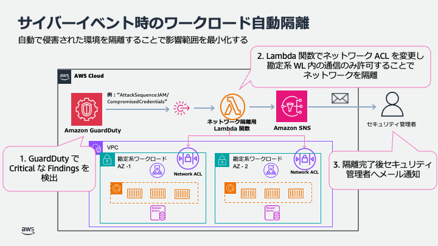
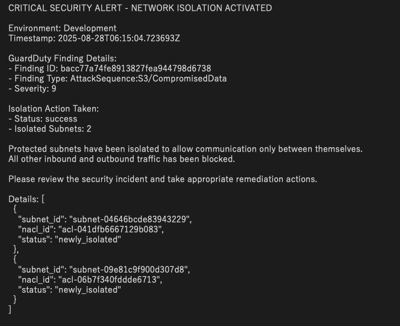
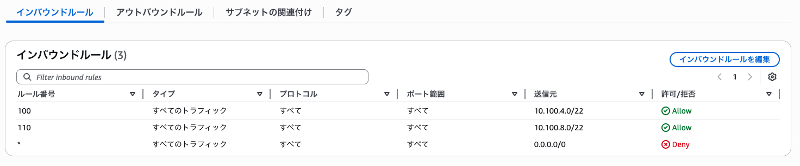

# サイバーレジリエンス 自動ネットワーク隔離機能

本書は BLEA for FSI「サイバーレジリエンス」アセットの自動ネットワーク隔離手順書である。

## 概要

本機能は Amazon GuardDuty で重大度が Critical の脅威が検出された際に、勘定系ワークロードを自動的に
ネットワーク隔離する仕組みを提供する。対象のシステムを隔離することで、脅威が発生した際の影響範囲を
最小限に留めることができる。本ドキュメントでは、本機能を実現する AWS のアーキテクチャと隔離手順に
ついて説明する。

※現在の実装では、インシデントに対する影響範囲を最小化するため、GuardDuty で Critical な通知が確認
されるとシステムを自動で隔離する実装になっている。しかし、隔離作業には業務への影響を伴うため、人に
よる判断が必要な場合も考えられる。そのような場合は、通知と隔離処理の間に人による判断を介在させるような
実装が推奨される。

## アーキテクチャ

```
Amazon GuardDuty → AWS EventBridge → AWS Lambda → Amazon SNS
                                        ↓
                                 Network ACL 変更
                                 (Protected Subnet の隔離)
```



## 機能詳細

### 1. 脅威検知

- Amazon GuardDuty で Severity 9.0 以上（Critical）の Finding が検出された際に、EventBridge
  ルールが自動的に Lambda 関数をトリガーする。この機能は **Critical** レベルのみに反応する。

### 2. ネットワーク隔離

- 勘定系ワークロードは 2 つのアベイラビリティゾーンのサブネット上に構築されている。そのため、
  ネットワークの自動隔離を行う際は Lambda 関数で Network ACL を作成することで、2 つのアベイラビリ
  ティゾーンに存在する勘定系ワークロードのサブネット間の通信のみを許可し、その他の inbound/outbound
  通信を全て遮断することで対象ワークロード外へのアクセス、外部ネットワークからの接続を Block する。
- Network ACL を動的に作成し、既存の ACL を変更する。

### 3. 通知

- 隔離完了後、Amazon SNS で管理者に通知する。
- エラー発生時も通知を送信する。

## ファイル構成

本機能に関するデプロイアセットは、fsi-banking-core スキルの
`assets/sample-cdk/lib/primary/cyber-resilience/automated-isolation` に格納されている。

```
/lib/primary/cyber-resilience/automated-isolation/
├── isolation-stack.ts           # メインスタック
├── guardduty-eventbridge.ts     # GuardDuty + EventBridge設定
├── isolation-lambda.ts          # Lambda関数の定義
├── sns-notification.ts          # SNS通知設定
├── types.ts                     # 型定義
└── lambda/                      # Lambda関数コード
    ├── isolation-handler.py     # メイン処理（Python）
    └── requirements.txt         # Python依存関係
```

## デプロイ方法

### 1. 機能の有効化

`bin/parameter.ts` の deploy パラメータを `true` に変更し、option に `isolation` を指定する。

```typescript
export const CyberResilienceParameter = {
  deploy: true,
  option: ['isolation'] as ('backup' | 'restore' | 'isolation')[],
  // ...
};
```

### 2. 通知先メールアドレスの設定

`bin/parameter.ts` の `notifyEmail` を適切なメールアドレスに設定する。

```typescript
export const DevParameter: StackParameter = {
  // ...
  notifyEmail: 'your-security-team@example.com',
  // ...
};
```

### 3. デプロイ実行

```bash
npm run cdk deploy BLEAFSI-CoreBanking-isolation-Dev
```

## テスト方法

### 1. Amazon GuardDuty でサンプル脅威を生成

デプロイ後、Amazon GuardDuty の create-sample-findings API を利用することで、サンプルの検出結果を
生成する。本機能は重大度が Critical な脅威が生成された際に実行されるため、Critical と定義された検出
結果タイプを指定する。

```bash
aws guardduty create-sample-findings \
  --detector-id $(aws guardduty list-detectors --query 'DetectorIds[0]' --output text) \
  --finding-types "AttackSequence:IAM/CompromisedCredentials"
```

### 2. AWS Lambda が実行され Amazon SNS で送られるメールを確認

サンプルの脅威が生成されると Lambda 関数が実行され、しばらく待つとデプロイ時に指定したメールアドレス
宛に以下図のようなネットワーク隔離が完了した旨のメール通知が届く。



### 3. 対象 Subnet に隔離用 Network ACL が適用されているか確認

AWS マネジメントコンソールから、勘定系ワークロードが存在する Protected Subnet に関連付けされた
Network ACL を確認し、該当サブネット間のみ許可され、それ以外の通信は拒否されていることを確認する。



## 制限事項

- Primary Region のみでの動作（Secondary Region は対象外）
- Amazon GuardDuty が有効化が前提
