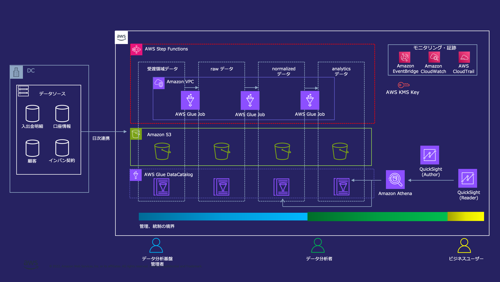

# FSI データ分析プラットフォーム（Simple data lake）

## ワークロード概要

不確実性が高まる事業環境において、データに基づく意思決定は不可欠となっており、企業が扱うデータの量は
前例のない速度で増加している。AWS はデータ分析に関わる広範なサービスを提供しており、これらを組み合わせる
ことでスケーラブルなデータ分析基盤を迅速に構築できる。

本リファレンスアーキテクチャは、将来の要件変化や利用規模の拡大に柔軟に対応しつつ、金融機関に求められる
セキュリティレベルを満たす、コスト最適なデータ分析基盤を構築するための **Simple data lake** を提示する。
その中核は **Amazon S3 データレイク** であり、データを *蓄積する* コンポーネントとデータを *処理する*
コンポーネントを意図的に分離している。これは両者が異なるライフサイクルで扱われるためである。データ分析
基盤上のデータは数年にわたって価値を蓄積するのに対して、データを処理する道具は社内外の環境の変化に
合わせて変わっていく。

サンプルアプリケーションは、仮想の "AWS 銀行" をモデルとしている。3 つの基幹システム（勘定系システム、
顧客システム、インターネットバンキングシステム）のデータが日次でデータレイクに取り込まれ、ETL パイプライン
で加工され、BI ツールを通じて分析可能となる。エンドツーエンドのフローは、Amazon QuickSight の
インターネットバンキング向けマーケティングダッシュボードまで観察できる。

詳細は `references/` に段階的に開示している。まずここから読み始め、タスクに関連するリファレンスファイルを
読み込むこと。

## ベストプラクティスと主要コンポーネント

### ベストプラクティス

- MUST: データ分析基盤のデータは Amazon S3 データレイク上に保管し、データを蓄積するコンポーネントとデータを処理するコンポーネントを分離すること。これにより、一貫したデータリポジトリを処理ツールとは独立して発展させられる。
- MUST: データは 3 層構造 — raw（オリジナルデータ）、normalized（標準化データ）、analytics（目的別データ）— で配置すること。これにより将来性を確保し、利活用を促進し、各領域間の統制・管理の境界を明確にする。
- MUST: raw レイヤーはソースシステムのデータを未加工のまま保持し、原則としてデータ分析基盤管理者のみがアクセス可能とすること。これにより将来のユースケースの変化にも対応できる。
- MUST: normalized レイヤーでは、共通的な前処理（名寄せ、日付形式の統一）、クエリ効率のためのパーティショニング、機微情報・個人情報のマスキングを適用し、サニタイズした上でデータ分析基盤利用者に広く公開できるようにすること。
- MUST: 各レイヤーの S3 バケットへのアクセスを IAM で管理し、ペルソナ（データ分析基盤管理者、データアナリスト、ビジネスユーザー）ごとに適切な IAM 権限を割り当ててプラットフォームを保護すること。
- MUST: Amazon S3 のデータを AWS KMS カスタマー管理キー（CMK）で暗号化し、Glue Data Catalog オブジェクトも暗号化すること。
- MUST: Glue Job は Internet Gateway を持たない VPC（隔離された/プライベートなサブネット）内で実行し、到達可能なネットワーク空間を制限した上で、S3 やその他のリソースへは VPC Endpoint 経由のみで到達すること。
- MUST: メタデータ（データソースの場所、フォーマット、スキーマ）は AWS Glue Data Catalog で管理し、ETL 処理やクエリエンジンがデータにアクセスする際の実装・設定を簡素化すること。
- MUST: Athena WorkGroup のクエリ結果を暗号化（SSE-KMS）し、WorkGroup 設定を強制してクエリ出力を保護すること。
- SHOULD: サーバーレスの分散処理 — ETL には AWS Glue Spark Job、クエリエンジンには Amazon Athena — を利用し、テラバイト規模のデータを効率的に処理し、必要なときにのみリソースを消費すること。これによりスモールスタートから長期的な成長までコストを最適に保つ。
- SHOULD: QuickSight の IP アドレス制限を利用して QuickSight にアクセス可能なユーザー環境を制限し、QuickSight ユーザーを IAM（およびパスワードルールを備えた SAML 連携 IdP）で認証すること。
- SHOULD: BI（QuickSight）ユーザーにはデータレイク内の標準化済みデータのみへのアクセスを許可すること。analytics レイヤーは参照可能とし、raw レイヤーは参照不可とする。
- SHOULD: IAM 権限は最小権限のみを付与し、IAM ロールの一時認証情報を用いてリソースにアクセスすること。
- SHOULD: AWS Glue が提供する標準ライブラリのみを利用すること。Glue Job で外部ライブラリを利用する場合は、当該ライブラリのバージョン管理を行うこと。
- SHOULD: Glue Job の Python コードは S3 バケット上で管理し、ソース管理が必要な場合は CodeCommit の利用を検討すること。
- PREFER: 3 層構造は初期提案として採用し、より大規模な組織や特定要件の場合は、より細分化された階層を検討すること。
- PREFER: 大規模なガバナンスには、純粋なリソースベースの IAM の代わりに、リソースタグによる ABAC や AWS Lake Formation の LF-Tags などの属性ベースのアクセス戦略を用いて、よりスケーラブルな制御を行うこと。
- MAY: normalized/analytics レイヤーで機微データを一部のユーザーにのみ公開するには、専用テーブルとアクセス権限の組み合わせ、Amazon Redshift の動的データマスキング、または AWS Lake Formation の行・列レベルアクセス制御を利用すること。
- MAY: S3 によるデータ保持に加え、必要性に応じて他リージョンへのデータバックアップを検討すること。
- WILL: Glue Job をオーケストレーションする Step Functions ステートマシンは EventBridge により日次でスケジュール実行される。実行中に一部のタスクが一時的に失敗すること（ステータス `TaskFailed`）があるが、自動的にリトライされ、最終的に全ジョブが成功する。
- WILL: 本アーキテクチャは AZ 障害への耐性を有しているが、大規模な障害が発生した場合はサービス復旧を待つかセカンダリリージョンへフェイルオーバーするかを判断する必要がある。
- MUST: このスキルから構築する全ての CDK Stack に cdk-nag の AwsSolutionsChecks を Aspects で適用し、未抑制の AwsSolutions-* 検出が 0 件であることを CI テスト（jest 等）でゲートする。例外は NagSuppressions に reason を明記して抑制する（詳細は references/cdk-nag.md）。

### 主要コンポーネント

#### データレイクストレージ（Amazon S3）

- **コンポーネント概要**: プラットフォームの中核。各データ配置レイヤー（origin/raw、normalized、analytics）に加え、マスタデータと Athena クエリ結果出力を、それぞれ別々の S3 バケットが保持する。バケットは SSE-KMS CMK で暗号化される（Athena クエリ結果バケットを除く。同バケットは Athena WorkGroup レベルで暗号化される）。並列アクセスに対する高い堅牢性、コスト効率、スケーラビリティを提供する。
- **想定 AWS サービス**: Amazon S3, AWS Key Management Service (KMS)。

#### ETL パイプライン（AWS Glue + AWS Step Functions）

- **コンポーネント概要**: origin/raw レイヤー → normalized レイヤー → analytics レイヤーへとデータを変換するサーバーレス ETL。Glue Spark Job が変換処理を実装し、Step Functions ステートマシン（`glue-job-pipeline`）がそれらを並列ステージでオーケストレーションし、失敗したタスクをリトライする。パイプラインは EventBridge Schedule により日次でトリガーされ、フル処理／増分処理を切り替える `import_date` 入力（`all` または `YYYYMMDD`）を受け付ける。
- **想定 AWS サービス**: AWS Glue (Spark Job), AWS Step Functions, Amazon EventBridge (Scheduler), Amazon CloudWatch (Logs, Alarms), Amazon SNS。

#### メタデータ & クエリエンジン（Glue Data Catalog + Amazon Athena）

- **コンポーネント概要**: Glue Data Catalog が origin/raw/normalized/analytics/master の各データベースにまたがるメタデータ（ソースの場所、フォーマット、スキーマ）を管理する。Amazon Athena は、クエリ結果が SSE-KMS で暗号化された Athena WorkGroup を通じてデータレイクにクエリを実行する。Glue と Athena はいずれもスケールアウトし、非常に大規模なデータセットを効率的かつサーバーレスに処理する。
- **想定 AWS サービス**: AWS Glue Data Catalog, Amazon Athena。

#### ネットワーク分離（プライベート VPC + VPC Endpoint）

- **コンポーネント概要**: Glue Job は、2 つの AZ にまたがるプライベート／隔離サブネット、Internet Gateway なし、VPC Flow Logs 有効の VPC 上で実行される。AWS サービス（Amazon S3, AWS KMS, AWS Glue）へのアクセスは VPC Endpoint 経由で行う。Glue 接続には自己参照型のセキュリティグループを用いる。
- **想定 AWS サービス**: Amazon VPC, VPC Endpoint (S3 Gateway, KMS, Glue), VPC Flow Logs, Security Group。

#### 可視化 / BI（Amazon QuickSight）

- **コンポーネント概要**: AWS 銀行のインターネットバンキング向けマーケティングダッシュボードを、Athena データソース経由で normalized レイヤーと analytics レイヤーの上に構築する。データは SPICE にインポートされ、QuickSight サービスロールに Athena と関連する S3 バケットへのアクセスを付与する。アクセスは IAM 認証と IP アドレス制限で制御される。
- **想定 AWS サービス**: Amazon QuickSight (Enterprise edition, SPICE), Amazon Athena, IAM。

## FISC 準拠サマリー

本リファレンスアーキテクチャは、FISC 安全対策基準（第 11 版）の実務基準に対してマッピングされている。
BLEA for FSI でカバーされる対策のみを記載しており、システム全体の安全性はユーザーアプリケーションの
実装や運用・開発プロセスと合わせて別途検討する必要がある。

代表的な適用対策は次のとおりである。QuickSight 認証によるアクセスユーザーの保護（実 1）、QuickSight の
IP アドレス制限（実 2）、S3 データと Glue Data Catalog オブジェクトの KMS 暗号化および IAM ベースの
アクセス制御（実 3）、VPC Endpoint 経由で到達するプライベートサブネット内での Glue Job の実行（実 4）、
CloudWatch Logs / CloudTrail / S3 アクセスログ / VPC Flow Logs への全て UTC でタイムスタンプされた
アクセスログの記録（実 10）、KMS CMK による暗号化鍵の保護（実 13）、最小権限 IAM と BI での標準化済み
データのみの利用（実 25）、AWS CDK による設定の IaC バックアップ（実 39, 実 42）、AZ 障害耐性を持つ
AWS マネージドサービスの利用（実 84）。多くの対策は「対象外」となっているが、これはガバナンスベース、
ユーザーアプリケーション、管理・運用プロセスで対応されるか、あるいは AWS クラウド側で既に対策済みである
ためである。

エントリごとの完全なマッピング表（実 1〜実 148）は `references/fisc-mapping.md` に保持している。

## リファレンスアーキテクチャ

アーキテクチャは、3 層構造でデータを配置した Amazon S3 データレイクを中核とし、サーバーレス ETL（Glue +
Step Functions）、スキーマ管理のための Glue Data Catalog、クエリのための Athena、可視化のための
QuickSight で構成される。Glue Job は閉域（Internet Gateway を持たない）VPC 内で実行され、VPC Endpoint
経由でのみ到達する。

技術的な詳細 — レイヤー定義、ペルソナとアクセス制御、データライフサイクル、閉域網での実行、スキーマ管理、
スケーラビリティ — は `references/architecture.md` にある。サンプルアプリケーションのデータモデル、ETL
処理、スキーマは `references/application-data.md` に、サンプルデータスキーマは
`references/sample-data-schema.md` にまとめられている。

アーキテクチャ図（S3 を中核とした Simple data lake）:

## CDK サンプル概要

動作する AWS CDK（TypeScript）サンプルを `assets/sample-cdk/`
（`usecases/guest-analytics-platform-sample`）配下に提供している。これは DataLake コンポーネント（VPC、
S3 バケット、AWS Glue Job、Athena WorkGroup、Step Functions ステートマシン、EventBridge Schedule）を
デプロイする。BLEA for FSI ガバナンスベースが既に導入されているアカウント上にデプロイされる。スタックの
デプロイ後、QuickSight サンプルアプリケーション（データソース、データセット、分析）を AWS CLI 経由で
セットアップし、Step Functions ステートマシンを通じて Glue Job を実行してパイプラインをエンドツーエンドで
検証する。

> **サンプルアプリのセキュリティに関する注意**: 本サンプルはリファレンス／動作デモであり、本番利用可能ではない。Glue ETL スクリプトは CIF・口座番号の「マスキング」に `reverse()` を用いるが、これは自明に可逆であり、BI が読み取れる normalized/analytics 層へ伝播する。さらに ETL は S3 プレフィックスを無条件に一括削除する。実データに対して実行する前に、`reverse()` を不可逆方式（ハッシュ/トークナイゼーション/Lake Formation 列制御）へ置換し、ターゲットの allow-list 検証と S3 バージョニング/バックアップを追加すること。同じ注意書きは `assets/sample-cdk/SECURITY_NOTICE.md` に同梱され、`cdk synth` / `cdk deploy` のたびに警告として表示される。

QuickSight のセットアップやトラブルシューティングを含む、詳細なデプロイ手順と運用検証手順は
`references/deployment.md` にある。

コピーした `assets/sample-cdk/test/*.test.ts` が cdk-nag 強制パターンの権威的な出典であり、
抽出した抑制ルール台帳は `references/cdk-nag.md` にある。
