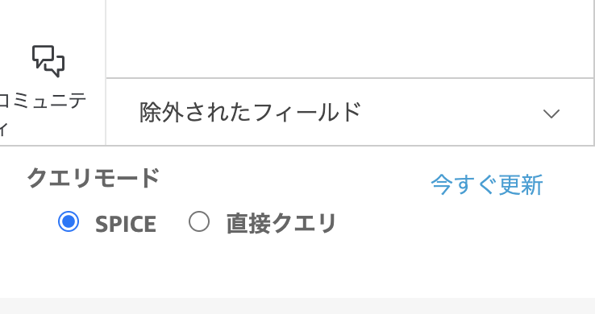
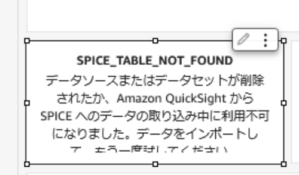
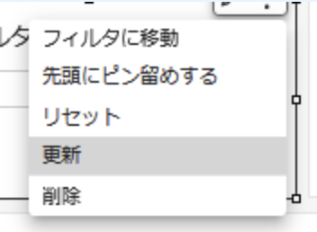
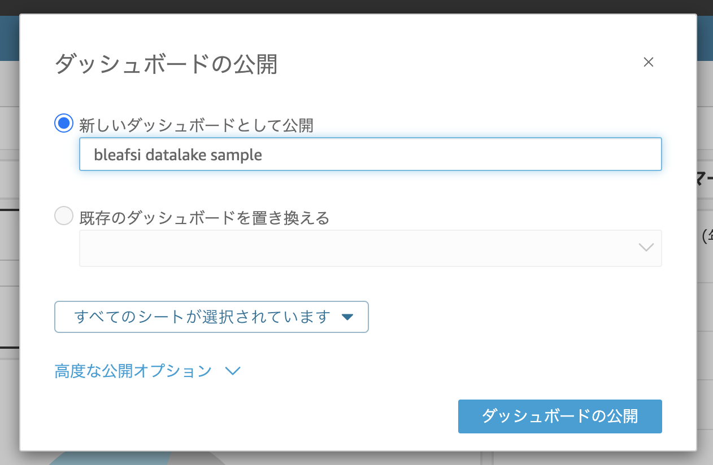
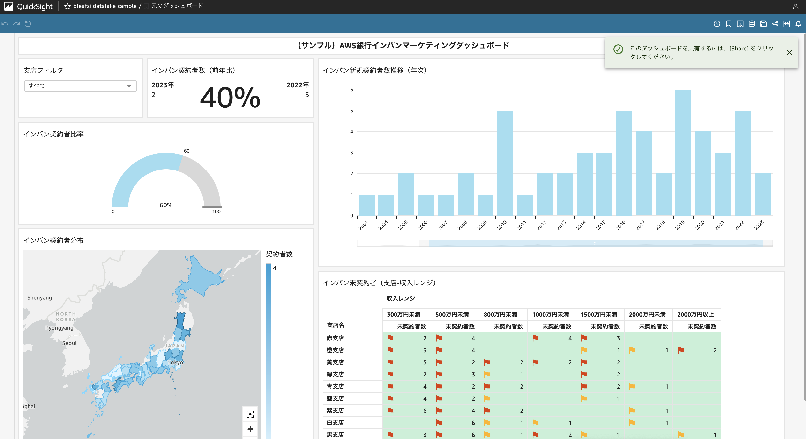
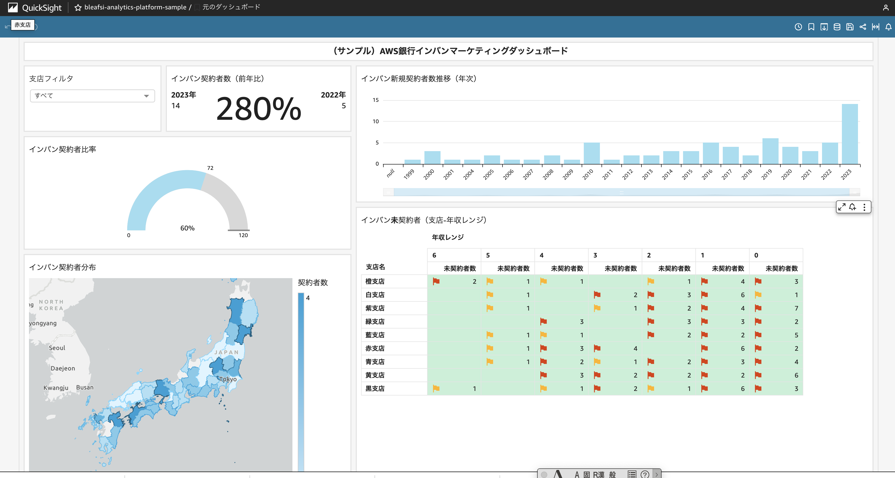

# [データ分析プラットフォーム] Simple Datalake ワークロードのデプロイ手順

ここでは BLEA for FSI のガバナンスベースがデプロイされたアカウントに [データ分析プラットフォーム] Simple Datalake ワークロードと QuickSight サンプルアプリケーションを導入する手順について記述する。CDK のソースは `assets/sample-cdk/` に同梱している。

> **作業ディレクトリについて**: 本スキルは読み取り専用のテンプレート提供元である。SKILL.md や
> references 等の CDK 実行に不要なファイルはコピーせず、**CDK 実行に必要な次の 3 つだけ**を、相対参照
>（`tsconfig.json` の `extends: "../../tsconfig.base.json"`、`package.json` の
> `file:"../../resources/bleafsi-shared-constructs/v1.0.0"`）が保たれる形で作業ディレクトリ `<workdir>` に
> コピーする:
>
> - `assets/sample-cdk/` → `<workdir>/assets/sample-cdk/`
> - `tsconfig.base.json` → `<workdir>/tsconfig.base.json`
> - `resources/` → `<workdir>/resources/`（共有ライブラリ bleafsi-shared-constructs）
>
> **コピー先 `<workdir>` は、スキル利用者に次の 3 択で確認すること**: (1) カレントディレクトリ、
> (2) スキル名のディレクトリ（例 `fsi-foundation-analytics-platform-cdk/`）を新規作成、(3) 利用者が指定するディレクトリ。
> コピー後 `<workdir>/assets/sample-cdk` に移動して CDK コマンドを実行する（以下の `cd assets/sample-cdk`
> はこの移動を指す）。**共有ライブラリに依存するため、初回は `<workdir>/resources/bleafsi-shared-constructs/v1.0.0`
> で `npm install && npm run build` を実行してからデプロイすること。** スキルディレクトリ内で直接 `cdk deploy`
> しないこと（生成物でスキルが汚れる）。アカウント・リージョンは `bin/parameter.ts` に直接書かず、環境変数
> `CDK_DEFAULT_ACCOUNT` / `AWS_REGION`（または `--profile`）で与える。

> `MC`はマネジメントコンソールでの作業を、`Local`は手元環境での作業を示す。

## 導入・確認手順

### 1. [データ分析プラットフォーム] Simple DataLake ワークロードをデプロイする

ゲストアカウントに SSO で認証している状態からのデプロイメントの手順を示す。

#### 1-1. ゲストアカウントデプロイ用の AWS CLI プロファイルを設定する(Local)

ゲストアカウントにデプロイするための AWS CLI プロファイルを設定する。ここではゲストアカウントの ID を 123456789012 としている。`~/.aws/config`：

```sh
# for Guest Account Login
[profile ct-guest-sso]
sso_start_url = https://d-90xxxxxxxx.awsapps.com/start/
sso_region = ap-northeast-1
sso_account_id = 123456789012
sso_role_name = AWSAdministratorAccess
region = ap-northeast-1
```

#### 1-2. 環境別の設定を指定する(Local)

デプロイ前に環境別（開発、ステージング、本番等）の情報を設定する必要がある。下記の typescript ファイルを編集する。

```sh
assets/sample-cdk/bin/parameter.ts
```

このサンプルは dev と staging という開発、検証用の設定を定義する例である。本番アカウントにもデプロイできるようにするには、prod 用の定義を追加する。

```js
//// Development environment parameters ////
export const DevParameters: StackParameter = {
  envName: 'Development',
  simpleDataLake: {
    notifyEmail: 'xxx@example.com',
    vpcCidr: string;
  },
};

//// Staging environment parameters ////
export const StageParameters: StackParameter = {
  envName: 'Staging',
  env: {
    account: '111111111111',
    region: 'ap-northeast-1',
  },
  simpleDataLake: {
    notifyEmail: 'xxx@example.com',
    vpcCidr: '10.4.0.0/16',
  },
};
```

この設定内容は以下の通りである。

| key                        | value                                                                                        |
| -------------------------- | -------------------------------------------------------------------------------------------- |
| env.account                | デプロイ対象のアカウント ID。CLI の profile で指定するアカウントと一致している必要がある      |
| env.region                 | デプロイする AWS リージョン名                                                                 |
| envName                    | 環境名。これが各々のリソースタグに設定される                                                 |
| simpleDataLake.notifyEmail | アラーム通知先のメールアドレス                                                               |
| simpleDataLake.vpcCidr     | リソースを配置する vpc の cidr block                                                         |

#### 1-3. データ分析プラットフォーム Simple DataLake ワークロードをデプロイする(MC|Local)

（ログインしていない場合）AWS IAM Identity Center（旧 AWS SSO) を使ってゲストアカウントにログインする。

```sh
aws sso login --profile ct-guest-sso
```

最初に下記の CDK スタックを実行して、DataLake を構成する下記の AWS サービスをデプロイする。

- VPC
- S3 バケット
- AWS Glue JOB
- AWS Athena WorkGroup
- AWS StepFunctions ステートマシン
- EventBridge Schedule

```sh
cd assets/sample-cdk
npx cdk deploy BLEAFSI-AnalyticsPlatform-SimpleDataLake-Dev --profile ct-guest-sso
```

> スタック名は環境ごとに異なる。xxx-Dev は開発環境用のスタック名である。

実行が完了すると下記の Output 名で Origin データを格納する S3 バケットの URL が出力されるので、メモしておくこと。手順 2 で使用する。

`BLEAFSI-AnalyticsPlatform-SimpleDataLake-Dev.S3BucketurlforOrigindata`

#### 1-4. QuickSight サンプルアプリケーションのセットアップ

Simple datalake に蓄積されたサンプルデータをビジュアルに参照するための QuickSight アプリケーションをセットアップする。

#### 1-4-1. QuickSight の有効化（Local)

QuickSight をアカウント上で有効化する。

> 既に有効化されている場合はこの作業は不要である。

コンソールから下記の AWS CLI コマンドを実行する。

> `<account id>` にはゲストアカウントの ID、notification-email には管理者の email を指定する。
> aws cli のバージョンが古い場合は下記コマンドの実行に失敗することがある。v2.11.12 以降のバージョンを利用すること。

```sh
cd assets/sample-cdk
aws quicksight create-account-subscription \
 --edition ENTERPRISE \
 --authentication-method IAM_AND_QUICKSIGHT \
 --aws-account-id <account id> \
 --account-name <account id>-quicksight-admin \
 --notification-email notify@example.com \
 --region ap-northeast-1 \
 --profile ct-guest-sso
```

#### 1-4-2. QuickSight のアクセス権の設定（MC)

QuickSight ダッシュボードが Amazon Athena サービスおよび分析データを格納した S3 バケットにアクセスできるように、権限設定を行う。

- 管理者権限など、必要な権限を持つロールで AWS 管理コンソールにログインしてから `QuickSight` サービスにアクセスする。
  > ログインユーザーで初めて QuickSight にアクセスすると、QuickSight ユーザーを作成するためにメールアドレスの入力を求められることがある。
- QuickSight の管理画面が表示されたら、右上のメニューから[QuickSight の管理]を選択する。
- [セキュリティとアクセス制限] - [QuickSight の AWS のサービスへのアクセス] で[管理]ボタンを押す。
- [IAM ロール]で "既存のロールを使用する"を選択し、下記ロールを選択し設定を保存する。
  - bleafsi-quicksight-role

#### 1-4-3. QuickSight データソースの作成（Local)

下記の json ファイルを開いて編集する。`/assets/sample-cdk/resources/quicksight/qs-datasource-simple-datalake.json`

[変更箇所]

- `<account-id>` にゲストアカウントの ID を指定する。

```json
{
  "AwsAccountId": "<account-id>",
  "Name": "bleafsi simple datalake athena datasource",
  "DataSourceId": "bleafsi-simple-datalake-athena-datasource",
  "Type": "ATHENA",
  "DataSourceParameters": {
    "AthenaParameters": {
      "WorkGroup": "analytics-workGroup"
    }
  }
}
```

変更を保存した後に、下記の CLI を実行して、分析に必要な QuickSight データソースを作成する。

```sh
cd assets/sample-cdk
aws quicksight create-data-source --cli-input-json file://resources/quicksight/qs-datasource-simple-datalake.json --profile ct-guest-sso
```

#### 1-4-4. QuickSight データセットの作成（Local)

下記の json ファイルを開いて編集する。`/assets/sample-cdk/resources/quicksight/qs-dataset-simple-datalake.json`

[変更箇所]

- `<account-id>` にゲストアカウントの ID を指定する。`<account-id>`は全部で 10 カ所ある。
- `<QuickSight-username>` には現在ログインしている QuickSight のユーザー名を指定する（ユーザー名の例 AWSReservedSSO_AWSAdministratorAcces_xx）。QuickSight のユーザー名は <QuickSight の管理> - <ユーザーを管理> から確認できる。

`ImportMode` は `SPICE`、`RelationalTable` は `AwsDataCatalog` カタログの Athena データソースを参照する。`Permissions` にはユーザーの QuickSight プリンシパルを指定する。

変更を保存した後に、下記の CLI を実行して分析に必要な QuickSight データセットを作成する。

```sh
aws quicksight create-data-set --cli-input-json file://resources/quicksight/qs-dataset-simple-datalake.json  --profile ct-guest-sso
```

> この段階では Glue カタログ上にテーブルがないため、作成されたデータセット `bleafsi simple datalake dataset`を開くとエラーが表示される。
> データの準備は「2. 稼働確認」の手順を実施すること。

#### 1-4-5. QuickSight 分析の作成

下記の json ファイルを開いて編集する。`/assets/sample-cdk/resources/quicksight/qs-analytics-simple-datalake.json`

[変更箇所]

- `<account-id>` にゲストアカウントの ID を指定する。`<account-id>`は全部で 3 カ所ある。
- `<QuickSight-username>` には現在ログインしている QuickSight のユーザー名を指定する。

`AnalysisId` / `Name` は `bleafsi-analytics-platform-sample`、`DataSetIdentifierDeclarations` はデータセット `bleafsi-simple-datalake-dataset` を参照する。

下記の CLI を実行して、サンプルとして提供されている QuickSight 分析を作成する。

```sh
aws quicksight create-analysis --cli-input-json file://resources/quicksight/qs-analytics-simple-datalake.json --profile ct-guest-sso
```

非同期で分析の作成がリクエストされるので、実行結果は下記の CLI コマンドで確認する。`<account-id>`は環境に合わせて変更する。

```sh
aws quicksight describe-analysis --aws-account-id <account-id> --analysis-id bleafsi-analytics-platform-sample --profile ct-guest-sso
```

`Status = CREATION_SUCCESSFUL` になっていれば作成に成功している。

以上で データ分析プラットフォーム Simple DataLake ワークロードのデプロイおよびサンプル QuickSight アプリケーションの設定は完了である。

> QuickSight のデータセットや分析のセットアップが上手くいかない場合は、本ファイル末尾の「QuickSight セットアップ中のエラー対応」を参照すること。

### 2. 稼働確認

実際にテストデータを使い、データ分析プラットフォームとしてセットアップした Glue JOB を実行して simple s3 datalake の稼働確認を行っていく。データの確認には QuickSight ダッシュボードを使用する。

#### 2-1. テスト用初期データの S3 バケットへのコピー（Local)

以下の CLI を実行して、テスト用の 4 種類のデータを S3 バケットにコピーする。

```sh
cd assets/sample-cdk/resources
unzip testdata-base.zip
aws s3 cp ./testdata-base/CustomerAccount.csv  <Originデータ用S3バケットURL>/CustomerAccount/ --profile ct-guest-sso
aws s3 cp ./testdata-base/InternetBankingUser.csv  <Originデータ用S3バケットURL>/InternetBankingUser/ --profile ct-guest-sso
aws s3 cp ./testdata-base/DepositWithdrawHistory.csv  <Originデータ用S3バケットURL>/DepositWithdrawHistory/ --profile ct-guest-sso
aws s3 cp ./testdata-base/Customer.csv  <Originデータ用S3バケットURL>/Customer/ --profile ct-guest-sso
```

> `<Originデータ用S3バケットURL>`は CDK スタック実行後に Output として出力されている。

#### 2-2. Glue Job の実行（MC)

管理コンソールから AWS Step Functions ステートマシンを実行して 3 つの Glue Job を実行する。これらの Glue Job では S3 バケット上に格納されたサンプルデータに対して origin(元データ) → raw（生データ）→ normalized（正規化） → analytics（分析） の 3 つのレイヤーでの変換を行う。

管理コンソールにログインして、AWS StepFunctions の管理メニューを開く。ステートマシン `glue-job-pipeline`を開く。右上の [実行を開始] ボタンを押す。表示されたダイアログの入力フィールドを以下入力値（全日付のデータを処理対象とする）で入れ替えて、[実行を開始] を押す。

```json
{"import_date":"all"}
```

3 つの Job が完了するのを待つ。

> この Step Functions ステートマシンは EventBridge スケジュールにより日次で実行するように設定されている。
> Job の実行中に処理のタイミングが原因で一部のタスクが失敗することがある（ステータスが`TaskFailed`になる）。自動でリトライすることで最終的に全ての Job が成功するように実装しているのでこのエラーは無視すること。

#### 2-3. Glue Job の実行確認（MC）

Glue Job が正常に実行され、raw（生データ）/ normalized（正規化）/ analytics（分析）の 3 つレイヤにそれぞれデータが作成されている事を確認する。

- S3 バケットに処理結果のデータ格納されている事を確認

| 目的                 | S3 バケット名                                        |
| -------------------- | ---------------------------------------------------- |
| raw（生データ）      | bleafsi-analyticsplatform-raw-<アカウント ID>        |
| normalized（正規化） | bleafsi-analyticsplatform-normalized-<アカウント ID> |
| analytics（分析）    | bleafsi-analyticsplatform-analytics-<アカウント ID>  |

- Glue DataCatalog に raw（生データ）/ normalized（正規化）/ analytics（分析）用のデータベースが作られていることを確認する。

[Glue DataCatalog に作成されるテーブルとデータベース]

| テーブル               | データベース名 |
| ---------------------- | -------------- |
| customer               | origin         |
| internetbankinguser    | origin         |
| customeraccount        | origin         |
| depositwithdrawhistory | origin         |
| customer               | raw            |
| internetbankinguser    | raw            |
| customeraccount        | raw            |
| depositwithdrawhistory | raw            |
| customer               | normalized     |
| internetbankinguser    | normalized     |
| customeraccount        | normalized     |
| depositwithdrawhistory | normalized     |
| internetbankingperiod  | analytics      |
| customerdepositinfo    | analytics      |
| master_acct            | master         |
| master_branch          | master         |
| master_trx_type        | master         |

#### 2-4. QuickSight サンプルダッシュボードを参照する(MC)

データレイク上のデータをビジュアルに確認するための QuickSight 分析をデプロイしているのでダッシュボードとして共有していく。

`分析`を表示する前に QuickSight データセットのデータを更新する必要があるので、下記の手順を実施する。

- 管理コンソールから QuickSight にアクセスする。
- メニューで「データセット」を選択して、`bleafsi simple datalake dataset`を開く。
- ステータスが "インポートに失敗しました" となっているが無視して、右上の[データセットの編集]ボタンを押して編集画面を開く。
- 左下のクエリモードで`今すぐ更新`をクリックして SPICE データを更新する。タイプは `フル更新`を選択する。



- 更新が終わるまで 1−2 分待つ。完了すると右上にメッセージボックスが表示される。

続いて`分析`を表示する。

- メニューに戻り「分析」を選択して、`bleafsi-analytics-platform-sample`を開く。
- 左上の`支店フィルタ`のビジュアルが正しく表示されていないので、設定画面で `更新`を選択し、データを再取得してフィルターが正しく表示されることを確認する。




- 右上のメニューからダッシュボードを作成して公開する。



ダッシュボードが表示される。この時点で 100 件のデータが読み込まれている。



> QuickSight 分析の表示が上手くいかない場合は、本ファイル末尾の「QuickSight セットアップ中のエラー対応」を参照すること。

#### (オプション) 2-5. 日次断面の取り込み

テストデータは日次（2023/6/14）で作成されている。ここからは翌日分(2023/6/15)の追加データに対して再度 Glue Job を回して、Glue Job が差分データを処理できる事を確認する。

以下の CLI を実行して、4 種類の追加データを S3 バケットにコピーする。

```sh
cd assets/sample-cdk/resources
unzip testdata-incremental.zip
aws s3 cp ./testdata-incremental/CustomerAccount.csv  <Originデータ用S3バケットURL>/CustomerAccount/ --profile ct-guest-sso
aws s3 cp ./testdata-incremental/InternetBankingUser.csv  <Originデータ用S3バケットURL>/InternetBankingUser/ --profile ct-guest-sso
aws s3 cp ./testdata-incremental/DepositWithdrawHistory.csv  <Originデータ用S3バケットURL>/DepositWithdrawHistory/ --profile ct-guest-sso
aws s3 cp ./testdata-incremental/Customer.csv  <Originデータ用S3バケットURL>/Customer/ --profile ct-guest-sso
```

> `<Originデータ用S3バケットURL>`は CDK スタック実行後に Output として出力されている。

手順 2-2 と同じ手順で、AWS StepFunctions ステートマシンの実行入力フィールドを以下入力値（YYYYMMDD 形式日付のデータを処理対象とする）で入れ替えて、AWS StepFunctions から Glue Job を実行する。

```json
{"import_date":"20230615"}
```

正常に実行が完了したら、QuickSight にアクセスしてデータセット `bleafsi-simple datalake dataset`を編集モードで開く。

左下のクエリモードで`今すぐ更新`をクリックして SPICE データを更新する。プラスで 20 件のデータが追加され合計 120 件のデータ数になる。


ダッシュボード `bleafsi-analytics-platform-sample`を開き、グラフの内容が更新されている事を確認する。



以上で確認作業は終了である。

## QuickSight セットアップ中のエラー対応

### ケース [手順 1-4-4] QuickSight データセットの作成に失敗する

```
Error message:  Texts contents could not be decoded.
Error message:  `cli-input-json`: Invalid JSON received
```

[可能性のある原因]

- AWS CLI のバージョンが古いため、CLI の実行に失敗している。v2.11.12 以降のバージョンを利用すること。

```
Error message: Unable to verify/create output bucket bleafsi-analyticsplatform-athenaquery-output-xxxxxx
```

[可能性のある原因]

- QuickSight が使用する IAM ロールが正しく設定されていないため、Athena の出力データを保管する S3 バケットにアクセスできていない可能性がある。手順 1-4-2 QuickSight のアクセス権の設定を確認すること。

```
Error message: One or more principals in resource permissions list are not valid QuickSight users
```

[可能性のある原因]

JSON ファイルに指定した QuickSight のユーザー名を見つけられない事が原因である。下記の 2 つの原因が考えられる。

- JSON ファイルに指定した QuickSight のユーザー名が間違っている。
- QuickSight を初期化したリージョンが `us-east-1`（バージニア北部）になっていて、`ap-northeast-1`（東京リージョン）ではない。

### ケース [手順 1-4-5] QuickSight 分析の作成に失敗する

```
Error message:  Texts contents could not be decoded.
Error message:  `cli-input-json`: Invalid JSON received
```

[可能性のある原因]

- AWS CLI のバージョンが古いため、CLI の実行に失敗している。v2.11.12 以降のバージョンを利用すること。

### ケース QuickSight 分析画面で、一部のビジュアルが正常に表示されない


[対応]

- 正常に表示されていないビジュアル部品の設定画面で `更新`を選択し、データを再取得すること。

### ケース QuickSight 分析画面で、全てのビジュアルが正常に表示されない

[可能性のある原因]

- QuickSight が使用する IAM ロールが正しく設定されていないため、データを保管する S3 バケットにアクセスできていない可能性がある。手順 1-4-2 QuickSight のアクセス権の設定を確認すること。
- QuickSight データセットでの SPICE データの更新が上手くいっていない可能性がある。以下の手順に従って QuickSight データセット内のデータを更新すること。
  - 管理コンソールから QuickSight にアクセスする。
  - メニューで「データセット」を選択して、`bleafsi simple datalake dataset`を開く。
  - 右上の[データセットの編集]ボタンを押して編集画面を開く。
  - 左下のクエリモードで`今すぐ更新`をクリックして SPICE データを更新する。タイプは `フル更新`を選択する。


  - 更新が終わるまで 1−2 分待つ。完了すると右上にメッセージボックスが表示される。
