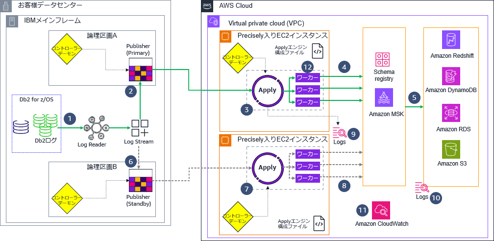
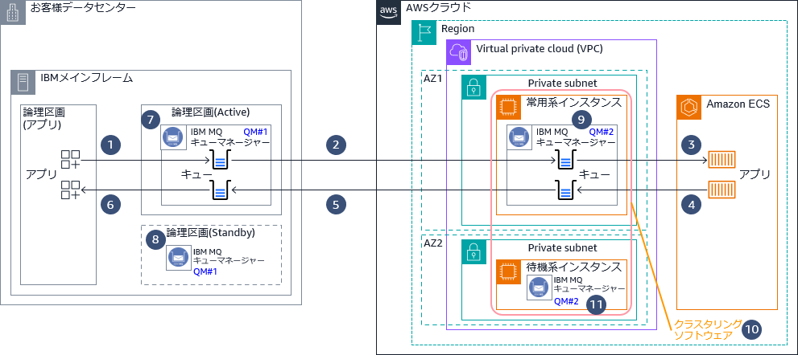
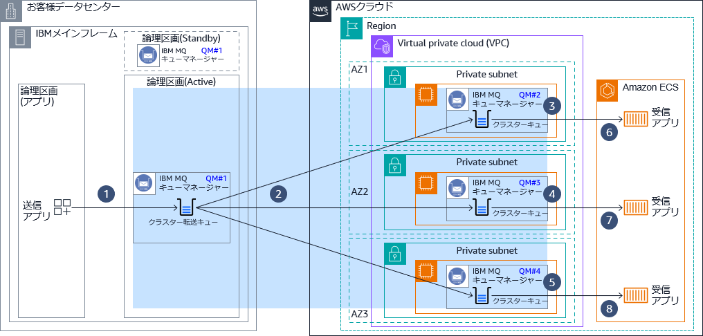
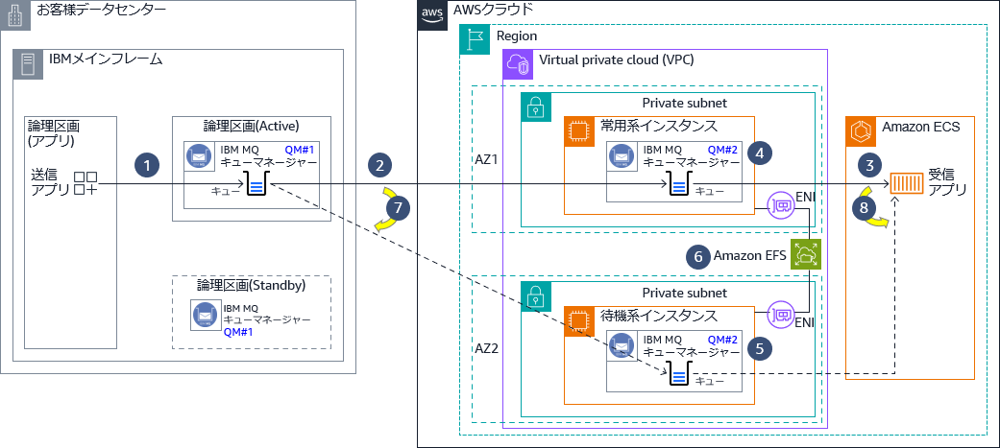
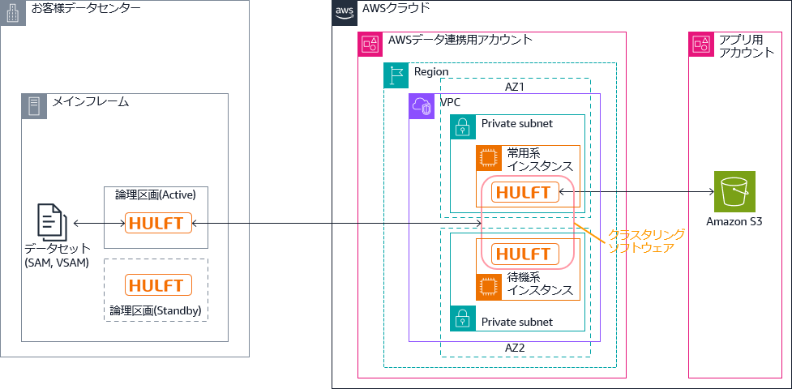

# リファレンスアーキテクチャ解説: メインフレーム連携

本書は、BLEA for FSI (金融リファレンスアーキテクチャ日本版) v1.6 の「メインフレーム連携」アセットの技術解説である。原典のアーキテクチャ解説 (`mf-integration-arch-readme.md`) の技術的内容をすべて収録している。

## 前提条件

- 本リファレンスアーキテクチャにおけるメインフレームとは、固有の命令セットを持つプロセッサーを搭載し、独自 OS の上で大量の業務データを処理する基幹系システムが稼働する大型コンピューターを指す。メインフレーム用の OS の例としては IBM z/OS、富士通 OS IV/MSP、日立製作所 VOS3、日本電気 ACOS-4 等が挙げられる。
- 本リファレンスアーキテクチャにて扱うメインフレーム連携は、メインフレームと AWS の間のデータ連携を対象とする。
- 本リファレンスアーキテクチャで言及するソフトウェア製品の動作を AWS がサポートもしくは保証するものではない。各ソフトウェア製品の前提条件や詳細は提供元に問い合わせること。
  - AWS Mainframe Modernization Data Replication with Precisely がサポートするレプリケーション元の環境は IBM z/OS と IBM i (AS/400) のみである。

---

## 1. データレプリケーション

### ユースケース

金融機関はメインフレームで稼働する各種システムのデータを AWS にレプリケーションすることにより、データの活用や新規サービスの開発を促進する。

- **メインフレームデータを使用した分析や AI / 機械学習**

  メインフレーム上で稼働する各種システム (勘定系、情報系、チャネル系) のデータを AWS 上のデータレイクやデータウェアハウスに取り込み、AWS サービスを活用した解析や AI / 機械学習によりビジネス価値を創出する。

- **メインフレームデータを活用したビジネスイノベーション**

  メインフレーム上のシステムに手を加えることなく、データをニアリアルタイムで AWS に伝播し、AWS サービスを活用して新しいサービスや機能を追加開発して、イノベーションを加速する。モバイルアプリ等により、カスタマーエクスペリエンスを向上させ、新しい市場機会を開拓する。

- **メインフレームアプリケーションのシームレスな移行**

  メインフレームのデータストアから AWS へデータをレプリケーションし、ビジネスアプリケーションの本稼働環境へのスイッチオーバーをダウンタイムほぼゼロでサポートする。

### アーキテクチャ図

AWS Mainframe Modernization Data Replication with Precisely によって Db2 for z/OS から AWS 上のデータベースにレプリケーションするアーキテクチャの例を以下に示す。メインフレーム側の Publisher エージェントはアクティブ/スタンバイ構成で、AWS 側の Apply エージェントはアクティブ/アクティブ構成である。

**レプリケーションの基本動作**

1. Log Reader が Db2 のログをキャプチャーし、カップリングファシリティー (CF) ベースの Log Stream に出力する。
2. IBM メインフレーム上の論理区画 (LPAR) 上のプライマリー Publisher エージェントがログを読み取り、Apply エージェントに発行する。
3. Apply エージェントが Publisher から転送されるデータを読み取る。
4. アクティブな Apply エージェントが Amazon MSK にデータを出力する。
5. Amazon MSK クラスターが AWS のデータストアを更新する。

**待機系にフェールオーバーするときの動作**

6. 論理区画 A のアクティブ Publisher エージェントで障害が発生すると、IBM メインフレーム上の別の論理区画 B 上でスタンバイ Publisher エージェントが動作する。アクティブ Apply エージェントは論理区画 A のアクティブ Publisher エージェントからのデータを読み取れず、処理を中断する。
7. 代替の Apply エージェントは一定のインターバルでスタンバイ Publisher エージェントからのデータ読み取りをリトライする。
8. アクティブだった Apply エージェントがデータの読み取りを中断すると、コントローラーデーモンが代替の Apply エージェントを Amazon MSK に接続する。

**モニタリングの仕組み**

9. Apply エージェントのログは CloudWatch Logs に記録される。
10. データベースのログは CloudWatch Logs に記録される。
11. CloudWatch がログを集約し、表示する。

### アーキテクチャの特徴

前掲のアーキテクチャの主な特徴を以下に示す。

- **メインフレームに対する影響の極小化**
  - メインフレームのアプリケーションやデータを変更せず、AWS クラウドでのデータ活用を促進する。VSAM ファイルのレイアウトを定義した COBOL コピーブックをスキーマ情報として使い、Lambda 関数によって入力データのフォーマットをターゲットのテーブルにマッピングすることができる。
  - メインフレーム側で無く、データの伝播先である AWS クラウドで分析やサービス構築を実装することで、上記の追加開発によるメインフレームの負荷の増大はない。
- **多様なデータソースのサポート**
  - IBM z/OS: Db2 for z/OS, IMS/DB, VSAM
  - IBM i: Db2 for IBM i
- **多様なターゲットのサポート**
  - データベース
    - Amazon RDS: Oracle, Microsoft SQL Server, PostgreSQL, Amazon Aurora PostgreSQL
    - EC2 にインストールしたデータベース: Oracle, Microsoft SQL Server, IBM Db2 for LUW, PostgreSQL
  - ストレージ: Amazon S3
  - ストリーミングサービス: Amazon Managed Streaming for Apache Kafka (MSK)
    - Amazon MSK 経由で上記以外のデータベースへのレプリケーションも可能
- **低遅延で高スループットのデータ同期**
  - データソースからターゲットに対してデータの一貫性を保ちつつ低遅延のレプリケーションを実現することができる。
  - Apply エージェントに複数のワーカー (コネクタロジックを実行する Java 仮想マシン (JVM) プロセス) を設定して Amazon MSK に対してデータを出力することにより (⑫)、必要に応じてスループットの増大を図ることができる。
- **高可用性**
  - z/OS 上の Publisher エージェントをアクティブ/スタンバイ構成にすることで、z/OS 側の Precisely 構成要素の高可用性を実現する。
  - AWS 上にマルチ AZ 構成で複数の EC2 インスタンスを稼働し、Amazon MSK クラスターに連携することにより、AWS 側の Precisely 構成要素の高可用性を実現する。
- **レプリケーションの構成要素の稼働状態の監視**
  - Apply エージェント、MSK、データベースの挿入 / 更新の動作に伴い CloudWatch Logs とメトリクスが記録される。これらのログとメトリクスを監視することで、レプリケーションの構成要素の稼働状態を監視することができる。各構成要素のログとメトリクスを照合すると、どこで問題が発生しているか特定することができる。

### アーキテクチャのバリエーション

Db2 for z/OS から Amazon RDS for Db2 へのレプリケーションは上記以外の構成でも可能である。その方法をいくつか以下に示す。

- **Q レプリケーション**

  Q レプリケーションは、IBM MQ メッセージキューを使用してソースとターゲットのデータベースまたはサブシステム間でトランザクションを伝送する、大容量で低遅延のレプリケーションソリューションである。Q キャプチャープログラムは、指定されたソース表に対する変更を Db2 リカバリーログから読み取り、このトランザクションをメッセージとしてキューに送信する。Q アプライプログラムはキューからメッセージを読み取り、ターゲット表に変更を適用する。

- **SQL レプリケーション**

  SQL レプリケーションは、ソース表とビューに対する変更をキャプチャーし、コミットされたトランザクションデータをステージング表に保管する。続いて、ステージング表から変更内容が読み取られ、対応するターゲット表に複製される。

- **CDC レプリケーション**

  IBM Change Data Capture (CDC Replication) は、データベースの変更を発生時にキャプチャーし、CDC Replication Management Console GUI アプリケーションで構成された表マッピングに基づいて、ターゲットデータベース、メッセージキュー、または ETL ソリューション (IBM DataStage など) に配信するレプリケーションソリューションである。

### 参考情報

- [1] AWS Mainframe Modernization Data Replication with Precisely
  <https://aws.amazon.com/mainframe-modernization/capabilities/data-replication/>
- [2] Amazon RDS for Db2
  <https://aws.amazon.com/jp/rds/db2/>
- [3] Amazon Managed Streaming for Apache Kafka
  <https://aws.amazon.com/jp/msk/>
- [4] AWS Prescriptive Guidance: Replicate mainframe databases to AWS by using Precisely Connect
  <https://docs.aws.amazon.com/prescriptive-guidance/latest/patterns/replicate-mainframe-databases-to-aws-by-using-precisely-connect.html>
- [5] AWS Prescriptive Guidance: Migrate and replicate VSAM files to Amazon RDS or Amazon MSK using Connect from Precisely
  <https://docs.aws.amazon.com/prescriptive-guidance/latest/patterns/migrate-and-replicate-vsam-files-to-amazon-rds-or-amazon-msk-using-connect-from-precisely.html>
- [6] Q レプリケーション
  <https://www.ibm.com/docs/ja/idr/11.4.0?topic=po-q-replication>
- [7] SQL レプリケーション
  <https://www.ibm.com/docs/ja/idr/11.4.0?topic=replication-sql>
- [8] CDC Replication について (InfoSphere CDC for Db2 for z/OS)
  <https://www.ibm.com/docs/ja/idr/11.4.0?topic=replication-infosphere-cdc-db2-zos>

---

## 2. 非同期メッセージング

### ユースケース

金融機関は、メインフレームで稼働する各種システムと AWS 上で稼働するシステムの間の非同期メッセージングにより、アプリケーション間で直接同期的に接続することなく、シンプルな API でデータを授受できる。

IBM MQ は、Point-to-Point (P2P) によるメッセージングと、トピックに対するパブリッシュ/サブスクライブのメッセージングをサポートする。いずれの方式でも、メッセージの入出力のトランザクション属性 (Atomicity, Consistency, Isolation and Durability: ACID) が保証される。

メインフレームと AWS のアプリケーションは、いずれもメッセージをキューに書き込む起点になることができる。メッセージに相関 ID (correlation ID) を指定すると、通信相手のアプリケーションとの間で、要求-応答のように対応付けてメッセージを授受することができる。

メインフレーム側のみにキューマネージャーを立てて、AWS 側のアプリが MQ クライアント経由でキューマネージャーにアクセスする構成も可能である。しかし、この方式は以下の課題がある。

- 複数の MQ クライアントからのアクセスがメインフレーム側のキューマネージャーに集中し、メインフレームの負荷が増加する場合がある。メインフレームが過負荷にならないようにするのがベストプラクティスである。
- メインフレーム側のキューマネージャーがダウンすると、MQ クライアントからのアクセスが失敗し、アプリケーションでエラーが発生する。ローカルにキューマネージャーを立てておけば、宛先のキューマネージャーがダウンしていても、アプリケーションはローカルキューに対してメッセージを授受することができる。

上述のような課題を回避するため、メインフレーム側と AWS 側それぞれにキューマネージャーを立てて、キューマネージャー間にチャネル接続を確立するのがベストプラクティスである。IBM MQ のキューマネージャー(※1)の可用性を高める構成は複数あるが、その中で代表的なものを 3 つ取り上げる。

|                      | 2.1 高可用性 (HA) 構成                                                                                 | 2.2 MQ クラスター                                                                                                                                                                                                            | 2.3 複数インスタンスキューマネージャー構成                     |
| -------------------- | ------------------------------------------------------------------------------------------------------ | ---------------------------------------------------------------------------------------------------------------------------------------------------------------------------------------------------------------------------- | -------------------------------------------------------------- |
| メッセージの順序性   | フェールオーバー前後を通じて維持される                                                               | 維持されない。したがって、金融取引等メッセージの順序性を維持する要件がある場合は、この構成を取ることができない。                                                                                                         | フェールオーバー前後を通じて維持される                       |
| 持続メッセージの保証 | 持続メッセージはフェールオーバー先のキューマネージャーに引き継がれ、フェールオーバー前後で維持される | 障害発生時にキューマネージャーが保持している持続メッセージは、当該キューマネージャーが再始動するとログデータから回復される。障害等で持続メッセージが利用不能になる時間を短縮するには、高可用性 (HA) 構成と組み合わせる。 | 持続メッセージは永続化され、フェールオーバー前後で維持される |
| RTO                  | 数分                                                                                                   | N/A (サービスが中断されない)                                                                                                                                                                                               | 30 秒 ~ 数分                                                   |
| 前提ソフトウェア等   | クラスタリングソフトウェアの導入が必要(※2)                                                  |                                                                                                                                                                                                                              | ファイル共有が必要(※3)                              |

- (※1) キューマネージャー: キューマネージャーが、キューやチャネルを管理し、アプリケーションに対してメッセージングサービスを提供する。キューマネージャーはローカルキューにメッセージを格納する。キューマネージャーがメッセージのトランザクション制御を行う。
- (※2) Windows Server の場合 Microsoft Cluster Service (MSCS)、Red Hat Enterprise Linux の場合 Red Hat Enterprise Linux cluster with Red Hat Cluster Suite 等。
- (※3) Amazon Elastic File System (EFS) や、Amazon FSx for Windows File Server 等。

### 2.1 高可用性 (HA) 構成 (アクティブ/スタンバイ)

アクティブ/スタンバイ構成とすることにより、障害発生時にキューマネージャーをフェールオーバーすることができる。クラスタリングソフトウェアにより、ディスクやネットワークアドレスをサーバー間で引き継ぐ。仕掛かり中のトランザクションがある状態で障害が発生すると、トランザクションはロールバックされる。通信相手のキューマネージャーや MQ クライアントは、障害検知後にフェールオーバー先のキューマネージャーに再接続する。

**非同期メッセージングの基本動作**

1. メインフレーム上のアプリケーションがキューマネージャー QM#1 のキューに対してメッセージを書き込む。
2. キューマネージャー QM#1 は、キューに書き込まれたメッセージをキューマネージャー QM#2 のキューに転送する。
3. AWS 上のアプリケーションがキューマネージャー QM#2 のキューからメッセージを読み取る。
4. ④⑤⑥ AWS 上のアプリケーションが起点になる場合の処理順序を示す。

**メインフレーム側が待機系にフェールオーバーするときの動作**

7. アクティブな論理区画のキューマネージャー QM#1 で障害が発生すると、オペレーターが該当の論理区画の OS をシャットダウンするか、キューマネージャーを停止する。
8. 次にスタンバイの論理区画の OS をオペレーターが起動し、キューマネージャー QM#1 を始動すると、両区画で共用するストレージを介してキューの状態が引き継がれ、処理が再開される。アプリケーションがキューに書き込んだ持続メッセージは、QM#1 の再開後にキューマネージャー QM#2 に転送される。非持続メッセージは、QM#1 の障害/停止により破棄されるため、アプリケーションから再送する必要がある。

**AWS 側が待機系にフェールオーバーするときの動作**

9. 常用系インスタンスで障害が発生すると、⑩ クラスタリングソフトウェアが ⑪ 待機系インスタンスに切り替える。このときにクラスター IP アドレスが引き継がれ、他システムからアクセスする通信相手は見かけ上は以前と変わらない。両インスタンスのストレージはクラスタリングソフトウェアが障害発生時点まで複製しており、同一の内容を保持する。待機系だったインスタンスで稼働するキューマネージャー QM#2 が障害発生時点の内容を引き継ぎ、処理が再開される。

### 2.2 MQ クラスター (アクティブ/アクティブ)

MQ クラスターを構成する各キューマネージャーに対して、ラウンドロビンでメッセージが振り分けられる。キューマネージャーの 1 つがダウンすると、クラスターから切り離され、残りの正常に稼働しているキューマネージャーにメッセージが振り分けられる。この仕組みにより、RTO を極小化することができる。ダウンしたキューマネージャーが管理するキュー内のメッセージは、該当のキューマネージャーが復旧するまで利用できない。そのため、要件に応じて高可用性 (HA) 構成と組み合わせて利用する。このアーキテクチャは、クラスタリングソフトウェアによるインスタンス間の同期を前提としないため、コンテナーでの IBM MQ 実行を検討しても良い。以下のアーキテクチャ図は、煩雑になるのを避けるため、メインフレーム側から AWS 側へのメッセージ送信のみ記載する。

**非同期メッセージングの基本動作**

1. メインフレーム上のアプリケーションがクラスターキューに対してメッセージを書き込む。このメッセージは、キューマネージャー QM#1 上のクラスター転送キューに一時的に保持される。
2. キューマネージャー QM#1 は、メッセージをキューマネージャー ③QM#2, ④QM#3, ⑤QM#4 のキューにラウンドロビン等で自動的に振り分けて転送する。
6. ⑥⑦⑧ AWS 上のアプリケーションがキューマネージャー ③QM#2, ④QM#3, ⑤QM#4 のキューからメッセージを読み取る。

**AWS 側のキューマネージャーが障害等で利用不能になったときの動作**

例えば、キューマネージャー ③QM#2 で障害が発生すると、キューマネージャー QM#1 がそれを検知して振り分けの対象から除外する。以後は、残りのキューマネージャー ④QM#3, ⑤QM#4 に対してメッセージが振り分けられる。

### 2.3 複数インスタンスキューマネージャー構成 (アクティブ/ウォームスタンバイ)

高可用性 (HA) 構成と異なり、フェールオーバー時にネットワークアドレスが引き継がれないが、通信相手のキューマネージャーや MQ クライアントは、自動フェールオーバー後のキューマネージャーに再接続できる。なお、この構成は AWS 上のキューマネージャーで実現可能である。z/OS 側は複数インスタンスキューマネージャーをサポートしていない。以下のアーキテクチャ図は、煩雑になるのを避けるため、メインフレーム側から AWS 側へのメッセージ送信のみ記載する。

**非同期メッセージングの基本動作**

1. メインフレーム上のアプリケーションがキューマネージャー QM#1 のキューに対してメッセージを書き込む。
2. キューマネージャー QM#1 は、キューに書き込まれたメッセージをキューマネージャー QM#2 のキューに転送する。
3. AWS 上のアプリケーションがキューマネージャー QM#2 のキューからメッセージを読み取る。

**AWS 側が待機系にフェールオーバーするときの動作**

4. 常用系のキューマネージャーの稼働状況は、⑤ 待機系のキューマネージャーがチェックしている。
5. 待機系のキューマネージャーは、④ 常用系のキューマネージャーの障害を検知すると、自動的にフェールオーバーし、自らがアクティブになる。
6. キューの内容やトランザクションの状態は Amazon EFS のような共有ストレージに記録され、フェールオーバー前後で引き継がれる。
7. キューマネージャー QM#1 の宛先として、キューマネージャー QM#2 の ④⑤ 両方を記述しておくと、フェールオーバー発生によりアクティブになった ⑤ インスタンスに自動再接続する。
8. アプリケーション側の IBM MQ クライアントライブラリーは、障害を検知してキューマネージャーに再接続する。フェールオーバーが発生すると、アクティブになった ⑤ インスタンスに接続先が切り替わる。

### 参考情報

- [1] MQ 虎の巻: 11. 高可用性設計
  <https://community.ibm.com/community/user/integration/viewdocument/mq-11-1>
- [2] IBM MQ 高可用性の構成
  <https://www.ibm.com/docs/ja/ibm-mq/9.4?topic=restart-high-availability-configurations>
- [3] IBM MQ typical architecture
  <https://docs.aws.amazon.com/amazon-mq/latest/migration-guide/ibm-mq-typical-architecture.html>
- [4] Event-Driven Architecture for ISO 20022 Messaging Workflows on AWS
  <https://aws.amazon.com/jp/blogs/industries/event-driven-architecture-for-iso-20022-messaging-workflows-on-aws/>
- [5] コンテナーでの IBM MQ の計画
  <https://www.ibm.com/docs/ja/ibm-mq/9.4?topic=integration-planning>

---

## 3. ファイル転送

### ユースケース

金融機関は、メインフレームで稼働する各種システムと AWS の間のファイル転送により、外部システム連携や、データのバックアップやアーカイブにクラウドを活用できる。

- **外部システム連携**

  メインフレーム上で稼働する各種システム (勘定系、情報系、チャネル系) のファイルを AWS に転送し、データベース更新やレポーティング等のバッチ処理に活用する。AWS 上のアプリケーションが作成したデータをメインフレームにファイル転送し、メインフレーム上のバッチ処理でデータベース更新や帳票出力を行う。

- **メインフレームデータを使用した分析や AI / 機械学習**

  メインフレーム上で稼働する各種システム (勘定系、情報系、チャネル系) のデータを AWS 上のデータレイクやデータウェアハウスに取り込み、AWS サービスを活用した解析によりビジネス価値を創出する。

- **メインフレームデータのバックアップ**

  メインフレーム上で稼働する各種システム (勘定系、情報系、チャネル系) のデータやログのバックアップを AWS 上のストレージに保管する。

- **メインフレームアプリケーションのクラウド化に伴うデータ移行**

  メインフレーム上のデータを AWS にファイル転送し、アプリケーションの AWS 移行中の AWS 側でのテストに利用する。AWS に移行したシステムへの切り替えに際して、メインフレームからのデータ移行に利用する。

### アーキテクチャ図

金融機関におけるメインフレームとオープン系でのファイル転送では、HULFT が一般的に利用されており、AWS 環境でも HULFT の機能を活用したい場合がある。HULFT によってメインフレームと AWS の間のファイル転送を実現するアーキテクチャ例を以下に示す。

- HULFT for z/OS と AWS 上の HULFT の間で、ファイル転送時のデータの変換を行う。無変換でバイナリー転送することができる他、テキストとして転送する場合は、それぞれのプラットフォーム間の文字コードへの変換を伴うファイル転送が可能である。固定長データのレイアウトに応じたデータ項目単位のデータ型の変換も可能である。
- ファイル転送の前後のタイミングで自動的に実行するジョブを、配信前ジョブ、配信後ジョブ、集信後ジョブとして登録しておくことができる。
- AWS 上の HULFT をアクティブ/スタンバイ構成にする場合は、HULFT がサポートするクラスタリングソフトウェアにより、両インスタンス間でデータ同期を行う必要がある。
- HULFT クラウドストレージオプションを使うと、Amazon S3 バケットのオブジェクトを直接入出力することができる。

### アーキテクチャの特徴

前掲のアーキテクチャの主な特徴を以下に示す。

- **メインフレームに対する影響の極小化**
  - メインフレームのアプリケーションやデータを変更せず、AWS クラウドでのデータ活用を促進する。
- **転送したファイルをメインフレームおよび AWS で活用可能**
- **高可用性**
  - クラスタリングソフトウェアによる制御の下で、AWS 上にマルチ AZ 構成で複数の EC2 インスタンスを稼働し、HULFT を実行することにより、高可用性を実現できる。クラスタリングソフトウェアの一覧は、参考情報 [2] を参照。
- **コスト最適化**
  - バックアップファイルを Amazon S3 バケットに保管すれば、メインフレームに保管する場合と比較すると、コストを節約することができる。Amazon S3 バケットのクロスリージョンレプリケーションを災害対策用に設定したり、長期保存用アーカイブとして Amazon S3 のストレージクラスを設定することができる。運用要件によっては、従来のテープベースのシステムを代替することができる。

### アーキテクチャのバリエーション

ファイル転送途中のエラー発生時のリトライや、項目単位のデータ変換 / 文字コード変換が不要であれば、ftp もしくは sftp によるファイル転送も選択肢になる。z/OS Communication Server の ftp サーバーを構成すると、AWS Transfer Family によって AWS 上のストレージとの間で ftp によるファイル転送が可能になる。z/OS OpenSSH を構成すると sftp によるファイル転送が可能になる。メインフレームと AWS 間のファイル転送を実現するソリューションは上記以外にもある。

### 参考情報

- [1] HULFT8 マニュアル
  <https://www.hulft.com/help/ja-jp/HULFT-V8/>
- [2] HULFT8 動作環境
  <https://www.hulft.com/software/hulft-8/os>
- [3] AWS Transfer Family
  <https://aws.amazon.com/jp/aws-transfer-family/>
- [4] AWS Prescriptive Guidance: Move mainframe files directly to Amazon S3 using Transfer Family
  <https://docs.aws.amazon.com/prescriptive-guidance/latest/patterns/move-mainframe-files-directly-to-amazon-s3-using-transfer-family.html>
- [5] AWS Prescriptive Guidance: Transfer large-scale Db2 z/OS data to Amazon S3 in CSV files
  <https://docs.aws.amazon.com/prescriptive-guidance/latest/patterns/transfer-large-scale-db2-z-os-data-to-amazon-s3-in-csv-files.html>

---

## 商標

IBM、Db2、IBM Z、IMS/ESA、MQSeries、z/OS は、International Business Machines Corporation の商標または登録商標である。
VOS3/LS および VOS3/US は株式会社 日立製作所の商標または登録商標である。
Red Hat および Red Hat Enterprise Linux は、米国およびその他の国における Red Hat, Inc. の登録商標である。
Linux は、米国およびその他の国における Linus Torvalds 氏の登録商標である。
Microsoft、SQL Server、Windows、Windows Server は、米国およびその他の国における米国 Microsoft Corporation の登録商標または商標である。
Oracle は Oracle Corporation および/またはその子会社もしくは関連会社の登録商標である。
PostgreSQL は、PostgreSQL Community Association of Canada のカナダにおける登録商標およびその他の国における商標である。
Apache、Apache Kafka、KAFKA は Apache Software Foundation の登録商標である。
HULFT は株式会社セゾンテクノロジーの登録商標または商標である。
その他、記載されている会社名、製品名は、各社の登録商標または商標である。
