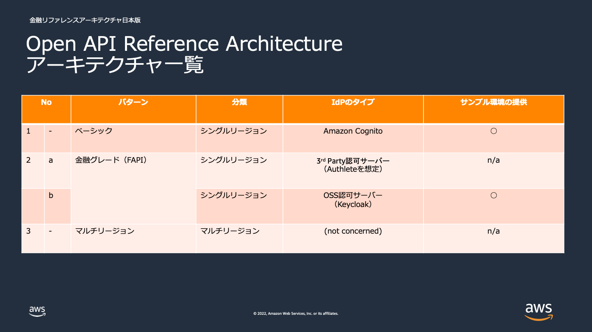
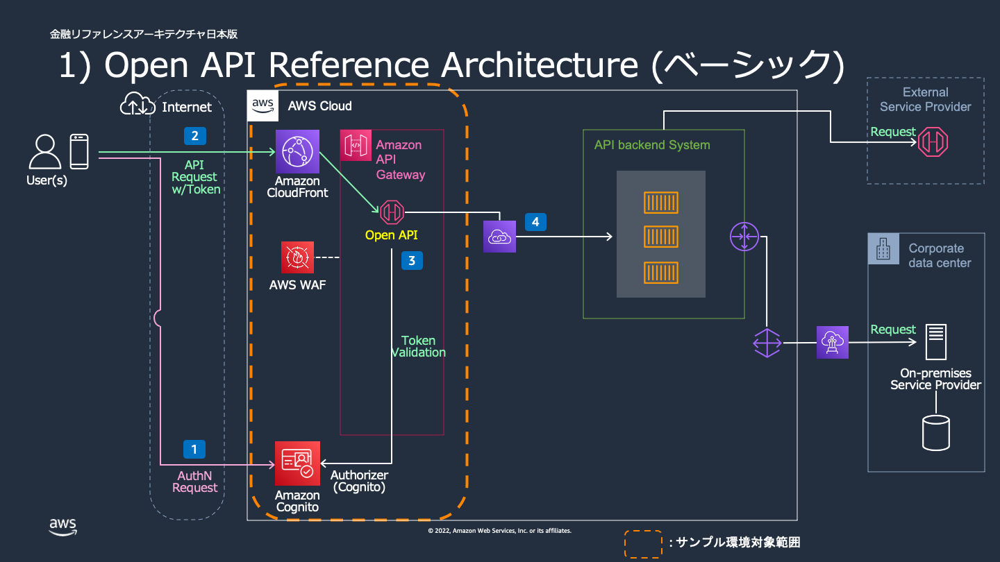
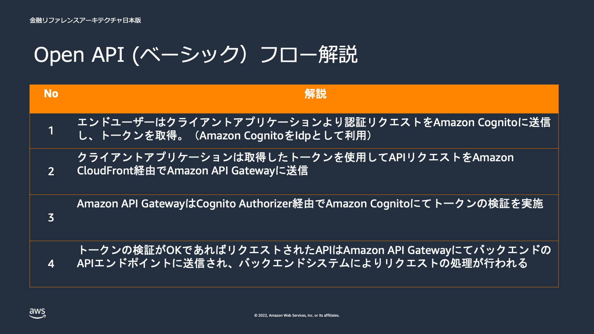
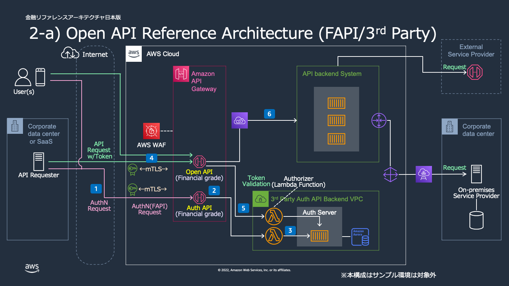
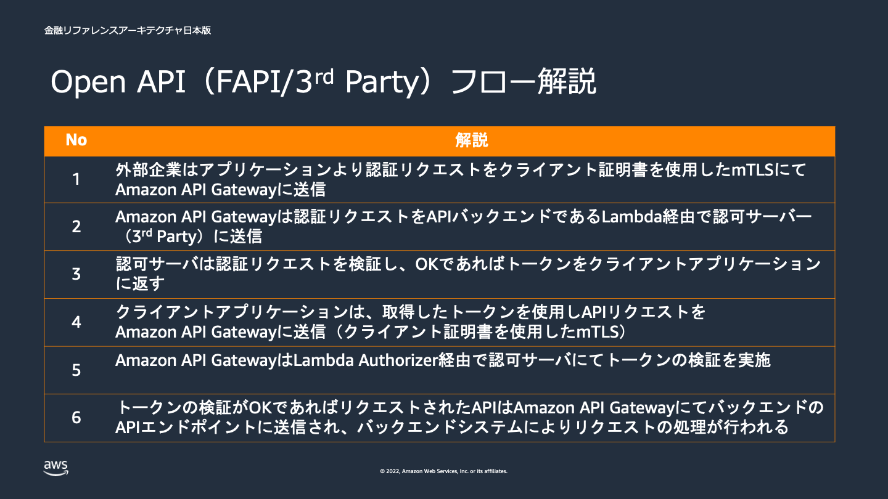
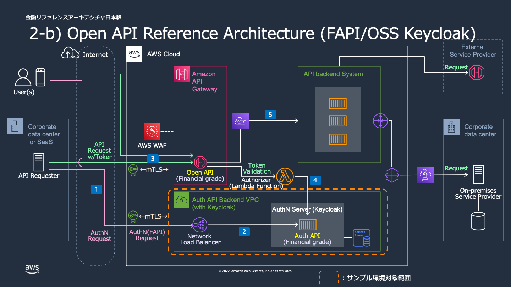
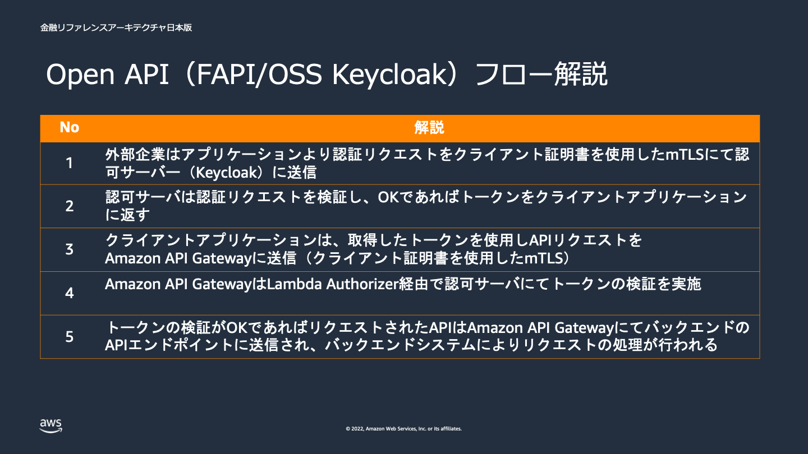
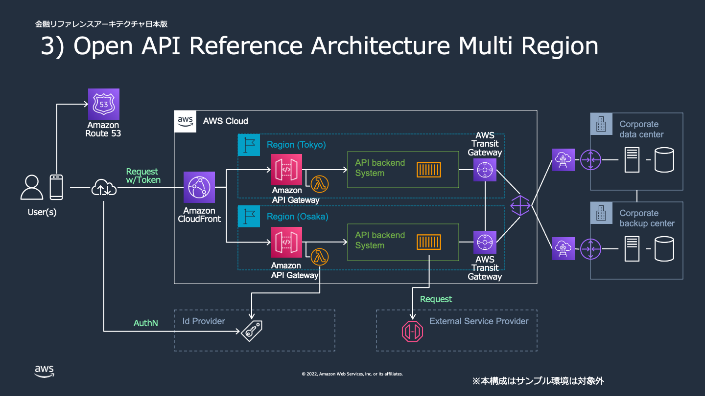

# リファレンスアーキテクチャ解説 [オープン API]

本書は、金融リファレンスアーキテクチャ日本版（BLEA for FSI）の「オープン API」ワークロードのアーキテクチャ解説である。

## 前提条件

- 本リファレンスアーキテクチャにおける「オープン API」とは、[全銀協の定義](https://www.fsa.go.jp/singi/singi_kinyu/financial_system/siryou/20161028/02.pdf)に基づき “サードパーティ（外部企業等）からアクセス可能な API” である。
- 本リファレンスアーキテクチャで扱う API は、付与する権限範囲において以下を対象とする。
  - 参照・照会系 API
  - 更新・実行系 API
- 本リファレンスアーキテクチャでは、以下の仕様は必ずしも前提としない。
  - OpenAPI 仕様のドキュメント規格である Open API Specification (Swagger) で定義されていること
  - 金融グレードアクセスの仕様である Financial grade API (FAPI) に準拠していること
  - ID 認証/認可の仕様である OAuth2、OpenID Connect に準拠していること

## ユースケース

金融機関が個人やサードパーティー（外部企業など）に対して、アクセス可能な API を通じて以下のようなサービスを提供することを想定している。

- **ベーシック API アクセス**
  - 主にエンドユーザからのアクセスを想定
  - 株価・為替相場情報照会、銀行残高照会、ポイント照会など
- **金融グレード API（FAPI）アクセス**
  - 主に Fintech 企業など外部の企業からのアクセスを想定
  - 金融グレードのアクセスが求められるワークロード
  - 株式・投信売買指図、資金移動（振込・振替）など

## アーキテクチャの特徴

### ベーシック API アクセス

- ユーザ認証として、ウェブおよびモバイルアプリの認証・承認・ユーザー管理機能を提供する Amazon Cognito を採用する。
- API の作成・公開・保守・モニタリング・保護として、Amazon API Gateway などのフルマネージドサービスを採用する。

### 金融グレード API（FAPI）アクセス

- 金融グレードのアクセスである Financial grade API (FAPI) に準拠するため、ユーザ認証として認可サーバーを、API アクセス時には相互 TLS による認証・暗号化を採用する。
- 認可サーバーの提供形態として、以下の 2 パターンに関するアーキテクチャを提供する（サンプル環境の提供は OSS のパターンのみ）。
  - 3rd パーティー製：Authlete を想定
  - OSS（Open Source Software）：Keycloak
- 本アーキテクチャは、FAPI 1.0 仕様の挙動を開発・テスト目的として確認する用途を想定したものである。

### 災害対策

- 関東広域被災発生時などの災害対策として、マルチリージョン（例：東京リージョンおよび大阪リージョン）構成を採用する。
- OpenAPI の構成が各リージョンごとにそれぞれ配置され、Route 53 によりリージョンへリクエストが振り分けられる構成となる。
- どのようにリクエストを振り分ける、もしくは切り替えるかは、API バックエンドシステムのポリシーに依存する。
- 本リファレンスアーキテクチャでは、ID 認証部分はリージョン間での認証情報の同期が必要ない、外部 IdP を利用する構成としている。

## アーキテクチャ図

- アーキテクチャ一覧

- ベーシック API アーキテクチャ図

- ベーシック API データフロー

- 金融グレード API(FAPI/3rd Party) アーキテクチャ図

- 金融グレード API(FAPI/3rd Party) データフロー

- 金融グレード API(FAPI/OSS) アーキテクチャ図

- 金融グレード API(FAPI/OSS) データフロー

- マルチリージョン・アーキテクチャ図

## FAPI（金融グレード API）に関する補足

### FAPI 1.0 について

- [FAPI (Financial-grade API) 1.0](https://openid.net/2021/03/12/fapi-1-0-part-1-and-part-2-are-now-final-specifications/) は、[OpenID Foundation Financial-grade API (FAPI) ワーキンググループ](https://openid.net/wg/fapi/) が策定する、OAuth2.0 や OpenID Connect 1.0 で規定された内容をベースに、“金融グレード”の、よりセキュアな API 通信を実現するための仕様である。
- FAPI 自体は金融領域に限定されず、高いセキュリティ基準が必要な API 全般に有効なものとして策定されている。
- FAPI 1.0 Security Profile では、以下の 2 つが規定されている。
  - [FAPI 1.0 - Baseline Security Profile](https://openid.net/specs/openid-financial-api-part-1-1_0.html)
  - [FAPI 1.0 - Advanced Security Profile](https://openid.net/specs/openid-financial-api-part-2-1_0.html)

### 認可サーバー（Keycloak）について

- 本 FAPI サンプル環境では、FAPI 1.0 Security Profile に対応した認可サーバーとして OSS の [Keycloak](https://www.keycloak.org/) バージョン 26.7.1 を利用する。
- Keycloak は過去に OpenID Foundation の FAPI 1.0 Advanced OP Certification を[取得](https://openid.net/certification/certified-fapi1-adv-openid-providers-profiles/)しており（Keycloak 15.0.2、2021年10月11日、MTLS/Private Key × by_value/pushed × JARM 有無の 8 プロファイル）、本サンプルで利用する 26.7.1 でも FAPI 1.0 Security Profile（Baseline / Advanced）に対応した実装を継続してサポートしている（Keycloak 公式リリースノートでは 26.4.0 以降 "FAPI 2 Final (supported)" として FAPI 2.0 対応も明記されている）。
- コンテナイメージは、Quarkus ベースの公式配布先である [quay.io/keycloak/keycloak](https://quay.io/repository/keycloak/keycloak) を利用する。以前は DockerHub の「[jboss/keycloak](https://hub.docker.com/r/jboss/keycloak/)」（WildFly ベース、16.1.1 で終了）を参照していたが、同リポジトリが DockerHub 上で廃止されたため移行した。WildFly 版と Quarkus 版は環境変数・起動コマンド・証明書設定の方式が異なる（詳細は [deployment.md](deployment.md) を参照）。
- 本 FAPI サンプル環境には、リソースサーバー(Resource Server)側のアプリケーション（API ならびにその実装）は含まれない。
  - リソースサーバーとしては、Amazon API Gateway の API およびそのバックエンド（Lambda 関数など）を利用することが可能である。
- 補足事項
  - 本ドキュメントに、FAPI 1.0 Security Profile ならびに関連仕様の解説は含まれない。
  - FAPI サンプル環境には、アプリケーション（クライアントアプリケーション、リソースサーバーならびに API とその実装）は含まれない。
  - 本サンプル環境では Keycloak を利用しているが、FAPI に対応する認可サーバーは商用プロダクトを含めて複数の選択肢が存在する。

### 相互 TLS（mTLS）のサーバー証明書とクライアント証明書について

- FAPI 1.0 Advanced Security Profile のクライアントに紐付けられたトークンの伝送のために、相互 TLS(Mutual TLS, mTLS)を必要とする。
  - クライアントは、FAPI 1.0 仕様に基づいて「トークンの発行をリクエストする対象の認可サーバー」と「トークンを付加してリクエストする対象のリソースサーバー」との通信の両方で、同一のクライアント証明書を用いた相互 TLS 通信が必要である。
- 用いるサーバー証明書の有効期限を認識し、失効タイミングより前に、サーバー証明書とクライアント証明書の双方を適切に更新する必要があることに留意する。
- Amazon API Gateway をリソースサーバーとして用いる場合は、以下のドキュメントを参照する。
  - 参考：「[REST API の相互 TLS 認証の設定](https://docs.aws.amazon.com/ja_jp/apigateway/latest/developerguide/rest-api-mutual-tls.html)」
  - 参考：「[HTTP API の相互 TLS 認証の設定](https://docs.aws.amazon.com/ja_jp/apigateway/latest/developerguide/http-api-mutual-tls.html)」
- Amazon API Gateway をリソースサーバーとして用いる場合、以下の点にも留意する。
  - Amazon API Gateway の相互 TLS 認証機能は、クライアント証明書の失効を確認しない。Lambda Authorizer を利用して検証ロジックを実装する必要がある。
  - Amazon API Gateway の相互 TLS 認証機能は、CRL(Certificate Revocation List, 証明書失効リスト)に対応しない。必要に応じて Lambda Authorizer を利用して CRL 対応を実装する必要がある。

## CDK サンプルのアーキテクチャ構成（実装からの確認事項）

以下は提供される 2 つの CDK サンプルの実装から確認できる構成である。

### ベーシック API サンプル（guest-openapi-base-sample）

- **Amazon Cognito**（`lib/cognito.ts`）
  - ユーザープール名：`apiUserPool`。セルフサインアップ無効。
  - 標準属性：email（必須・変更可）、電話番号（必須）。
  - パスワードポリシー：最小 8 文字、小文字・大文字・数字・記号を要求、一時パスワード有効期間 7 日。
  - サインインは email エイリアス、大文字小文字を区別しない。email 自動検証。アカウント復旧は email のみ。
  - MFA：OPTIONAL（SMS）。
  - ユーザープールクライアント：`apiUserPoolClient`。シークレット生成なし。認証フロー：adminUserPassword / userSrp / userPassword を有効化。
  - Lambda 関数：`HelloHandler`（Node.js 22.x、`lambda/hello.js` を実行）。
- **Amazon API Gateway**（`lib/api-gw.ts`）
  - `sample-api` という REST API。Cognito ユーザープール Authorizer（`CognitoAuthorizer`）を使用。
  - デプロイオプション：データトレース有効、ログレベル INFO、アクセスログを CloudWatch Logs（保持 365 日）へ CLF フォーマットで出力。
  - `{proxy+}` リソースに GET メソッドを定義し、Cognito 認可のうえ Lambda 統合（プロキシ）。
  - リージョナルのカスタムドメイン（`customdomainName`）を設定し、ACM 証明書（`certIdarnApigw`）を割り当てる。
- **AWS WAF（WAFv2）**（`lib/waf-apigw.ts`）
  - `sample-waf-web-acl-apigw` という REGIONAL スコープの WebACL。デフォルトアクションは allow。
  - AWS マネージドルールグループを 5 種適用（いずれも overrideAction: count）。
    - AWSManagedRulesCommonRuleSet
    - AWSManagedRulesKnownBadInputsRuleSet
    - AWSManagedRulesAmazonIpReputationList
    - AWSManagedRulesLinuxRuleSet
    - AWSManagedRulesSQLiRuleSet
  - API Gateway の `prod` ステージ（ap-northeast-1）に WebACL を関連付ける。
- **Amazon CloudFront**（`lib/cloudfront.ts`）
  - `OpenApiDistribution`。オリジンは API Gateway カスタムドメイン（HttpOrigin）。
  - キャッシュポリシー `cachePolicyForApiGateway`：Brotli/Gzip 有効、`Authorization` ヘッダーをキャッシュキーに含める。
  - ビューワープロトコルポリシー：HTTPS_ONLY。許可メソッド：GET/HEAD。
  - 代替ドメイン名（`alterdomainName`）と ACM 証明書（`certIdarnCf`）を設定。
  - PriceClass：PRICE_CLASS_ALL。地域制限：allowlist（US, GB, JP）。
  - ログ用 S3 バケット（`AppLogBucket`）：パブリックアクセスブロック、S3 マネージド暗号化、SSL 強制、バージョニング有効。CloudFront のみからのアクセスを許可するバケットポリシーを付与。

### FAPI サンプル（guest-openapi-fapi-sample）

- **VPC**（`lib/shared/vpc.ts`）
  - maxAzs: 2。サブネット構成（各 /24、TGW アタッチメント予約は /28）。
    - Public（NAT GW と NLB）
    - Protected（PRIVATE_WITH_EGRESS、ECS Fargate タスク）
    - Private（PRIVATE_ISOLATED、Aurora MySQL クラスター）
    - ForTgwAttachments（PRIVATE_ISOLATED、将来拡張用予約）
  - VPC フローログを取得し、CMK（キーローテーション有効）で暗号化した S3 バケットへ ALL トラフィックを出力。
  - Public サブネット向けの NACL（Ingress/Egress とも全許可の設定例）。
  - VPC エンドポイント：CloudWatch Logs（Interface）、ECR（Interface）、ECR Docker（Interface）、S3（Gateway）。
- **Keycloak**（`lib/shared/keycloak.ts`、`lib/primary/bleafsi-guest-openapi-fapi-stack.ts`）
  - `KeycloakVersion` により Keycloak バージョンを管理（15.0.0 / 15.0.1 / 15.0.2 / 16.1.1（旧 `jboss/keycloak`、WildFly ベース） / 26.7.1（現行 `quay.io/keycloak/keycloak`、Quarkus ベース）など。`of()` でカスタム指定可能）。スタックでは `keycloakContainerVersionTag`（既定 26.7.1）を使用。
  - **データベース（Database）**：`auroraServerlessV1` フラグや `singleDbInstance` により、Aurora Serverless v1 / 単一 RDS インスタンス / Aurora MySQL クラスターを切り替え。
    - RDS クラスター：Aurora MySQL（VER_2_11_1）、defaultDatabaseName `keycloak`、削除保護あり、バックトラック 24 時間、バックアップ保持 7 日、ストレージ暗号化、removalPolicy RETAIN。
    - 単一 RDS インスタンス：MySQL 8.0.21、r5.large、バックアップ 7 日、ストレージ暗号化。
    - Aurora Serverless v1：AURORA_MYSQL、バックアップ 7 日、削除保護あり、removalPolicy RETAIN。
    - DB のシークレットは自動生成（`admin`）。同一 SG 内および VPC CIDR 全体から 3306 番ポートへの接続を許可。
    - スタック本体では `auroraServerlessV1: false` を指定（＝クラスター構成）。
  - **ECS Fargate サービス（FargateContainerService）**：
    - ECS クラスター（Container Insights 有効）。
    - タスク定義：CPU 1024 / メモリ 2048 MiB。
    - Keycloak コンテナイメージは ECR リポジトリ（`keycloakContainerImageName`、既定 `fapidemo/keycloak`）からタグ指定で取得。コンテナ起動コマンドとして `start`（本番モード）を指定。
    - 環境変数：`KC_DB=mysql`、`KC_DB_URL_HOST`（DB エンドポイント）、`KC_DB_URL_DATABASE=keycloak`、`KC_DB_USERNAME=admin`、`KC_DB_URL_PROPERTIES=?useSSL=false`、`KC_HTTPS_CERTIFICATE_FILE`/`KC_HTTPS_CERTIFICATE_KEY_FILE`（コンテナイメージ内の証明書ファイルパス）、`KC_CACHE=ispn`/`KC_CACHE_STACK=jdbc-ping`（DB 経由のノード探索、旧 WildFly 版の `JGROUPS_DISCOVERY_PROTOCOL=JDBC_PING` に相当）、`KC_HOSTNAME_STRICT=false`（本番モード起動に必要、詳細は SECURITY_NOTICE.md）。
    - シークレット（Secrets Manager 由来）：`KC_DB_PASSWORD`、`KC_BOOTSTRAP_ADMIN_USERNAME`、`KC_BOOTSTRAP_ADMIN_PASSWORD`（bootstrap admin、初回ログインまたは一定時間で失効する一時的な管理者アカウント）。
    - ポートマッピング：8443（HTTPS）、7800（TCP、jgroups。Infinispan の embedded トランスポートが
      `KC_CACHE_STACK=jdbc-ping` 環境下でバインドする既定ポート）、57800（TCP、jgroups の FD_SOCK2 障害検知。
      既定の TCP スタック定義（Infinispan `default-jgroups-tcp.xml`）で `bind_port + 50000` のオフセットで
      別ソケットを開く仕様のため、7800 とは独立したポートとして開放する必要がある）。旧 WildFly 版が
      使っていた 4 ポート構成（jgroups-tcp/tcp-fd/udp/udp-fd）のうち UDP 系（MPING）の対応物は Quarkus 版の
      既定スタックには存在しない。Keycloak 26.7.1 および Infinispan 16.0.12 のソース
      （`CachingOptions.java`、`JGroupsConfigurator.java`、`default-jgroups-tcp.xml`、JGroups
      `FD_SOCK2.java`）で確認済み。
    - 実行ロールに `AmazonEC2ContainerRegistryReadOnly` を付与。
    - サービス：desiredCount 2、ヘルスチェック猶予 120 秒。オートスケール min 2 / max 10、CPU 使用率 80% でスケール。
    - **Network Load Balancer（NLB）**：インターネット向け、クロスゾーン有効。TCP 443 リスナー → ターゲット 8443（TCP、preserveClientIp false）。ターゲットグループに source_ip スティッキネスを設定。
  - **AWS Secrets Manager**：Keycloak 管理者用シークレット `KCSecret`（username 固定 `keycloak`、password は 12 文字自動生成）。
