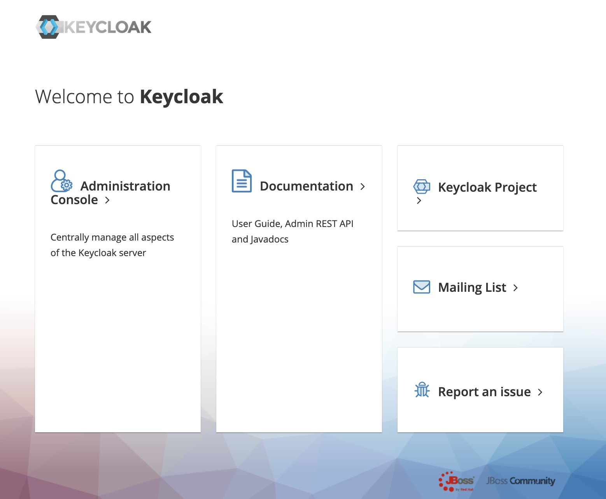

# デプロイ手順 [オープン API]

本書は、BLEA for FSI のガバナンスベースがデプロイされたアカウントに、オープン API の 2 つのサンプル環境（ベーシック API / 金融グレード FAPI）を導入する手順である。いずれも `MC` はマネジメントコンソールでの作業、`Local` は手元環境での作業を示す。

> **作業ディレクトリについて**: 本スキルは読み取り専用のテンプレート提供元である。SKILL.md や
> references 等の CDK 実行に不要なファイルはコピーせず、**CDK 実行に必要な次の 2 つだけ**を、相対参照
>（各 usecase の `tsconfig.json` の `extends: "../../tsconfig.base.json"` — `assets/sample-cdk/<usecase>/`
> から見て 2 階層上の `assets/` を指す）が保たれる形で作業ディレクトリ `<workdir>` にコピーする:
>
> - `assets/sample-cdk/` → `<workdir>/assets/sample-cdk/`（`guest-openapi-base-sample` /
>   `guest-openapi-fapi-sample` を含む）
> - `assets/tsconfig.base.json` → `<workdir>/assets/tsconfig.base.json`
>
> **コピー先 `<workdir>` は、スキル利用者に次の 3 択で確認すること**: (1) カレントディレクトリ、
> (2) スキル名のディレクトリ（例 `fsi-foundation-openapi-cdk/`）を新規作成、(3) 利用者が指定するディレクトリ。
> コピー後 `<workdir>/assets/sample-cdk/<usecase>` に移動して CDK コマンドを実行する（以下の
> `cd assets/sample-cdk/<usecase>` はこの移動を指す）。スキルディレクトリ内で直接 `cdk deploy` しないこと
>（生成物でスキルが汚れる）。アカウント・リージョンは `bin/parameter.ts` に直接書かず、環境変数
> `CDK_DEFAULT_ACCOUNT` / `AWS_REGION`（または `--profile`）で与える。

---

## A. ベーシック API サンプル環境のデプロイ手順

### 前提・補足

- AWS 上でベーシックな API アクセスを提供する環境を構築する際のアーキテクチャサンプルである。
  - API の認証（IdP）として AWS Cognito を、API 管理として Amazon API Gateway を採用している。
  - “金融グレード” のよりセキュアな API 通信を行う場合は、後述の「B. 金融グレード(FAPI) サンプル環境」を参照する。
- 本 API サンプル環境には、API からアクセスされるバックエンドシステムの実装は含まれない。
  - サンプル環境構築後の API 確認のために、指定した URL を返す簡単な Lambda 関数を提供している。

### 1. 事前作業

#### 1-1. Public な DNS ドメインを取得し、Route 53 Public Hosted Zone を作成する(MC)

（ログインしていない場合）AWS IAM Identity Center（旧 AWS SSO）を使ってゲストアカウントにログインする。

```sh
aws sso login --profile ct-guest-sso
```

有効なドメインを Public Hosted Zone として作成する（例：「apibase.example.com」）。

#### 1-2. Amazon CloudFront と Amazon API Gateway で利用するサーバー証明書を登録する(MC)

本サンプル環境の導入手順には含まれないが、Amazon CloudFront と Amazon API Gateway で TLS 通信を行うため、サーバー証明書を AWS Certificate Manager（ACM）に登録する必要がある。登録する証明書は外部認証局から取得したもの、もしくは ACM で作成したものを使用する。登録リージョンは以下の通り。

- Amazon CloudFront 用サーバー証明書：バージニア北部(us-east-1)リージョン
- Amazon API Gateway 用サーバー証明書：東京(ap-northeast-1)リージョン

ACM に登録後、各証明書の ARN をマネジメントコンソールで確認し、後続の `2-1` で Context として設定する。

### 2. ベース API サンプル環境をデプロイする(Local)

#### 2-1. ゲストアプリケーションの Context を設定する

ファイル名: `assets/sample-cdk/guest-openapi-base-sample/bin/parameter.ts`

```js
//// Development environment parameters ////
export const DevParameter: StackParameter = {
  envName: 'Development',
  customdomainName: 'api.xxxx.xxxxx',
  alterdomainName: 'openapi.xxxx.xxxx',
  certIdarnApigw: 'arn:aws:acm:ap-northeast-1:xxxxxxxxxxxx:certificate/xxxxxxxx-xxxx-xxxx-xxxx-xxxxxxxxxxxx',
  certIdarnCf: 'arn:aws:acm:us-east-1:xxxxxxxxxxxx:certificate/xxxxxxxx-xxxx-xxxx-xxxx-xxxxxxxxxxxx',
};

//// Staging environment parameters ////
export const StageParameter: StackParameter = {
  envName: 'Staging',
  customdomainName: 'api.xxxx.xxxxx',
  alterdomainName: 'openapi.xxxx.xxxx',
  certIdarnApigw: 'arn:aws:acm:ap-northeast-1:xxxxxxxxxxxx:certificate/xxxxxxxx-xxxx-xxxx-xxxx-xxxxxxxxxxxx',
  certIdarnCf: 'arn:aws:acm:us-east-1:xxxxxxxxxxxx:certificate/xxxxxxxx-xxxx-xxxx-xxxx-xxxxxxxxxxxx',
  env: {
    account: '111111111111',
    region: 'ap-northeast-1',
  },
};
```

設定内容は以下の通り。

| key              | value                                                                                     |
| ---------------- | ----------------------------------------------------------------------------------------- |
| envName          | 環境名                                                                                    |
| customdomainName | AWS API Gateway に設定するカスタムドメイン名                                               |
| alterdomainName  | AWS CloudFront に設定する代替ドメイン名                                                    |
| certIdarnApigw   | AWS API Gateway 用サーバー証明書の ARN（例 arn:aws:acm:ap-northeast-1:1111111111xxx:...）  |
| certIdarnCf      | AWS CloudFront 用サーバー証明書の ARN                                                      |
| env.account      | デプロイ対象のアカウント ID。profile で指定するアカウントと一致している必要がある          |
| env.region       | デプロイ対象のリージョン                                                                   |

#### 2-2. ゲストアプリケーションをデプロイする(Local)

ゲストアカウントで CDK ブートストラップを実行する（すでに実行済みの場合は不要）。

```sh
$ cd assets/sample-cdk/guest-openapi-base-sample
$ npx cdk bootstrap --profile ct-guest-sso
```

サンプル環境をデプロイする。

```sh
$ cd assets/sample-cdk/guest-openapi-base-sample
$ npx cdk deploy --profile ct-guest-sso
```

`cdk deploy` コマンドが正常に終了することを確認する。

#### 2-3. エイリアスレコードを作成する(MC)

Route 53 に作成した Public Hosted ドメイン（例：「apibase.example.com」）に、エイリアスレコードとして Context で指定した以下のドメイン名を登録する。

- customdomainName（Amazon API Gateway に設定するカスタムドメイン名）
- alterdomainName（Amazon CloudFront に設定する代替ドメイン名）

### 3. 参照系 API の確認

#### 3-1. API アクセス用ユーザーを作成する(MC)

参照系 API のアクセスを確認するためのテスト用ユーザーを Amazon Cognito に作成する。以下のユーザープールにテストアクセス用ユーザーを作成する（ユーザー名などは任意）。

- ユーザープール名：`apiUserPool`

後続手順で使用するため以下を記録する。

- ユーザープール ID（`apiUserPool` の ID）
- クライアント ID（`apiUserPoolClient` の ID）

#### 3-2. テスト用ユーザーのパスワード初期化(Local)

Cognito ではユーザー作成後の初回アクセス時にパスワード変更が必須のため、管理者によるパスワードリセットを行う（AWS CLI が必要）。

```sh
$ aws cognito-idp admin-set-user-password --user-pool-id `ユーザープールID` --username `テスト用ユーザー名` --password `設定する新パスワード` --permanent
```

#### 3-3. テスト用ユーザーの ID トークンを取得する

Cognito で認証し、API アクセス用の ID トークンを取得する。出力された `IdToken` を記録する。

```sh
$ aws cognito-idp initiate-auth --auth-flow USER_PASSWORD_AUTH --client-id `クライアントID` --auth-parameter USERNAME=`テスト用ユーザー名`,PASSWORD=`パスワード`
```

#### 3-4. ID トークンを使用して API アクセスを行う

取得した ID トークンを使用してサンプル API にアクセスする。

```sh
$ curl -H GET 'https://`AWS CloudFront代替ドメイン名`/test' -H 'Authorization: `取得したIDトークン`'
```

（出力例）

```sh
$ curl -H GET 'https://openapi-base.apibase.example.com/test' -H 'Authorization: `取得したIDトークン`'

Hello, Sample Open API Function! You've hit /test
```

ID トークンが Cognito で認証され、API Gateway から Lambda 関数が実行される。指定した URL のパスが表示されるのみのシンプルな API である。ID トークンを指定しない場合は認証エラー（`{"message":"Unauthorized"}`）となる。

---

## B. 金融グレード(FAPI) サンプル環境のデプロイ手順

> **注記**：Keycloak コンテナイメージは、以前 Docker Hub で参照していた `jboss/keycloak`（WildFly ベース、16.1.1 で終了）が Docker Hub 上で廃止されたため、現行の公式配布先である `quay.io/keycloak/keycloak`（Quarkus ベース）へ移行済みである。WildFly 版と Quarkus 版は環境変数・起動コマンド・証明書設定の方式が異なるため、本手順は Quarkus 版（26.7.1）の仕様に合わせて更新されている。

### 前提・補足

- FAPI 1.0 に対応した認可サーバー（Authorization Server）を VPC 上に構築する際のアーキテクチャサンプルである。FAPI 1.0 / Keycloak の詳細は [architecture.md](architecture.md) を参照。
- 認可サーバーとして OSS の Keycloak 26.7.1（`quay.io/keycloak/keycloak`）を利用する。
- 本 FAPI サンプル環境には、リソースサーバー側のアプリケーション（API ならびにその実装）は含まれない。リソースサーバーとしては Amazon API Gateway の API およびそのバックエンド（Lambda 関数など）を利用可能。
- 相互 TLS（mTLS）に関する留意事項は [architecture.md](architecture.md) を参照。

### 1. 事前作業

#### 1-1. Public な DNS ドメインを取得し、Route 53 Public Hosted Zone を作成する(MC)

```sh
aws sso login --profile ct-guest-sso
```

有効なドメインを Public Hosted Zone として作成する（例：「fapidemo.example.com」）。また、BLEA for FSI には含まれないが、上記とは別にリソースサーバー用の別ドメイン（例：「api.fapidemo.example.com」）も利用できる状態にする。これは、例えば Amazon API Gateway REST API を利用して FAPI 1.0 Security Profile で保護されるリソースサーバー(API)が用いるドメインを指す。

#### 1-2. 各種証明書（CA/中間 CA/認可サーバー/リソースサーバー）を作成する(Local)

> 補足：本手順には含まれないが、Amazon API Gateway で相互 TLS を実現するサーバー証明書として利用するためには、サーバー証明書を ACM に登録する必要がある。

CDK プロジェクト直下の `docker_and_certification` ディレクトリで作業する。実際の業務利用では Public な CA から署名されたサーバー証明書を利用する。ここでは自己署名でルート CA を生成する。

```bash
$ cd docker_and_certification

## ルートCAとして利用する秘密鍵(例：ca.key)を生成
$ openssl genrsa -out ca.key 4096

## ルートCA証明書(例：ca.crt)を作成
$ openssl req -new -x509 -days 36500 -key ca.key -out ca.crt -subj "/C=JP/ST=Tokyo/O=fapidemo/CN=fapidemo ca"

## クライアント証明書の秘密鍵(例：client.key)を作成
$ openssl genrsa -out client.key 2048

## クライアント証明書のための署名要求(例：client.csr)を作成
$ openssl req -new -key client.key -out client.csr -subj "/C=JP/ST=Tokyo/O=fapidemo/CN=fapidemo client"

## クライアント証明書(例：client.crt)を作成
$ openssl x509 -req -in client.csr -CA ca.crt -CAkey ca.key -set_serial 01 -out client.crt -days 36500 -sha256

## 中間証明局の秘密鍵(例：inca.key)を作成
$ openssl genrsa -out inca.key 2048

## 中間証明局の署名要求(例：inca.csr)を作成
$ openssl req -new -key inca.key -out inca.csr -subj "/C=JP/ST=Tokyo/O=fapidemo/CN=fapidemo inca"

## 中間証明局の署名要求にルート証明局の秘密鍵で署名し、中間証明局の証明書(例：inca.crt)を作成
$ openssl x509 -req -in inca.csr -CA ca.crt -CAkey ca.key -set_serial 01 -out inca.crt -days 36500 -sha256

## 認可サーバー(Keycloak)が用いるサーバー証明書の秘密鍵(例：authserver.key)を作成
$ openssl genrsa -out authserver.key 2048

## 認可サーバー証明書の署名要求(例：authserver.csr)を作成
## CommonName(CN)は、利用するPublicなドメイン名と一致させる
$ openssl req -new -key authserver.key -out authserver.csr -subj "/C=JP/ST=Tokyo/O=fapidemo/CN=fapidemo.example.com"

## 認可サーバー証明書に中間証明局の秘密鍵で署名し、認可サーバー証明書(例：authserver.crt)を作成
$ openssl x509 -req -in authserver.csr -CA inca.crt -CAkey inca.key -set_serial 01 -out authserver.crt -days 36500

## リソースサーバー用証明書もここで作成する。CNは Publicドメイン名と一致させる（例：api.fapidemo.example.com）
$ openssl genrsa -out resourceserver.key 2048
$ openssl req -new -key resourceserver.key -out resourceserver.csr -subj "/C=JP/ST=Tokyo/O=fapidemo/CN=api.fapidemo.example.com"
$ openssl x509 -req -in resourceserver.csr -CA inca.crt -CAkey inca.key -set_serial 01 -out resourceserver.crt -days 36500 -sha256
```

#### 1-3. カスタムコンテナイメージのビルド用 Dockerfile を作成する(Local)

`docker_and_certification` ディレクトリで Dockerfile を作成する。Quarkus ベースの `quay.io/keycloak/keycloak`
コンテナイメージでは、サーバー証明書・秘密鍵をファイルパスで指定する方式に変わっている。

- サーバー証明書（フルチェーン）と秘密鍵を `/opt/keycloak/conf/` ディレクトリ直下に配置する。
- `KC_HTTPS_CERTIFICATE_FILE` / `KC_HTTPS_CERTIFICATE_KEY_FILE` 環境変数（CDK 側の `lib/shared/keycloak.ts`
  で設定済み）で、それぞれのファイルパスを指定する。
- 旧 `jboss/keycloak`（WildFly 版）の `X509_CA_BUNDLE` のような、CA バンドルを複数ファイルで列挙する仕組みは
  Quarkus 版には存在しないため、サーバー証明書ファイル自体に中間 CA・ルート CA の証明書チェーンを結合する。

Dockerfile の内容（変更不要）：

```docker
FROM quay.io/keycloak/keycloak:26.7.1
COPY ./authserver.key /opt/keycloak/conf/tls.key
COPY ./authserver.crt ./inca.crt ./ca.crt /opt/keycloak/conf/
RUN cat /opt/keycloak/conf/authserver.crt /opt/keycloak/conf/inca.crt /opt/keycloak/conf/ca.crt > /opt/keycloak/conf/tls.crt
```

#### 1-4. ECR リポジトリを作成(MC)

管理コンソールで、リージョン ap-northeast-1 に「`fapidemo/keycloak`」という名前で ECR リポジトリを作成する。

#### 1-5. ECR リポジトリへログイン(Local)

作成後、ローカルから docker コマンドで push できるよう ECR リポジトリへログインする。

```bash
$ aws ecr get-login-password | docker login --username AWS --password-stdin <アカウントID>.dkr.ecr.ap-northeast-1.amazonaws.com
```

#### 1-6. カスタムコンテナイメージをビルド(Local)

作成した Dockerfile を用いて Keycloak のカスタムコンテナイメージをビルドする（HTTPS 処理用のサーバー証明書をコンテナイメージに格納するため）。コンテナイメージ名は「fapidemo/keycloak」とする（CDK プロジェクトの cdk.json でデフォルトとして設定されている）。

```bash
$ docker build -t fapidemo/keycloak:26.7.1 .

## M1 MacBook Pro 環境の Docker CLI を使用している場合は buildx を利用する
$ docker buildx build --platform linux/amd64 -t fapidemo/keycloak:26.7.1 .

## ビルドしたコンテナイメージを確認
$ docker images fapidemo/keycloak

## ECRプライベートリポジトリへのプッシュのためにタグ付け
$ docker tag fapidemo/keycloak:26.7.1 <アカウントID>.dkr.ecr.ap-northeast-1.amazonaws.com/fapidemo/keycloak:26.7.1
```

#### 1-7. カスタムコンテナイメージを ECR リポジトリへプッシュ(Local)

```sh
$ docker push <アカウントID>.dkr.ecr.ap-northeast-1.amazonaws.com/fapidemo/keycloak:26.7.1
```

### 2. FAPI サンプル環境をデプロイする(Local)

#### 2-1. ゲストアプリケーションの Context を設定する

ファイル名: `assets/sample-cdk/guest-openapi-fapi-sample/bin/parameter.ts`

```js
//// Development environment parameters ////
export const DevParameter: StackParameter = {
  envName: 'Development',
  dbUser: 'dbadmin',
  keycloakContainerVersionTag: '26.7.1',
  keycloakContainerImageName: 'fapidemo/keycloak',
  primaryRegion: {
    region: 'ap-northeast-1',
    vpcCidr: '10.110.0.0/16',
  },
};

//// Staging environment parameters ////
export const StageParameter: StackParameter = {
  envName: 'Staging',
  account: '111111111111',
  dbUser: 'dbadmin',
  keycloakContainerVersionTag: '26.7.1',
  keycloakContainerImageName: 'fapidemo/keycloak',
  primaryRegion: {
    region: 'ap-northeast-1',
    vpcCidr: '10.110.0.0/16',
  },
};
```

設定内容は以下の通り。

| key                         | value                                          |
| --------------------------- | ---------------------------------------------- |
| envName                     | 環境名。各々のリソースタグに設定される         |
| dbUser                      | Aurora MySQL データベースへのログインユーザ名  |
| keycloakContainerImageName  | カスタム Keycloak コンテナイメージ名           |
| keycloakContainerVersionTag | カスタム Keycloak のコンテナバージョンタグ     |
| primaryRegion.region        | デプロイするリージョン                         |
| primaryRegion.vpcCidr       | 作成する VPC の CIDR                           |

#### 2-2. ゲストアプリケーションをデプロイする(Local)

```sh
cd assets/sample-cdk/guest-openapi-fapi-sample
npx cdk bootstrap --profile ct-guest-sso
```

サンプル環境をデプロイする。

```sh
cd assets/sample-cdk/guest-openapi-fapi-sample
npx cdk deploy BLEAFSI-OpenApi-Fapi-primary-Dev --profile ct-guest-sso
```

> `BLEAFSI-OpenApi-Fapi-primary-Dev` はデプロイする開発環境用のスタック名。環境（開発・ステージング・本番）によってスタック名は異なる。

`cdk deploy` が正常に終了し、Outputs に以下が出力されていることを確認する。

- Network Load Balancer (NLB) のホスト名
- AWS Secrets Manager の Secrets の ARN

#### 2-3. ゲストアプリケーションの情報を確認する(MC)

Secrets Manager に自動生成されたシークレット「KeycloakKCSecret…」で始まる名前のシークレットの詳細画面から、Keycloak 管理者ユーザーのパスワードを取得する。

- ユーザー名(username)は「keycloak」で固定
- パスワード(password)は **自動生成された値**

#### 2-4. NLB のホスト名にアクセスし、Keycloak 管理画面の HTML が得られることを確認する(Local)

得られた NLB ホスト名に対して curl を実行し、404 などのエラーではなくレスポンスとして HTML テキストが得られることを確認する。

```sh
$ curl --insecure https://BLEA-Keycl-XXXXXXXXXXXX-XXXXXXXXXXXXXXXX.elb.ap-northeast-1.amazonaws.com
```

（Keycloak のウェルカムページ、または管理コンソールへリダイレクトする HTML が返る。旧 `jboss/keycloak`
（WildFly 版）ではコンテキストパス `/auth/` 配下にリダイレクトされたが、Quarkus 版はデフォルトでルート
パス `/` 配下で応答する点に留意する）

#### 2-5. Public ドメインに、NLB のホスト名に対するエイリアスレコードを作成する(MC)

Route 53 に作成した Public Hosted ドメイン（例：「fapidemo.example.com」）に、エイリアスレコードとして ap-northeast-1 リージョンにデプロイされた NLB のホスト名を登録する。

#### 2-6. Public ドメイン名にアクセスし、Keycloak 管理画面の HTML が得られることを確認する(Local)

> エイリアスレコード登録後、1〜2 分程度待機する。

Public ドメイン名に対してアクセスし、同じ HTML テキストが得られることを確認する。自己署名証明書を使用している場合は引き続き `--insecure` オプションが必要。

```sh
$ curl --insecure https://fapidemo.example.com
```

### 補足 1. Keycloak 管理コンソールにログインする

Web ブラウザで、エイリアスレコードとして登録した Public ドメイン名にアクセスし、Keycloak 管理にサインインする。

> 自己署名証明書を使用している場合、ブラウザはセキュリティ警告を表示する。Firefox や Safari など自己署名証明書を受け入れてアクセス継続可能なブラウザを利用する。

- ユーザー名：「keycloak」（固定、`KC_BOOTSTRAP_ADMIN_USERNAME` の値）
- パスワード：Secrets Manager の Secrets から得たパスワード文字列

> **重要**：この管理者アカウントは Keycloak の「bootstrap admin」機能によるものであり、**初回のログインに
> 成功した時点、または起動から一定時間（デフォルト 12 時間）が経過した時点で自動的に失効する**一時的な
> アカウントである。サインイン後、早い段階で「Users」メニューから永続的な管理者ユーザーを作成し、以後は
> そのユーザーでログインする運用に切り替える。

サインインに成功すると Keycloak のトップページが表示される。



> 以降の手順は Keycloak 自体の設定作業であり、個別の設定に基づいて実施する。管理コンソールの UI は
> バージョン 16.1.1（WildFly 版）時点のものから変更されている可能性があるため、実際の画面に応じて
> 適宜読み替える。

### 補足 2. Keycloak の設定：レルムの追加

- レルム（例：「fapi」）を追加する。初期時点では「Master」レルムのみが登録されているため、「Add Realm」をクリックして新しいレルムを作成する。

### 補足 3. Keycloak の設定：レルムにクライアントポリシーの追加

- 追加したレルムに「クライアントポリシー」として、必要な FAPI 1.0 Advanced Profile または Baseline Profile を設定する。
  - 追加したレルムの「Client Policies」タブをクリックする。
  - デフォルトで「Profiles タブ > Form View タブ」が表示されていることを確認する。この画面で、Keycloak が「FAPI 1.0 Baseline」「FAPI 1.0 Advanced」「FAPI CIBA」に関するプロファイルを定義していることを確認できる。
  - 「Policies」タブをクリックし、「Create」をクリックする。
  - 表示画面で以下を入力して「Save」をクリックする。
    - Name：「fapi-1-advanced-policy」（任意の名前）
  - Condition セクションでクライアントプロファイルを適用する条件を設定する。「Create」をクリックし、以下を指定して「Save」をクリックする。
    - Condition Type：「client-updater-context」
    - Update Client Context：「ByAuthenticatedUser」

### 補足 4. Keycloak の設定：レルムにキープロバイダーの追加

> FAPI 1.0 では ID トークンの署名アルゴリズムに PS256 または ES256 が要求されるが、Keycloak のレルム初期設定ではこれらに対応する鍵ペアが設定されていないため、必要な鍵ペアを生成・登録する必要がある。

- 作成したレルムで「Realm Settings > Keys タブ > Providers タブ」を選択し、「Add keystore...」から `rsa-generated` をクリックする。
- 作成するキーペアの設定項目で Algorithm に「PS256」を選択して「Save」をクリックする。
- 「Active」タブで「PS256」の行が追加されていることを確認する。

### 補足 5. Keycloak の設定：fapi-client クライアントの追加

- 以下のクライアントを例として定義する。
  - fapi-client (Access Type: Confidential)
    - このクライアントは、アプリケーションとして認証を行いトークンを得るために Keycloak にアクセスする。
    - また、リソースサーバーが行うトークン検証に備え、得たトークンをリソースサーバーへのアクセス時に送信する。
- 追加したレルムの「Clients」メニューを選択し、「Create」をクリックする。以下を入力して「Save」する。
  - Client ID：「fapi-client」
  - Client Protocol：「openid-connect」
- Save 後の詳細画面で以下を設定して「Save」する。
  - Access Type：confidential（Public から変更）
  - Valid Redirect URIs：クライアントアプリケーションがリダイレクトを受け付ける URI を指定（例：「https://localhost:8082/callback」）。
  - Implicit Flow Enabled：「ON」
- 「Advanced Settings」セクションで、Proof Key for Code Exchange Code Challenge Method に「S256」を選択する。

### 補足 6. Keycloak の設定：fapi-client クライアントの設定

> Keycloak のデフォルトでは、クライアント認証方法として FAPI 1.0 で定義される「private_key_jwt」と「tls_client_auth」の 2 つのうち前者が指定されている。これを「tls_client_auth」（クライアント TLS = 相互 TLS）を利用するように変更する。

- 追加した fapi-client の「Credentials」タブで以下を設定する。
  - Client Authenticator：「X509 Certificate」
  - Subject DN：クライアント証明書の DN を指定する。厳密に「CN=fapidemo client, O=fapidemo, ST=Tokyo, C=JP」のような正規形の Subject DN を指定する（openssl コマンドで指定した文字列とは書式が異なることに留意）。テストなどで DN を限定しない場合は正規表現文字列「(.\*?)(?:$)」を指定し「Allow Regex Pattern Comparison」をオンにする。
- 「Roles」タブで、Role Name（例：「fapi1adv」）を入力して「Save」する。
- レルム内に作成したクライアントポリシー「fapi-1-advanced-policy」に、このロールを条件として追加する。
- 「Keys」タブで、このクライアントが認可サーバー（Keycloak）に提示する「JWKS の URI」または「JWKS 文字列」を指定して保存する。JWKS（JSON Web Key Set）にはクライアントの公開鍵が含まれ、認可サーバーはこれを用いてトークンを暗号化してクライアントに払い出す。

### 補足 7. Keycloak の設定：fapi-resource-server クライアントの追加

- 同様の手順で、Client ID に「fapi-resource-server」を指定したクライアントを追加する。
  - このクライアントは、例えば Amazon API Gateway などを表現する。
  - Resource Server として、Keycloak に対しトークンのイントロスペクションリクエストを行うクライアントを意味する。
  - Access Type：bearer-only（トークン検証のために Keycloak にアクセスする）。
- 「Clients」メニューで「Create」をクリックし、以下を入力して「Save」する。
  - Client ID：「fapi-resource-server」
  - Client Protocol：「openid-connect」
- Save 後の詳細画面で以下を設定して保存する。
  - Access Type：bearer-only（Public から変更）

### 補足 8. Keycloak の設定：fapi-resource-server クライアントの設定

- 追加した fapi-resource-server の「Credentials」タブで以下を設定する。
  - Client Authenticator：「X509 Certificate」
  - Subject DN：クライアント証明書の DN を指定する。厳密に「CN=api.fapidemo.example.com, O=fapidemo, ST=Tokyo, C=JP」のような正規形の DN 文字列を指定する（CN がホスト名に一致していることを確認）。テストなどで DN を限定しない場合は正規表現文字列「(.\*?)(?:$)」を指定し「Allow Regex Pattern Comparison」をオンにする。

### 補足 9. Keycloak の設定：リソースオーナーとしてのユーザーを追加

- 追加したレルムの左メニュー「Users」をクリックし、「Add user」をクリックする。以下を設定して「Save」しテスト用ユーザーを作成する。
  - Username：任意のユーザー名（例：fapidemo）
  - Email：適切なメールアドレス
  - First Name / Last Name：任意の文字列
- 追加したユーザー詳細画面の「Credentials」タブで、Set Password セクションに任意のパスワードを入力し「Set Password」をクリックする。
- 「Role Mappings」タブで、Client Roles セクションで先に作成したクライアント「fapi-client」のロール（Available Roles に表示される fapi1adv）を選択し「Add Selected」をクリックしてマッピングする。

### 補足 10. Keycloak の設定確認

Configuration エンドポイントに GET リクエストを送信することで設定情報を得ることができる。以下は fapi レルムの Configuration エンドポイントにリクエストを送信する curl コマンドの例である（Quarkus 版はデフォルトのコンテキストパスが `/` のため、旧 `jboss/keycloak`（WildFly 版）の `/auth/` プレフィックスは付かない）。

```sh
$ curl --insecure https://fapidemo.example.com/realms/fapi/.well-known/openid-configuration
```

応答として、認証エンドポイント(authorization_endpoint)、トークンエンドポイント(token_endpoint)、イントロスペクションエンドポイント(introspection_endpoint)など、OpenID Connect に定義された各種の情報を確認できる。以上で Keycloak の設定は完了である。
