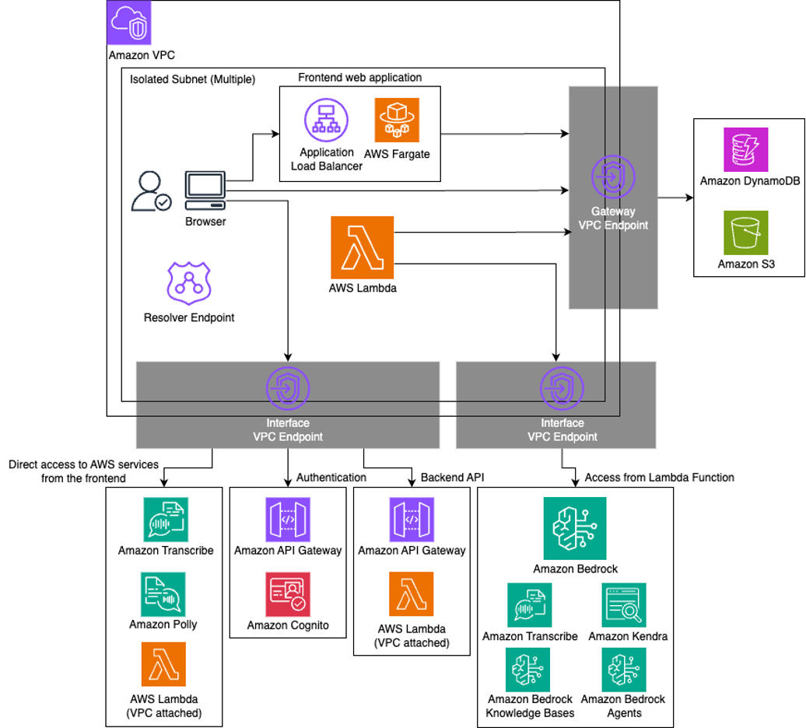

# リファレンスアーキテクチャ解説 [生成 AI]

本ドキュメントは、金融リファレンスアーキテクチャ日本版（BLEA for FSI）v1.6 の
「生成 AI」ワークロードの技術的な詳細を記載する。

## 本リファレンスアーキテクチャの目的

本リファレンスアーキテクチャは、金融機関における生成 AI 活用のためのサンプル実装で
ある。AWS Samples で公開されている生成 AI アプリケーション
[Generative AI Use Cases (GenU)](https://github.com/aws-samples/generative-ai-use-cases)
の閉域版をベースに、金融機関で求められるセキュリティ要件に対応するためのカスタマイズ
を施している。

本リファレンスアーキテクチャでは以下を提供する。

- GenU で実現可能な金融機関向けユースケースの整理
- GenU 閉域版の主要機能と活用方法の解説
- セキュリティ強化のためのカスタマイズ内容（暗号化、監査ログ、Guardrail 設定など）
- FISC 安全対策基準への対応状況（[FISC マッピング](./fisc-mapping.md)を参照）

## 前提条件

- 本サンプル実装は、GenU の
  [閉域版](https://github.com/aws-samples/generative-ai-use-cases/blob/main/docs/ja/CLOSED_NETWORK.md)
  をベースに、金融機関のセキュリティ要件に対応するためのカスタマイズを施したものである。
- GenU は、チャット、文章生成、要約、翻訳、RAG、画像生成、動画生成など、多様な生成
  AI ユースケースを提供するオープンソースアプリケーションである。
- 閉域ネットワーク構成は組織のネットワークポリシーに応じた選択肢の一つである。通常版
  の GenU も十分なセキュリティ機能を備えており、要件に応じて選択可能である。

## ユースケース

金融機関における生成 AI の活用は、業務効率化と顧客体験向上の両面で期待されている。
GenU で実現可能な主なユースケースは以下の通りである。

### 社内ナレッジの検索・活用

金融機関には膨大な規程、マニュアル、過去の稟議書、商品説明資料などが蓄積されている。
RAG（Retrieval-Augmented Generation）機能を活用することで、これらの情報を自然言語で
検索し、必要な知識を素早く引き出すことができる。例えば、「新規口座開設時の本人確認手
続きは？」といった問いに対して、関連する規程を参照しながら正確な回答を得ることが可能で
ある。

### 文書作成支援

稟議書、報告書、お客様向けの説明資料、社内メールなど、金融機関の業務では多様な文書作成
が求められる。生成 AI を活用することで、テンプレートに沿った文書の下書き作成や、既存文
書の改善提案を受けることができ、文書作成にかかる時間を大幅に削減できる。

### 顧客対応支援

お客様からの問い合わせ内容の要約、回答案の作成、過去の類似事例の検索など、顧客対応業務
において生成 AI が有用である。オペレーターの対応品質を向上させ、応答時間の短縮にも貢献
する。

### データ分析支援

営業データや市場データの傾向分析、レポートの要約、データから得られる示唆の抽出など、デ
ータ分析業務においても生成 AI が活用できる。特に、大量のテキストデータから重要な情報を
抽出するタスクにおいて効果を発揮する。

### 社内コミュニケーション効率化

会議の議事録自動生成、複数言語間の翻訳、社内向け資料の要約など、日常的な業務コミュニケ
ーションの効率化にも活用できる。特に議事録生成機能は、音声録音から自動的に議事録を作成
することで、会議後の作業負担を軽減する。

### その他の活用シーン

画像生成機能を活用したプレゼンテーション資料の作成、動画生成機能を活用した社内教育コン
テンツの制作、ダイアグラム生成機能を活用した業務フローの可視化など、多様な業務シーンで
の活用が期待される。

## GenU の主要機能

### 1. 閉域ネットワーク構成による通信の保護

金融機関では、データの機密性保護やネットワークセキュリティポリシーの観点から、システム
間の通信を閉域ネットワーク内に閉じることが求められる場合がある。GenU の閉域ネットワーク
モードを活用することで、インターネットを経由しない閉域通信を実現している。

具体的には、従来 Amazon CloudFront で配信していた Web 静的ファイルを、Application Load
Balancer と Amazon ECS Fargate の組み合わせで配信する。また、AWS Lambda 関数から他の
AWS サービス（Amazon DynamoDB、Amazon S3、Amazon Bedrock など）への通信は、すべて VPC
エンドポイントを経由して VPC 内で完結させている。Amazon Cognito 認証についても、Amazon
API Gateway の Private API をプロキシとして経由することで、閉域環境からのアクセスを可能
にしている。

この構成により、外部ネットワークへの露出を排除し、データの流出リスクを最小化すると同時
に、ネットワークレベルでの攻撃対象領域を大幅に削減している。ただし、この閉域構成は組織の
ネットワークポリシーに応じた選択肢の一つであり、要件によっては通常版の GenU で十分な場
合もある。

### 2. Amazon Cognito による認証・認可

金融機関のシステムでは、誰がいつ何にアクセスしたかを厳密に管理することが求められる。GenU
では Amazon Cognito を活用したユーザー認証・認可の仕組みを実装している。

閉域環境での Cognito 認証を実現するため、専用の API Gateway プロキシを配置し、クライア
ントからの認証リクエストを Cognito User Pool に中継する。認証後は Lambda Authorizer が
JWT トークンの有効性を検証し、適切に認可されたリクエストのみがバックエンドサービスにアク
セスできる仕組みとなっている。

この実装により、セキュアなセッション管理と不正アクセスの防止を実現している。また、組織の
要件に応じて、パスワードポリシーの厳格化（最小文字数、複雑性要件など）、MFA（多要素認証）
の強制適用、セッションタイムアウトの適切な設定などの追加実装を検討することが可能である。

### 3. 監視ダッシュボード機能

生成 AI の業務活用において、利用状況の可視化とコスト管理は重要な課題である。GenU では
Amazon CloudWatch を活用した監視ダッシュボード機能を提供している。

ダッシュボードでは、Amazon Bedrock のトークン使用量（入力・出力トークン数）、API 呼び出
し状況（リクエスト数、エラー率、レスポンス時間）、最近のプロンプト履歴、ユーザーの活動パ
ターンなどを可視化する。これにより、システム管理者はサービスの利用状況をリアルタイムで把
握し、異常なトラフィックの検知やコストの最適化を行うことができる。

また、CloudWatch Logs にすべての操作ログが記録されるため、監査要件への対応や、問題発生時
の原因究明にも活用できる。ログは改ざん防止の観点から、適切な保持期間とアクセス制御が設定
されている。

### 4. Amazon Bedrock Guardrails による出力制御

生成 AI を業務で活用する際、不適切な出力の防止は重要である。GenU では Amazon Bedrock
Guardrails による入出力のフィルタリング機能を実装している。

本リファレンスアーキテクチャでは、機密情報（クレジットカード番号、国際銀行口座番号、AWS
アクセスキー、メールアドレス、電話番号、パスワードなど）の検出とブロックを実装している。
これにより、誤ってこれらの情報がモデルに入力されたり、モデルから出力されたりすることを防
ぐ。

Guardrails の設定は組織の要件に応じてカスタマイズ可能である。例えば、投資助言に関する具
体的な推奨の防止、金融法規に抵触する可能性のある応答の制限、その他組織固有のポリシーに基
づくフィルタリングルールの追加などを検討できる。Guardrails はモデルとは独立して設定され
るため、複数のモデルに対して共通のポリシーを適用することも可能である。

## 本実装でのセキュリティ強化

本サンプル実装では、GenU 閉域版に対して金融機関のセキュリティ要件に対応するため、以下を
はじめとしたカスタマイズを施している。詳細は[デプロイ手順書](./deployment.md)とソースリ
ポジトリの差分ファイル（`changes.diff`）を参照。

- AWS KMS カスタマーマネージドキーによる暗号化の追加（S3、DynamoDB、OpenSearch など）
- DynamoDB テーブルのポイントインタイムリカバリ（PITR）の有効化
- Guardrail 設定の強化（日本語対応、金融業界向けトピックフィルタの追加）

### Guardrail 強化設定の詳細

ソースの差分ファイルで確認できる、金融機関向けに強化された Amazon Bedrock Guardrails の
主な設定は以下の通りである。

- **クロスリージョン設定**: Guardrail プロファイル ARN を指定したクロスリージョン構成。
- **KMS 暗号化**: Guardrail 専用の KMS キーで暗号化。
- **ブロックメッセージ**: 入力・出力のブロック時に日本語のメッセージ（社内ポリシー抵触
  の旨）を返す。
- **コンテンツフィルタ（contentPolicyConfig）**: SEXUAL / VIOLENCE / HATE / MISCONDUCT /
  PROMPT_ATTACK を HIGH 強度、INSULTS を MEDIUM 強度でブロック。ティアは STANDARD（日本
  語対応）。
- **コンテキストグラウンディング（contextualGroundingPolicyConfig）**: GROUNDING と
  RELEVANCE をしきい値 0.8 でブロック。
- **機密情報ポリシー（sensitiveInformationPolicyConfig）**: AWS_ACCESS_KEY、
  AWS_SECRET_KEY、CREDIT_DEBIT_CARD_CVV/EXPIRY/NUMBER、
  INTERNATIONAL_BANK_ACCOUNT_NUMBER、PIN、SWIFT_CODE、IP_ADDRESS、LICENSE_PLATE、
  MAC_ADDRESS、PASSWORD、PHONE、EMAIL、URL、USERNAME、AGE などの PII をブロック。加えて、
  正規表現によるマイナンバー（個人番号）検出を追加（入力はブロック、出力は匿名化）。
- **トピックポリシー（topicPolicyConfig）**: 金融業界向けの拒否トピックとして
  insider-trading（インサイダー取引）、money-laundering（マネーロンダリング）、
  regulatory-violation（金融規制違反）、customer-confidential-info（顧客の機密情報）を
  定義し、入出力ともにブロック。ティアは STANDARD。
- **単語ポリシー（wordPolicyConfig）**: マネージド単語リスト PROFANITY をブロック。

## アーキテクチャ上の特徴

### 1. サーバーレスアーキテクチャによる運用効率の向上

本リファレンスアーキテクチャでは、AWS Lambda、Amazon API Gateway、Amazon DynamoDB、
Amazon Bedrock など、サーバーレスのマネージドサービスを中心に構成されている。

サーバーレスアーキテクチャの採用により、以下のメリットが得られる。まず、サーバーの構築や
管理、パッチ適用などの運用作業が不要になり、IT 部門の運用負荷が大幅に軽減される。金融機
関では人的リソースの制約がある中で、本質的な業務に集中できる環境を整えることができる。

また、利用量に応じた自動スケーリングにより、ピーク時のトラフィックにも柔軟に対応できる。
従来のようにピーク時を想定したサーバーサイジングが不要になるため、コストの最適化にも寄与
する。特に Lambda は実行時間に応じた課金となるため、利用が少ない時間帯のコストを抑えるこ
とができる。

さらに、サーバーレスアーキテクチャは高可用性を標準で提供する。AWS がインフラストラクチャ
の冗長化を管理するため、システムの可用性を高いレベルで維持することができる。

### 2. マネージドサービスによるセキュリティの確保

本リファレンスアーキテクチャで採用している AWS マネージドサービスは、セキュリティのベスト
プラクティスが組み込まれている。例えば、Amazon Bedrock はモデルの学習に顧客データを使用し
ない設計となっており、入力データの機密性が保護される。また、サービス間の通信は暗号化され、
データの保存時も暗号化が標準で適用される。

これらのマネージドサービスを活用することで、金融機関が独自にセキュリティ対策を実装する負担
を軽減しつつ、高いセキュリティレベルを実現できる。また、AWS は定期的にセキュリティパッチを
適用し、新たな脅威に対応するため、常に最新のセキュリティ状態を維持することができる。

### 3. 段階的なセキュリティ強化の柔軟性

本リファレンスアーキテクチャでは、組織の要件やリスク評価に応じて、段階的にセキュリティを強
化できる設計となっている。

例えば、初期導入時は通常版の GenU で開始し、基本的な Cognito 認証と AWS の標準的なセキュリ
ティ機能を活用することができる。その後、必要に応じて Guardrails の追加、閉域ネットワーク構
成への移行、MFA の強制適用など、段階的にセキュリティレベルを高めていくことが可能である。

このような柔軟性により、過度なセキュリティ対策によるユーザビリティの低下や、初期導入のハー
ドルを避けながら、組織に適したセキュリティレベルを実現できる。また、実際の利用状況やリスク
評価に基づいて対策を追加できるため、効果的なセキュリティ投資が可能になる。

### 4. Infrastructure as Code による環境の再現性

本リファレンスアーキテクチャは AWS CDK で実装されており、インフラストラクチャをコードとし
て管理できる。これにより、開発環境、検証環境、本番環境といった複数環境を一貫した構成で構築
することができる。

また、構成変更の履歴がバージョン管理システムに記録されるため、変更の追跡や、問題発生時の以
前の状態への復旧が容易になる。金融機関の監査要件においても、システム構成の証跡を明確に示す
ことができる。

### 5. 閉域版による機能制限

閉域ネットワーク構成を採用する場合、アーキテクチャの制約からいくつかの機能に制限が生じる。
具体的には、外部 IdP との SAML 統合、音声機能（Voice Chat）、一部のエージェント機能
（AgentCore Chat）は現在サポート対象外となっている。また、デプロイリージョンとモデルのリー
ジョンは同一である必要がある。

これらの制限は、閉域ネットワークによるセキュリティ要件とのトレードオフとなる。すべての機能
が必要な場合は、組織のネットワークポリシーと相談の上、通常版の GenU の活用も検討する。通常
版でも十分なセキュリティ機能を備えており、多くの金融機関で活用されている。

## アーキテクチャ図

閉域ネットワーク構成では、すべての通信が Amazon VPC 内で完結する。分離サブネット（Isolated
Subnet）内のブラウザからフロントエンド（Application Load Balancer + Amazon ECS Fargate）
へアクセスし、AWS Lambda およびフロントエンドは各 AWS サービスへ VPC エンドポイント経由で
アクセスする。Amazon DynamoDB と Amazon S3 へは Gateway VPC エンドポイント、Amazon
Bedrock・Amazon Transcribe・Amazon Polly・Amazon Cognito・Amazon Kendra などへは Interface
VPC エンドポイントを経由する。認証は Amazon API Gateway の Private API を経由して Amazon
Cognito に中継され、Route 53 Resolver エンドポイントが VPC 内での名前解決を提供する。
Lambda 関数からは Amazon Bedrock（Knowledge Bases、Agents を含む）や Amazon Kendra、Amazon
Transcribe へアクセスする。

## 参考情報

- [aws-samples/generative-ai-use-cases](https://github.com/aws-samples/generative-ai-use-cases)
- [GenU 閉域モードドキュメント](https://github.com/aws-samples/generative-ai-use-cases/blob/main/docs/ja/CLOSED_NETWORK.md)
- [Amazon Bedrock ドキュメント](https://docs.aws.amazon.com/bedrock/)
