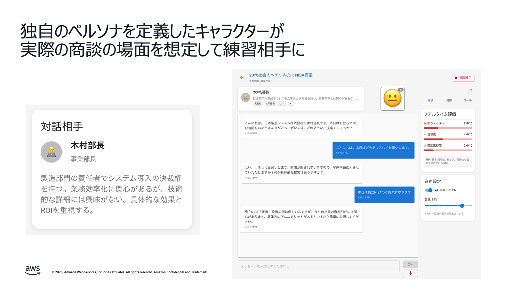

# 生成 AI 活用ユースケース：ロールプレイ

## 1. ユースケース概要

**営業担当者が、AI が演じる顧客と音声で対話しながら、金融商品の営業スキルを向上させる**
研修システムである。

担当者はパソコンの前に座り、AI が演じる仮想の顧客と実際に音声で会話する。AI は、投資信託や
保険などの金融商品に興味を持つ顧客役として、質問したり、懸念を表明したりする。担当者は
それに対して、商品説明やリスク説明を行い、顧客の理解を得ようとする。

**システムは会話中にリアルタイムで複数の項目を評価する。**

- **感情メーター**：顧客（AI）の怒り度、信頼度、進捗度を可視化する。
- **コンプライアンスチェック**：金融商取法違反の発言を即座に指摘する。
- **映像分析**：Web カメラで表情やアイコンタクトを分析する。
- **リファレンス確認**：根拠資料に基づいた正確な説明ができているか検証する。

セッション終了後は、AI が詳細な分析レポートを提供し、改善点を具体的にフィードバックする。
24 時間いつでも利用でき、何度でも練習できるため、新人研修や定期的なスキル向上に最適である。

### 主な特徴

- **リアルな音声対話**：Amazon Bedrock を活用した AI との自然な会話練習。
- **リアルタイム感情フィードバック**：顧客の感情状態（怒り・信頼・進捗）を画面上に
  リアルタイム表示する。
- **コンプライアンス自動チェック**：金融商取法や業界規制に基づく違反発言の即座指摘。
- **映像分析による評価**：表情、アイコンタクト、身振り手振りの効果を分析する。
- **多様なシナリオ**：投資信託、保険、融資など、カスタマイズ可能な営業シーン。



## 2. ユースケースの具体例

| ユースケース名 | 対象者 | 概要 | 目的・目標 | 主要な評価項目 | 期待効果 |
| --- | --- | --- | --- | --- | --- |
| **投資信託営業トレーニング** | 投資信託販売担当者 | AI 顧客が「老後資金のために投資信託を検討している」という設定で、リスクや手数料を説明しながら商品提案を行う | リスク説明義務と手数料説明の適切な実施 | リスク説明の網羅性、手数料説明の明確性、顧客理解度の確認 | 説明義務違反の防止、顧客満足度向上、販売品質の標準化 |
| **保険商品セールス練習** | 保険営業担当者 | AI 顧客が「家族のために生命保険を検討している」という設定で、ニーズを聞き取り適切な商品を提案する | 契約者保護と適合性原則の遵守 | 顧客ニーズの把握精度、商品適合性の判断、契約内容の説明力 | 適合性違反の予防、契約継続率の改善、クレーム減少 |
| **住宅ローン相談対応** | 個人融資担当者 | AI 顧客が「マイホーム購入のための住宅ローンを相談したい」という設定で、審査基準や返済計画を説明する | 審査基準説明と返済計画提案の最適化 | 審査基準の正確な説明、返済計画の妥当性、顧客不安の解消度 | 相談品質の向上、成約率の改善、顧客信頼度向上 |
| **法人融資営業** | 法人営業担当者 | AI 顧客が「事業拡大のための運転資金を検討している中小企業経営者」という設定で、財務分析に基づく融資提案を行う | 財務分析に基づく提案力強化 | 財務分析の深度、リスク評価の妥当性、提案内容の説得力 | 融資品質の向上、不良債権の予防、営業効率化 |
| **資産運用提案** | 資産運用アドバイザー | AI 顧客が「退職金の運用方法を相談したい」という設定で、リスク許容度を確認しながらポートフォリオを提案する | 顧客ニーズに応じたポートフォリオ提案 | ニーズヒアリング力、リスク許容度の把握、提案の妥当性 | 提案精度の向上、顧客満足度向上、AUM（預かり資産）増加 |
| **新人研修プログラム** | 新入社員・若手職員 | AI 顧客が「初めて金融商品を購入する若年層」という設定で、基本的な商品説明と接客マナーを実践する | 基本的な金融知識と接客スキルの習得 | 金融知識の理解度、接客マナーの習得、コンプライアンス意識 | 研修効率の向上、実践力の早期習得、標準的なスキル定着 |
| **コンプライアンス研修** | 全営業職員 | AI 顧客が「高齢者で複雑な金融商品に興味を持っている」という設定で、説明義務を適切に履行できるか確認する | 金融商取法遵守と説明義務の徹底 | 法令知識の正確性、説明義務の履行度、違反リスクの認識 | コンプライアンス違反の予防、法的リスクの軽減、組織全体の意識向上 |

## 3. 金融機関での導入メリット

### リスク管理の強化

- **コンプライアンス違反の事前防止**：AI が金融商取法や業界規制に基づいてリアルタイムで
  発言をチェックする。
- **説明義務履行の確実性**：必要な説明項目の漏れを防ぎ、法的リスクを軽減する。

### 営業品質の標準化

- **全拠点での統一された研修**：地域や支店による営業品質のばらつきを解消する。
- **客観的な評価指標**：感情フィードバックや分析レポートによる定量的なスキル評価。

### コスト効率の改善

- **研修コストの削減**：講師や会場の手配が不要、24 時間いつでも利用可能である。
- **個別指導の自動化**：AI による個人別の弱点分析と改善提案。

### 顧客満足度の向上

- **説明スキルの向上**：映像分析による非言語コミュニケーションの改善。
- **信頼関係構築**：適切な情報提供により顧客との長期的関係を構築する。

## 4. 使用方法

- 金融シナリオの作成方法については、[金融シナリオ作成手順書](ai-roleplay-scenario-guide.md)
  を参照すること。

## 5. システム構成・技術要素

### 使用 AWS サービス

- **Amazon Bedrock**：生成 AI（Anthropic Claude）によるロールプレイ対話と
  コンプライアンスチェック。
- **Amazon Transcribe**：音声のテキスト化。
- **Amazon Rekognition**：映像分析による非言語コミュニケーション評価。
- **AWS Lambda**：サーバーレス処理。
- **Amazon S3**：シナリオデータ・評価結果の保存。
- **Amazon DynamoDB**：ユーザー情報・進捗管理。

## 6. デプロイ方法

### GitHub リポジトリ

- [aws-samples/sample-ai-sales-roleplay](https://github.com/aws-samples/sample-ai-sales-roleplay)

詳細なデプロイ手順はリポジトリの README を参照すること。

### AWS CloudShell を使った簡単デプロイ

事前準備不要で、AWS CloudShell を使って簡単にデプロイできる。

#### 1. AWS コンソールにログイン

画面上部の CloudShell アイコン（ターミナルマーク）をクリックする。

#### 2. 以下のコマンドを実行

```bash
# リポジトリをクローン
git clone https://github.com/aws-samples/sample-ai-sales-roleplay.git
cd sample-ai-sales-roleplay

# デプロイスクリプトを実行
chmod +x bin.sh
./bin.sh
```

#### 3. デプロイオプション（任意）

```bash
# セルフサインアップ機能を無効化
./bin.sh --disable-self-register

# 別のBedrockリージョンを使用
./bin.sh --bedrock-region us-west-2

# 詳細なカスタマイズ
./bin.sh --cdk-json-override '{"context":{"allowedSignUpEmailDomains":["example.com"]}}'
```

#### 4. アクセス

デプロイ完了後、表示される URL からアプリケーションにアクセスできる。

## 7. 参考情報

- [GitHub Repository](https://github.com/aws-samples/sample-ai-sales-roleplay)
- [Amazon Bedrock Documentation](https://docs.aws.amazon.com/bedrock/)
- [AWS Lambda Best Practices](https://docs.aws.amazon.com/lambda/latest/dg/best-practices.html)
