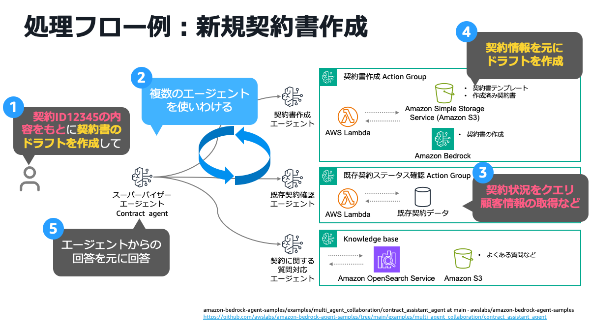
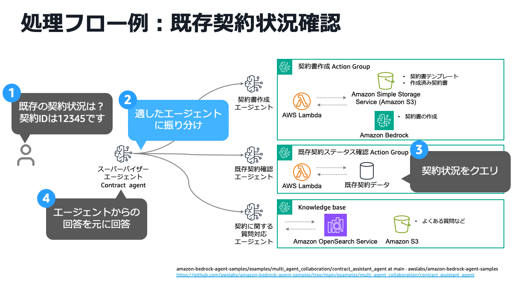
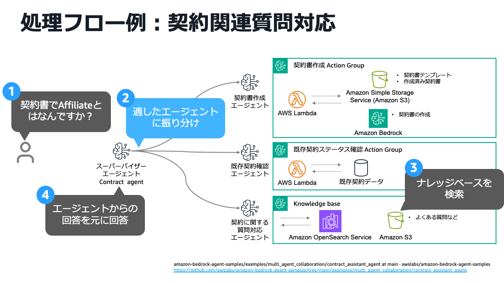
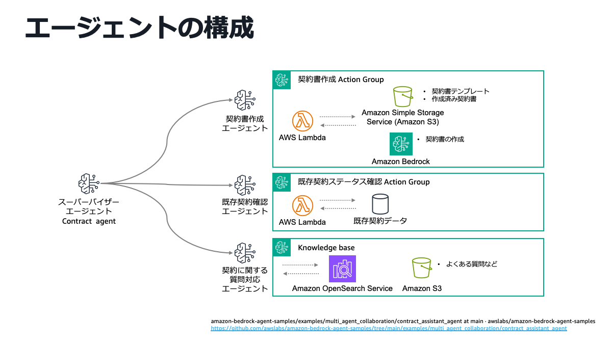
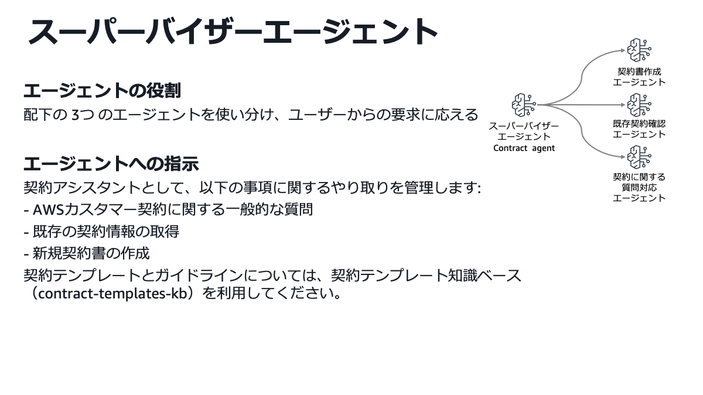
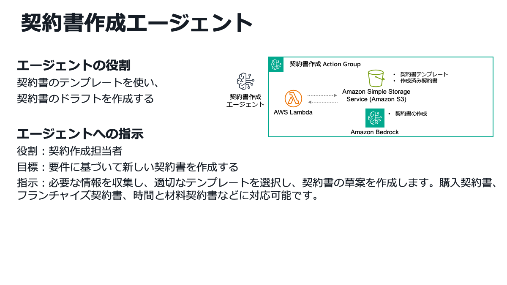
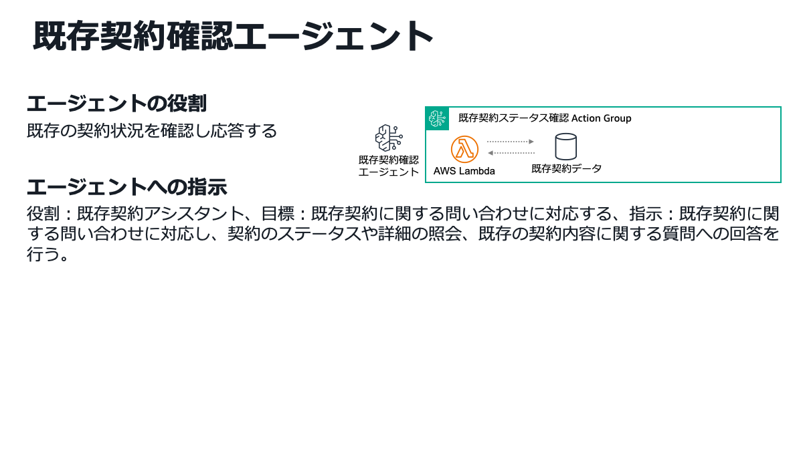
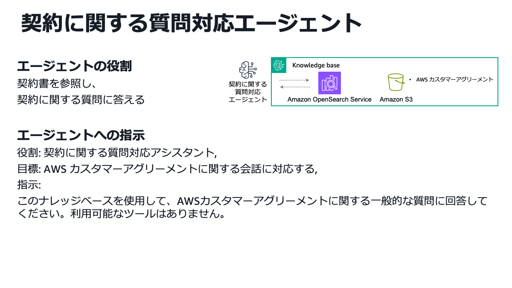

# 生成 AI 活用ユースケース：契約書業務アシスタント

## 1. ユースケース概要

契約書関連業務を包括的に支援する AI アシスタントシステムである。法務担当者や営業
担当者は、自然言語での問い合わせやリクエストを通じて、**契約書の新規作成**、
**既存契約の照会・確認**、**契約に関する質問への回答**を迅速に行うことができる。

複数の専門 AI エージェントが連携して動作し、ユーザーの要求を自動的に適切な
エージェントに振り分けることで、複雑な契約業務を効率化する。テンプレートベースの
契約書作成、既存契約データベースへのアクセス、契約に関するナレッジベース検索を、
一つのインターフェースから利用できる。

### 主な特徴

- **統合されたインターフェース**：契約書作成、照会、質問対応を一つのシステムで処理する。
- **自然言語での操作**：専門知識がなくても、日常的な言葉で操作可能である。
- **自動タスク振り分け**：ユーザーの要求内容に応じて、最適なエージェントが自動選択される。
- **複数エージェントの連携**：複雑なタスクも、複数のエージェントが協調して処理する。

## 2. ユースケースの具体例

| ユースケース名 | 対象者 | 目的・目標 | 主要な機能 | 期待効果 |
| --- | --- | --- | --- | --- |
| **新規契約書作成** | 法務担当者、営業担当者 | 顧客情報や契約形態の入力のみで、契約書のテンプレートをベースに AI エージェントが契約書を作成することによる作業負荷軽減 | 適切なテンプレート選択、要件に基づく自動生成 | 作成時間の短縮、品質の標準化 |
| **既存契約状況確認** | 営業担当者、カスタマーサポート | 自然言語で既存の契約状況の問い合わせが可能になり、契約情報の迅速な照会と回答を実現 | 契約 ID による検索、ステータス確認、詳細情報の提供 | 問い合わせ対応の迅速化、顧客満足度向上、業務効率化 |
| **契約関連質問対応** | 全社員 | 既存契約書やよくある質問をナレッジベースとすることで、自然言語での契約に関する質問とその回答を実現 | ナレッジベース検索、契約に関する情報提供 | 専門知識の組織的活用、回答品質の向上 |

## 3. 金融機関での導入メリット

### 業務効率化

- **24 時間対応**：時間制約のない契約関連業務の処理。
- **自動化による効率向上**：手作業による契約書作成・確認作業の削減。

### 品質向上

- **一貫した品質**：テンプレートベースによる標準化された契約書作成。
- **専門知識の活用**：ナレッジベースを通じた組織的な知識共有。

### コスト削減

- **人件費削減**：契約関連業務の自動化による工数削減。
- **迅速な対応**：問い合わせ対応時間の短縮による機会損失回避。

## 4. 使用方法

本システムは、Web インターフェースまたはプログラマティックに利用できる。ユーザーは
自然言語で契約に関する質問や依頼を入力するだけで、スーパーバイザーエージェントが
適切なサブエージェントにタスクを振り分け、回答を返す。

### 処理フロー例：新規契約書作成

ユーザーが既存の契約情報を参照した上で、新しい契約書のドラフト作成を依頼すると、
スーパーバイザーエージェントが複数のエージェントを協調させ、既存契約確認エージェントが
既存の契約情報を確認した上で、その情報をもとに契約書作成エージェントが契約テンプレートを
利用して契約書のドラフトを生成する複合的な処理を実行する。

1. ユーザーが既存の契約 ID を指定して、参考にすべき情報を明示し、契約書のドラフト作成を
   依頼する。
2. スーパーバイザーエージェントが適したサブエージェントを選択し、それぞれのエージェントに
   タスクを振り分ける。
3. 既存契約確認エージェントはユーザーからの契約 ID をもとに既存契約データから契約状況を
   取得する。
4. 契約書作成エージェントが、既存契約確認エージェントが取得した契約情報をもとに契約書の
   ドラフトを作成する。
5. サブエージェントからの回答をもとにユーザーに最終的な回答を行う。

### 処理フロー例：既存契約状況確認

ユーザーが既存の契約 ID を自然言語で問い合わせると、スーパーバイザーエージェントが
既存契約確認エージェントにタスクを振り分ける。既存契約確認エージェントは、既存契約
データにクエリを送信し、契約情報を把握した上で、スーパーバイザーエージェントを介して
ユーザーに契約情報を自然言語で回答する。

1. ユーザーが既存の契約 ID をもとに、既存の契約状況を問い合わせる。
2. スーパーバイザーエージェントが既存契約確認エージェントに振り分ける。
3. 既存契約確認エージェントは既存契約データに対してクエリを行い、回答を生成する。
4. スーパーバイザーエージェントが既存契約確認エージェントからの回答をもとにユーザーに
   最終回答を送信する。

### 処理フロー例：契約関連質問対応

ユーザーが契約に関する質問を自然言語で問い合わせると、スーパーバイザーエージェントが
契約に関する質問対応エージェントにタスクを振り分ける。契約に関する質問対応エージェントは、
よくある質問などが格納されたナレッジベースを検索し、検索結果を踏まえてスーパーバイザー
エージェントを介してユーザーに質問の回答を自然言語で回答する。

1. ユーザーが契約に関する質問を行う。
2. スーパーバイザーエージェントが契約に関する質問対応エージェントに振り分ける。
3. 契約に関する質問対応エージェントはよくある質問などが格納されたナレッジベースを検索し、
   回答を生成する。
4. スーパーバイザーエージェントが契約に関する質問対応エージェントからの回答をもとに
   ユーザーに最終回答を送信する。

### サンプルプロンプト

以下のようなプロンプトに対応することができる。

- 「契約 ID 12345 の契約状況を教えてください。」
- 「新しいサービス契約書のドラフトを作成してください。」
- 「契約書で Affiliate とはなんですか？」

## 5. システム構成・技術要素

ユーザーからの問い合わせを受けるスーパーバイザーエージェントが、3 つの専門エージェント
（契約書作成、既存契約確認、契約関連質問対応）に内容に応じてルーティングする構成である。
各エージェントは Amazon Bedrock でホスティングされる LLM を活用し、既存の契約書データ、
契約テンプレート、契約に関するナレッジベースを利用して割り振られたタスクを完遂する。

システムは以下の 4 つの主要エージェントで構成されている。

### 1) スーパーバイザーエージェント (Contract Agent)

スーパーバイザーエージェントは、ユーザーからの多様な契約関連の問い合わせを受け取り、
内容を分析して最適な専門エージェントに振り分けるコントロール機能と最終的な回答の作成を
担う。Amazon Bedrock のマルチエージェントコラボレーション機能により、割り振る
エージェントの識別と、各エージェントからの回答の収集と最終的な回答の作成を行う。

- **役割**：配下の 3 つのエージェントを使い分け、ユーザーからの要求に応える。
- **管理する業務**：契約に関する一般的な質問はスーパーバイザーエージェントが回答する。
  また、各サブエージェントが担うタスクは、各サブエージェントへタスクの振り分けを行う。

### 2) 契約書作成エージェント

契約書作成エージェントは、スーパーバイザーエージェントからの契約書作成に関するタスクを
受領し、適切な契約テンプレートを選択し、Amazon Bedrock の LLM を使用して新規契約書の
ドラフトを自動生成する。生成された契約書は S3 に保存され、ユーザーに提供される。
サンプルでは、契約テンプレートとして、購入契約書、フランチャイズ契約書、タイムアンド
マテリアル契約書のサンプルが格納されている。

- **役割**：契約書のテンプレートを使い、契約書のドラフトを作成する。
- **機能**：要件に基づいて、適切なテンプレートを選択し、新しい契約書を作成する。

### 3) 既存契約確認エージェント

既存契約確認エージェントは、ユーザーから既存の契約 ID や契約に関する問い合わせを受け取り、
既存の契約データにアクセスして契約状況やステータスを照会する。AWS Lambda を通じて、
契約の詳細情報や現在の状況を回答する。

- **役割**：既存の契約状況を確認し応答する。
- **機能**：既存契約に関する、契約のステータスや詳細情報の照会と回答を行う。

### 4) 契約に関する質問対応エージェント

契約に関する質問対応エージェントは、ナレッジベースに格納された契約に関する情報
（例えば、よくある質問など）をもとに、契約に関する質問に回答する。ナレッジベースとして
利用している Amazon OpenSearch Service を利用し、検索と適切な回答の生成を行う。

- **役割**：契約に関する情報を参照し、契約に関する質問に答える。
- **機能**：ナレッジベースを使用し、契約に関する質問へ回答する。

## 6. デプロイ方法

以下のレポジトリにデプロイ方法が記載されている。

- [Amazon Bedrock Agent Samples - Contract Assistant Agent](https://github.com/awslabs/amazon-bedrock-agent-samples/tree/main/examples/multi_agent_collaboration/contract_assistant_agent)

## 7. 参考情報

- [Amazon Bedrock Agent Samples - Contract Assistant Agent](https://github.com/awslabs/amazon-bedrock-agent-samples/tree/main/examples/multi_agent_collaboration/contract_assistant_agent)
- [Amazon Bedrock Agents Documentation](https://docs.aws.amazon.com/bedrock/latest/userguide/agents.html)
- [Multi-Agent Collaboration Documentation](https://docs.aws.amazon.com/bedrock/latest/userguide/agents-multi-agent-collaboration.html)
