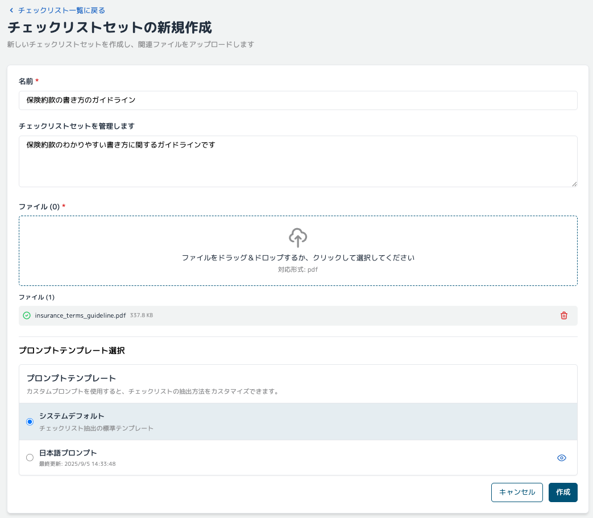
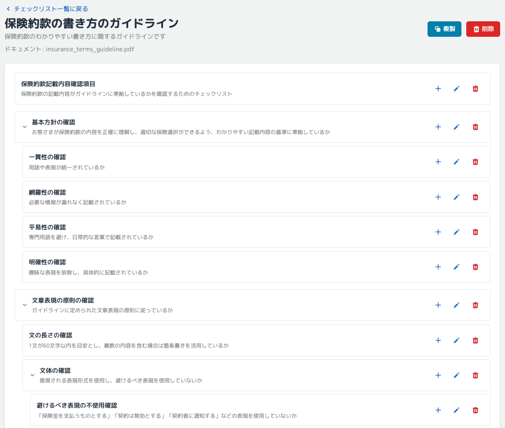
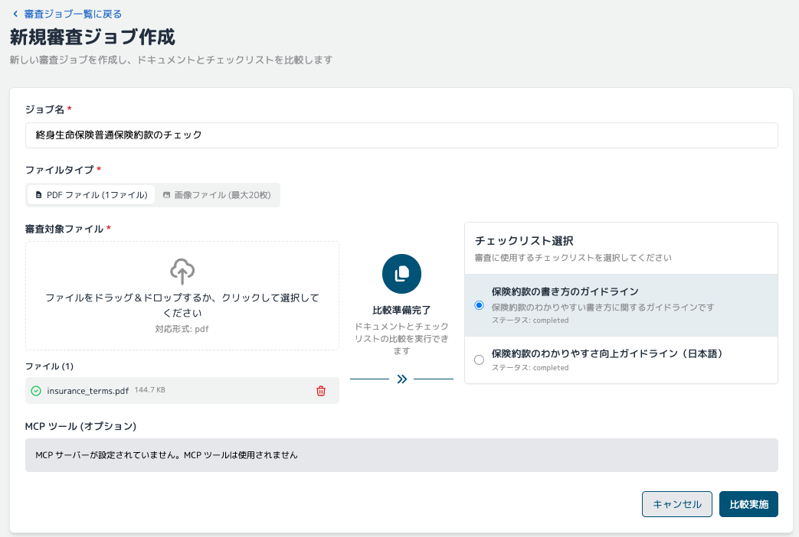
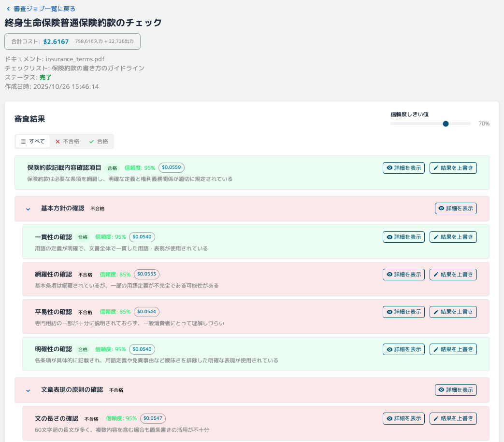
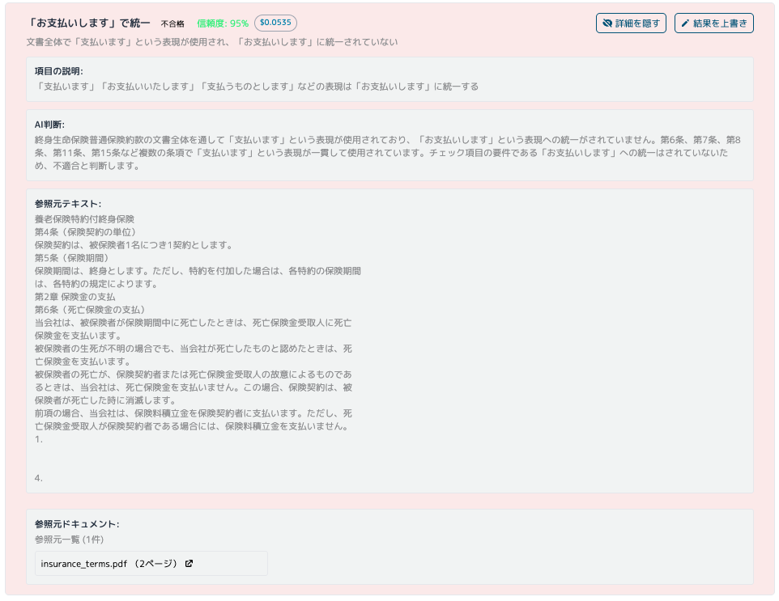

# 生成 AI 活用ユースケース：文書・コンテンツ審査

## 1. ユースケース概要

RAPID (Review & Assessment Powered by Intelligent Documentation) は、Amazon Bedrock を
活用した生成 AI 書類審査ソリューションである。金融機関における膨大な文書審査業務を、
AI と人間の協働（Human in the Loop）で効率化する。

**利用方法は 3 ステップ**で非常にシンプルである。

1. **審査基準となるガイドライン文書をアップロード** → AI が自動的にチェックリストを生成する。
2. **審査対象の文書をアップロード** → AI が生成したチェックリストに基づいて自動審査する。
3. **審査結果を確認** → 人間が最終判断を行い、必要に応じて修正指示を行う。

担当者は、複雑な審査基準を理解していなくても、ガイドライン文書をシステムに渡すだけで、
AI が自動的にチェック項目を抽出し、審査を実行する。AI の判断根拠も明示されるため、
説明責任を確保しながら、審査時間の短縮と品質向上を同時に実現できる。

### 主な特徴

- **ガイドラインからチェックリストを自動生成**：審査基準書をアップロードするだけで、
  AI が確認すべき項目を自動抽出する。
- **大量文書の自動審査**：生成 AI による高速かつ網羅的な文書審査。
- **判断根拠の透明性**：AI がなぜそう判断したのか、根拠を明示する。
- **人間と AI の協調**：AI による一次審査と人間による最終確認の組み合わせで、効率と品質を
  両立する。

## 2. 文書審査ユースケースの具体例

| 審査基準の種類 | 対象文書例 | 適用基準例 |
| --- | --- | --- |
| **法令・規制ガイドライン** | 金融商品広告、募集文書、開示書類 | 金融庁監督指針、業界団体自主規制規則 |
| **社内コンプライアンス規程** | 営業資料、顧客提案書、社外発表資料 | 社内コンプライアンスマニュアル、リスク管理規程 |
| **ブランドガイドライン** | マーケティング資料、Web コンテンツ、広告素材 | 企業ブランドガイドライン、デザインスタンダード |
| **品質管理基準** | 顧客向けマニュアル、FAQ、サポート資料 | 品質管理規程、文書作成ガイドライン |
| **情報セキュリティポリシー** | 顧客情報取扱文書、システム仕様書、外部委託契約書 | 情報セキュリティポリシー、個人情報保護規程 |
| **業界ベストプラクティス** | ESG 報告書、サステナビリティレポート、統合報告書 | GRI スタンダード、TCFD 提言、SASB 基準 |

## 3. 金融機関での導入メリット

### 審査業務の効率化

- **審査時間の短縮**：手作業による文書審査の時間とコストを削減する。
- **24 時間対応**：時間制約なく審査を実行可能である。
- **人的リソースの最適化**：定型的な審査作業を AI に任せ、高度な判断業務に集中する。

### 品質向上

- **品質の標準化**：審査者による判断のばらつきを解消する。
- **一貫した審査基準**：人的ばらつきの排除。
- **見落とし防止**：網羅的なチェック実行により審査品質を向上する。
- **判断根拠の明確化**：AI による透明性の高い審査。

### コスト削減

- **人件費削減**：審査業務の自動化。
- **迅速な市場投入**：審査期間短縮による機会損失回避。
- **再審査コストの削減**：初回審査の精度向上。

## 4. 使用方法

### 基本的な利用フロー

#### ステップ 1: チェックリストの作成

1. RAPID の Web UI のチェックリストセット一覧画面にアクセスし、「新規作成」を選択する。
2. 審査基準となるガイドラインや規程文書（PDF）をアップロードする。

   

3. AI が文書を解析し、審査項目を自動抽出して構造化されたチェックリストを生成する。

   

4. 生成されたチェックリストを確認し、必要に応じて項目の追加・修正・削除を行う。

#### ステップ 2: 文書の審査

1. 審査ジョブ一覧画面にアクセスし、「新規ジョブ作成」を選択する。
2. 審査したい文書（PDF、画像）をアップロードする。
3. 適用するチェックリストを選択する。
4. 「比較実施」ボタンをクリックすると、システムが自動的に文書を解析し、チェックリストの
   各項目について審査を実行する。

   

#### ステップ 3: 結果の確認と承認

1. 審査が完了すると、結果画面が表示される。各項目の合否判定と AI の判断根拠を確認できる。

   

2. 不合格項目がある場合は、詳細な理由と該当箇所が表示される。

   

3. 人間が最終確認と承認を行い、必要に応じて修正指示や再審査を実施する。

## 5. システム構成・技術要素

### RAPID (Review & Assessment Powered by Intelligent Documentation)

- **GitHub**: [aws-samples/review-and-assessment-powered-by-intelligent-documentation](https://github.com/aws-samples/review-and-assessment-powered-by-intelligent-documentation)

RAPID は、Amazon Bedrock を活用した生成 AI 書類審査ソリューションである。GitHub で
公開されているオープンソースソリューションで、生成 AI による文書審査の自動化を実現する。

### 使用 AWS サービス

- **Amazon Bedrock**：生成 AI による文書解析と審査。
- **AWS Lambda**：サーバーレス処理。
- **Amazon S3**：文書の保存と管理。
- **Amazon DynamoDB**：チェックリストと審査結果の管理。
- **Amazon CloudFront**：Web UI の配信。

### 主要機能

**チェックリスト自動生成**

- ガイドライン文書から審査項目を自動抽出する。
- 構造化されたチェックリストを生成する。

**AI 文書審査**

- Amazon Bedrock による文書解析。
- チェックリストに基づく自動審査。
- 合否判定と判断根拠の提示。

**審査結果管理**

- 審査結果の保存と履歴管理。

**Web インターフェース**

- ブラウザベースの操作画面。
- 文書アップロードと審査実行。
- 審査結果の確認と承認。

## 6. デプロイ方法

### GitHub リポジトリ

- [aws-samples/review-and-assessment-powered-by-intelligent-documentation](https://github.com/aws-samples/review-and-assessment-powered-by-intelligent-documentation)

詳細なデプロイ手順はリポジトリの README を参照すること。

### 前提条件

- AWS アカウント
- AWS CLI の設定
- Amazon Bedrock へのアクセス権限

### 基本的なデプロイ手順

リポジトリのドキュメントに従ってデプロイを実行する。通常、以下の手順が含まれる。

1. リポジトリのクローン
2. 必要な依存関係のインストール
3. AWS リソースのデプロイ
4. 環境変数の設定
5. アプリケーションの起動

## 7. 参考情報

### 関連記事・ブログ

- [AWS の書類審査ソリューション RAPID をデプロイして利用してみる - Qiita](https://qiita.com/sugimount-a/items/f5720c9d06f66e83f228)
- [AWS Summit Japan 2025 建設・不動産向けブース展示 - AWS Blog](https://aws.amazon.com/jp/blogs/news/aws-summit-2025-japan-cre-booth-and-sessions/)

### 適用可能な業界

RAPID は金融機関以外にも、以下のような業界で活用可能である。

- 建設・不動産：工事書類、安全管理文書の審査。
- 製造業：品質管理文書、技術仕様書の審査。
- 医療・ヘルスケア：臨床文書、規制対応文書の審査。
- 公共機関：申請書類、報告書の審査。
