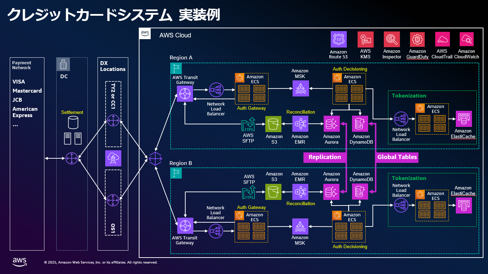

# クレジットカード イシュアシステム リファレンスアーキテクチャ（BLEA for FSI）

## ワークロード概要

本ケーススタディは、**クレジットカードのイシュア（issuer）システム**をオンプレミス環境から
段階的に AWS へ移行・構築運用する際のリファレンスである。

クレジットカードのイシュアシステムの処理は主に以下の 3 つのプロセスで構成される。

- **Authorization（承認）** — カード利用をリアルタイムに承認する処理。顧客がカードを利用する
  際、加盟店 → 決済代行会社（アクワイアラ）→ カード発行会社（イシュア）の流れで情報を中継し
  承認判定を行う。
- **Reconciliation（突合せ）** — 承認された取引データの交換・照合を行う処理。決済代行会社
  （アクワイアラ）が売り上げ情報であるクリアリングデータをカード発行会社（イシュア）に連携し、
  承認データとの突合せ処理を行う。
- **Settlement（資金決済）** — 決済ネットワーク上でのアクワイアラとイシュア間の清算・決済・
  資金移動。

本アーキテクチャの目的・意義：

- 大規模セールやポイント還元キャンペーン等に起因した決済需要による高トラフィック処理やリアル
  タイム承認要件に柔軟に対応する。
- 新しい決済技術や業界標準の導入／金融規制要件の変更が必要になった際等に、サービス・機能の追加・
  変更を効率的に実行可能な IT 基盤を構築する。
- 高可用性が求められるミッションクリティカルなカード決済システムの業務継続性を支える高レジリエンス
  なアーキテクチャを構築する。

ビジネス・技術ドライバー（要件）：

- **パフォーマンス**：最大 5,000TPS、レスポンス時間 200msec 以下、日次で 100 万件／月次で 3 億件
  を超えるトランザクションを処理する。マイクロサービスアーキテクチャを採用し各機能の独立した
  スケールアウトを実現する。
- **可用性**：99.99%。マルチリージョン／マルチ AZ 等の AWS のメカニズムを最大限に活用し高可用性
  を実現する。

全体構成：本アーキテクチャでは Authorization（承認）および Reconciliation（クリアリングファイル
と承認済みデータの突合せ）を AWS 上に構築し、Settlement（資金精算）をオンプレミスで構築する。
段階的に AWS へ移行する Strangler Pattern を採用することで、移行に伴うリスクやコストを低減しつつ
クラウド化のメリットをバランスよく享受する。AWS 上で Reconciliation 済みのクリアリングデータを
作成した上でオンプレミスにファイルを連携し、Settlement 処理を実施する流れである。

## ベストプラクティスと主要コンポーネント

### ベストプラクティス

- MUST: Authorization（承認）と Reconciliation（クリアリングファイルと承認済みデータの突合せ）を
  AWS 上に構築し、Settlement（資金精算）をオンプレミスに配置する。
- SHOULD: Strangler Pattern を採用し、ワークロードを段階的に AWS へ移行することで、移行に伴うリスク
  やコストを低減しつつクラウド化のメリットをバランスよく享受する。
- MUST: マイクロサービスアーキテクチャを採用し各機能の独立したスケールアウトを実現することで、
  クレジットカード業界で要求される高トラフィック処理やリアルタイム承認要件に柔軟に対応する。
- MUST: リージョン内のサービス継続性を高めるためにマルチ AZ 構成を採用し、ECS のコンピューティング
  リソース、Amazon MSK、Amazon EMR、ElastiCache for Valkey、AWS SFTP をマルチ AZ で冗長配置する。
- MUST: マルチリージョンでの Active-Active 構成を採用し、カード番号・顧客 ID 等のデータ内容ごとに
  オンプレミスからどちらのリージョンに振り分けるかを判定することで各リージョンの処理対象を分離し、
  整合性と可用性を両立する。
- MUST: リージョン間のデータ同期に Aurora Global Database と DynamoDB Global Tables を利用する
  （通常 1 秒以内にレプリケーション）。
- SHOULD: 障害復旧時のレプリケーションラグによるデータロストへの対策を用意する。例：DynamoDB Streams
  で書き込みイベントを Kinesis Data Firehose 経由で S3 にアーカイブする、アプリの処理結果ログを S3 に
  連携し Athena で確認しリージョン復旧時に活用する、外部決済システムと突合し未反映取引を検出・補完する、
  店舗の POS システム・EC 事業者の注文記録・顧客アプリの履歴等を元に復旧する。
- MUST: リージョン障害時の切り替えに AWS Application Recovery Controller（ARC）の Routing control を
  用いて信頼性の高い切り替えを実現する。
- MUST: オンプレミスと AWS の接続をマルチロケーションの Direct Connect + Direct Connect Gateway +
  Transit Gateway による冗長化構成とする。
- MUST: 国際ブランドのカードネットワークとの接続はオンプレミス側で維持する。
- SHOULD: オンプレミス側からの通信は Route 53 の名前解決を利用して実装する。
- SHOULD: Amazon ECS を採用し VPC 内にマルチ AZ で展開する。要件に合わせて Amazon ECS の代わりに
  Amazon EKS を選択してもよい。
- MUST: Amazon MSK を利用してデータをキューイングし機能間の疎結合を実現する（外部承認要求を受信する
  "Auth Gateway"、承認処理を実行する "Auth Decisioning" 等の用途別タスク群を配置する）。
- PREFER: 機能間のメッセージングに Amazon MSK を選択する。クレジットカード取引は大容量メタデータ
  （商品情報、顧客情報、リスクスコア等）を含む場合があり、扱えるメッセージサイズが大きく、スループット・
  レイテンシ等のパフォーマンス面で優れる MSK が有効な選択肢となるため。
- MUST: 取り扱うデータ／処理の内容に合わせて適材適所でデータベースを選択する。
- MUST: カード取引に関連するアカウント情報（残高／取引データ）を DynamoDB で保管・処理し、NoSQL の
  パフォーマンス特性を活用して低レイテンシ・高スループット要件に対応する。
- MUST: カードの上限金額、PIN エラーの許容回数といった顧客ごとの業務ルールを Aurora で管理し、複雑な
  条件付きの参照／検索・集計に RDB の特性を活用する。
- MUST: カード情報のトークナイゼーションを ElastiCache for Valkey で処理する。カード番号や認証コード等を
  トークン化した上で加盟店や決済代行会社と連携するために（セキュリティ／PCI DSS 対応）、インメモリ DB
  によりマイクロ秒レベルの低遅延でトークナイゼーションを処理する。
- SHOULD: DynamoDB のテールレイテンシー対策としてリクエストヘッジを導入する。リクエストが指定した時間
  しきい値（デルタ値）を超えた際に自動的に 2 番目のリクエストを送信し、2 つのうち最速のレスポンスを使用
  することで全体的なテールレイテンシーを改善する。
- WILL: DynamoDB は分散システムであるため、内部コンポーネントの稀な性能低下により 99 パーセンタイルや
  99.9 パーセンタイルでテールレイテンシーが発生する可能性がある。
- MUST: Reconciliation（クリアリングファイルと承認済みデータの突合せ）のバッチ処理を Amazon EMR で実行し、
  S3 にエクスポートした上で AWS Transfer Family を使って SFTP でオンプレミスに転送する。
- MUST: 各 AWS マネージドサービスの AWS 責任領域で PCI DSS 基準に対応することを活用し、規制変更時における
  ユーザ側の対応負荷を低減する。
- SHOULD: マイクロサービスアーキテクチャにより規制変更の影響範囲を限定する（例：カード情報処理に関する
  規制変更は該当する Authorization 部分のみを更新すれば対応可能）。
- SHOULD: ユーザ側の責任領域において、PCI DSS 等の金融規制に準拠しカード情報のトークン化、暗号化、アクセス
  制御、監査ログ機能を包括的に実装する。
- SHOULD: AWS Config、CloudTrail、Security Hub を活用したコンプライアンス監視により、規制要件の継続的な
  監視と迅速な対応を可能とする。

### 主要コンポーネント

#### Auth Gateway / Auth Decisioning（Computing）

- **コンポーネント概要**：Amazon ECS（VPC 内にマルチ AZ で展開）上に用途別に配置するタスク群。"Auth Gateway"
  は外部からの承認要求を受信し、"Auth Decisioning" は承認処理を実行する。Amazon MSK でデータをキューイング
  し機能間の疎結合を実現する。要件に合わせて ECS の代わりに Amazon EKS を選択可能。
- **想定される AWS サービス**：Amazon ECS（または Amazon EKS）、Amazon MSK、Amazon VPC。

#### アカウントデータストア（DynamoDB）

- **コンポーネント概要**：カード取引に関連するアカウント情報（残高／取引データ）を保管・処理する。NoSQL の
  パフォーマンス特性で低レイテンシ・高スループット要件に対応。テールレイテンシー対策としてリクエストヘッジ
  を適用する。リージョン間同期には DynamoDB Global Tables を利用。
- **想定される AWS サービス**：Amazon DynamoDB、DynamoDB Global Tables、DynamoDB Streams。

#### 業務ルールストア（Aurora）

- **コンポーネント概要**：カードの上限金額、PIN エラーの許容回数といった顧客ごとの業務ルールを管理する。RDB
  の特性で複雑な条件付きの参照・検索・集計に対応。サービス仕様として 3AZ でストレージ 6 つのクォーラム構成で
  冗長化し、インスタンスをマルチ AZ で構築。リージョン間同期には Aurora Global Database を利用。
- **想定される AWS サービス**：Amazon Aurora、Aurora Global Database。

#### トークナイゼーション（ElastiCache for Valkey）

- **コンポーネント概要**：カード番号や認証コード等を、加盟店や決済代行会社とのデータ連携前にトークン化する
  （セキュリティ／PCI DSS 対応）。インメモリ DB によりマイクロ秒レベルの低遅延でトークナイゼーションを処理。
  マルチ AZ で配置。
- **想定される AWS サービス**：Amazon ElastiCache for Valkey。

#### Reconciliation のファイル連携（EMR + Transfer Family）

- **コンポーネント概要**：Reconciliation（クリアリングファイルと承認済みデータの突合せ）のバッチ処理を
  Amazon EMR で実行し、S3 にエクスポートした上で AWS Transfer Family を使って SFTP でオンプレミスに転送する。
  Authorization はリアルタイムにオンプレミスへ連携する一方、Reconciliation は取引明細データの突合せ確認を
  バッチで行う。
- **想定される AWS サービス**：Amazon EMR、Amazon S3、AWS Transfer Family（SFTP）。

#### データアーカイブと復旧サポート

- **コンポーネント概要**：障害復旧時のレプリケーションラグによるデータロストへの対応を担う。DynamoDB Streams
  で書き込みイベントを Kinesis Data Firehose 経由で S3 にアーカイブし、アプリの処理結果ログを S3 に連携して
  リージョン復旧時に Athena で確認・活用する。
- **想定される AWS サービス**：DynamoDB Streams、Amazon Kinesis Data Firehose、Amazon S3、Amazon Athena。

#### ネットワーク接続

- **コンポーネント概要**：オンプレミスと AWS の接続をマルチロケーションの Direct Connect + Direct Connect
  Gateway + Transit Gateway で冗長化する。国際ブランドのカードネットワークとの接続はオンプレミス側で維持する。
  オンプレミス側からの通信は Route 53 の名前解決を利用する。
- **想定される AWS サービス**：AWS Direct Connect、Direct Connect Gateway、AWS Transit Gateway、Amazon Route 53。

#### リージョンフェイルオーバー制御

- **コンポーネント概要**：リージョン障害時に AWS Application Recovery Controller（ARC）の Routing control で
  信頼性の高い切り替えを実現する。
- **想定される AWS サービス**：AWS Application Recovery Controller（ARC）。

#### コンプライアンス監視

- **コンポーネント概要**：規制要件／PCI DSS 関連のコンプライアンス状態を継続的に監視し、規制変更への迅速な
  対応を可能にする。
- **想定される AWS サービス**：AWS Config、AWS CloudTrail、AWS Security Hub。

## FISC 準拠サマリー

本ケーススタディには専用の FISC マッピングファイル（fisc-mapping）が提供されておらず、基準ごとのマッピング
テーブルは存在しない。元ドキュメントには基準単位の FISC マッピングは含まれていない。

元ドキュメントに含まれる規制関連のポイントは PCI DSS と一般的な金融規制対応に限られており、以下にまとめる。

- 各 AWS マネージドサービスの AWS 責任領域は AWS 側で PCI DSS 基準に対応するため、規制変更時においてもユーザ側
  の対応負荷を低減できる。
- ユーザ側の責任領域においても、マイクロサービスアーキテクチャにより規制変更の影響範囲を限定できる（例：カード
  情報処理に関する規制変更は該当する Authorization 部分のみを更新すれば対応可能）。
- カード情報はトークン化、暗号化、アクセス制御、監査ログ機能を包括的に実装することで PCI DSS 等の金融規制に準拠
  する。
- AWS Config、CloudTrail、Security Hub によるコンプライアンス監視で継続的な監視と迅速な対応を可能にする。

## リファレンスアーキテクチャ

本アーキテクチャは Authorization と Reconciliation を AWS 上にマイクロサービスとして構築し、Settlement を
オンプレミスに配置し、マルチ AZ ＋ マルチリージョン Active-Active により高可用性を実現する。データベースは
ワークロードごとに選択（アカウントデータは DynamoDB、業務ルールは Aurora、トークナイゼーションは ElastiCache
for Valkey）し、DynamoDB のテールレイテンシー対策にリクエストヘッジを用いる。

技術的な詳細（マルチ AZ ／マルチリージョン設計、リージョン間データ同期と復旧、ネットワーク、コンピューティング、
データベース選択とリクエストヘッジ、ファイル連携）については
[references/architecture.md](references/architecture.md) を参照。

## CDK サンプル概要

本ケーススタディに CDK サンプルは提供されていない。
